# 🌱 콩잎 질병 분류 Vision AI — 동기·비동기 서빙

> **ResNet18 Fine-tuning × FastAPI × Redis × Celery × PostgreSQL**
> 발표: 김지후 · 2026-11-04 · 저장소 `Jihoo2/Test_resnet18`

| 🎯 과제 | 🧠 모델 | ⚙️ 서빙 | ✅ 결과 |
|:---:|:---:|:---:|:---:|
| 콩잎 사진 1장 → 3클래스 | `microsoft/resnet-18` 출력층 1000 → **3** | 동기 200 / 비동기 202 Redis 캐시 · Celery · DB | 통합 테스트 **18/18 PASS** 산출물 **8종 + 부록 + README** |

---

## ① 한눈에 보는 전체 흐름

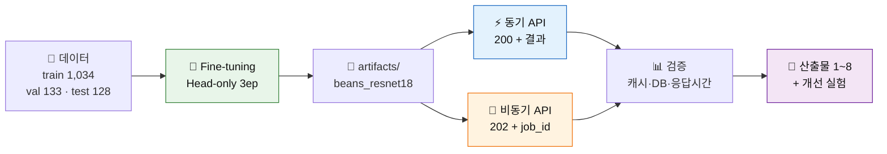

---

## ② 데이터와 학습

| 클래스 | Train | Val | Test |
|---|---:|---:|---:|
| 🟤 angular_leaf_spot (각진잎반점병) | 345 | 44 | 43 |
| 🟠 bean_rust (녹병) | 348 | 45 | 43 |
| 🟢 healthy (정상) | 341 | 44 | 42 |
| **합계** | **1,034** | **133** | **128** |

- 원본 `validation/` → 코드용 `dataset/val/` 복사, 원본은 보존
- **SHA-256 해시로 1,295장 전수 비교 → Split 간 중복 0건** (누출 없음)

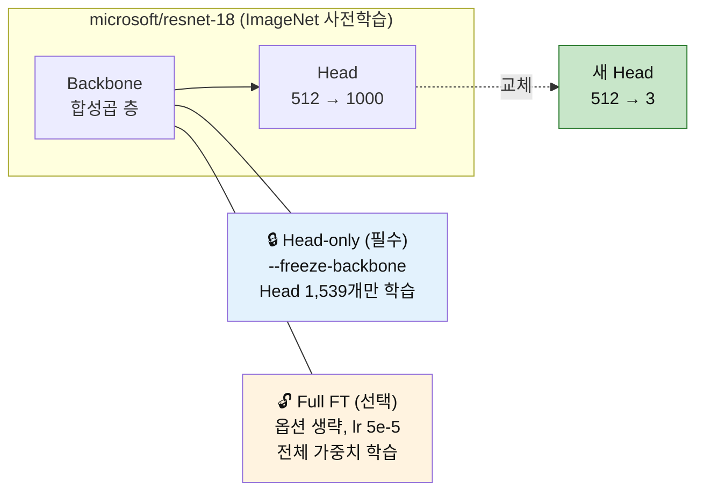

| 필수 학습 설정 | 값 |
|---|---|
| 명령 | `python -m training.finetune --data dataset --output artifacts/beans_resnet18 --epochs 3 --batch-size 8 --freeze-backbone` |
| lr / seed / 장치 | 0.0002 (AdamW) / 42 / RTX 3060 |
| **Best Validation Accuracy** | **0.7669** (102/133, Epoch 2 저장) |

---

## ③ 시스템 구조

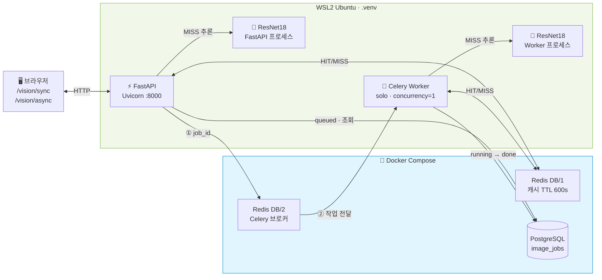

> Docker 에는 **Redis·PostgreSQL 만** 있다. FastAPI·Worker 는 WSL 가상환경에서 실행하며, 모델은 두 프로세스에 **각각** 로드된다.

---

## ④ 동기 vs 비동기 — 무엇이 다른가

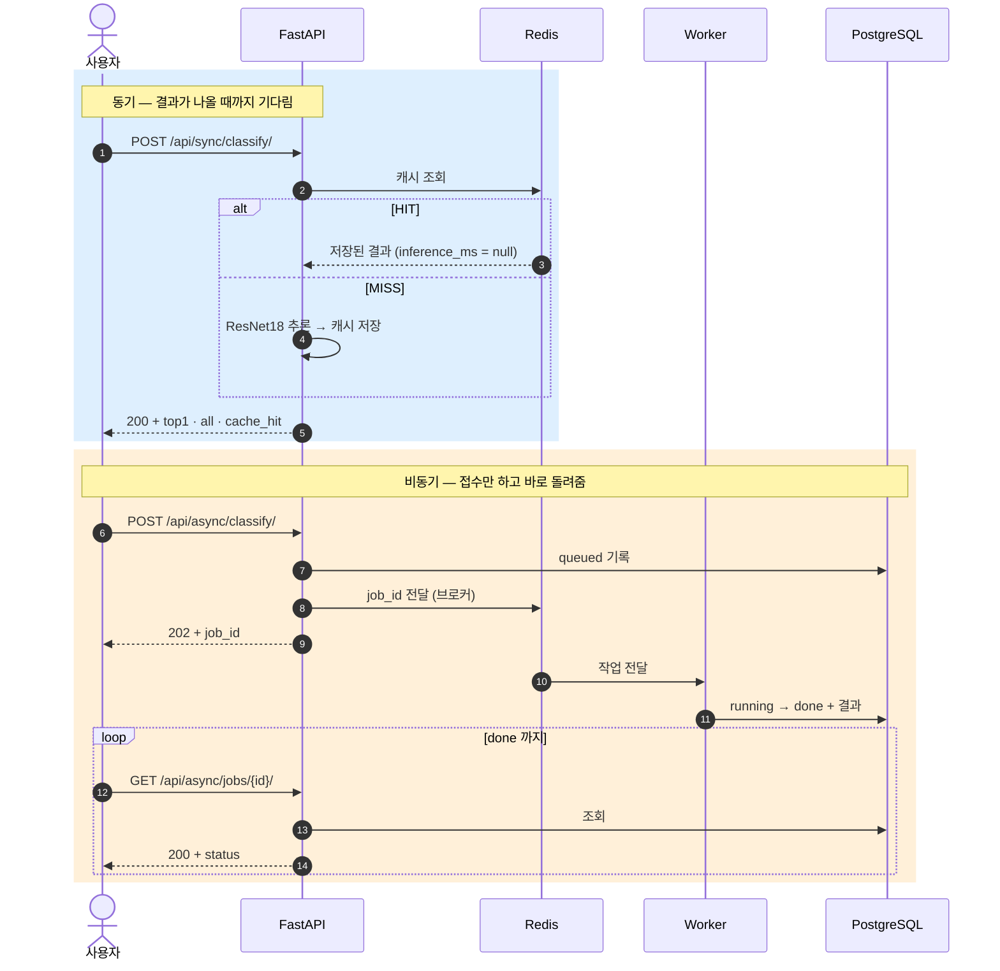

| | 동기 | 비동기 |
|---|---|---|
| 첫 응답 | **200 = 결과 포함** | **202 = 접수만** (완료 아님) |
| 결과 확인 | 즉시 | job_id 로 상태 조회 → `done` |
| DB 기록 | 없음 (제공 코드 기준) | `image_jobs` 에 상태·결과 |

---

## ⑤ 시연 결과 (오늘 녹화, 평가가이드 시연 순서)

| 단계 | 입력 | 결과 | 판정 |
|---|---|---|---|
| 동기 MISS | `healthy_test.11` | 200 · **healthy 0.8478** · `cache_hit: false` | ✅ 정답 |
| 동기 HIT | 같은 사진 | 200 · **11 ms** · `inference_ms: null` · `cache_hit: true` | ✅ 추론 생략 |
| 비동기 | `bean_rust_test.11` | 202 · job_id **19** → `done` · **bean_rust 0.5911** | ✅ 정답 |
| Worker | job 19 | `received` → `succeeded in 2.66s` | ✅ |
| PostgreSQL | `image_jobs` | `19 · done · bean_rust · cache_hit f` | ✅ |
| Redis | `KEYS vision:classify:*` | 2개 (방금 두 사진) | ✅ |

> 두 점수는 오전 성능 측정 때 값과 **소수점 4자리까지 동일** → 같은 모델·입력에서 결과가 재현된다.
> 첫 요청 2.5초는 **모델 로딩 시간** (프로세스별 1회). 이후 요청은 수십 ms.

| 동기 HIT | 비동기 완료 | DB 행 |
|---|---|---|
| 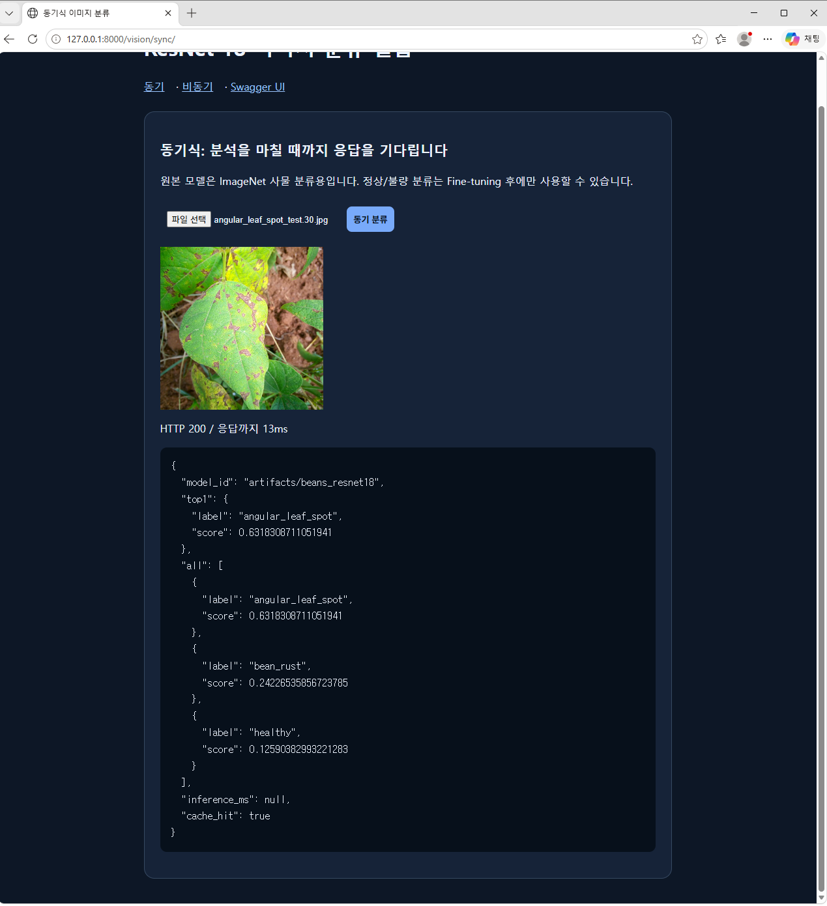 | 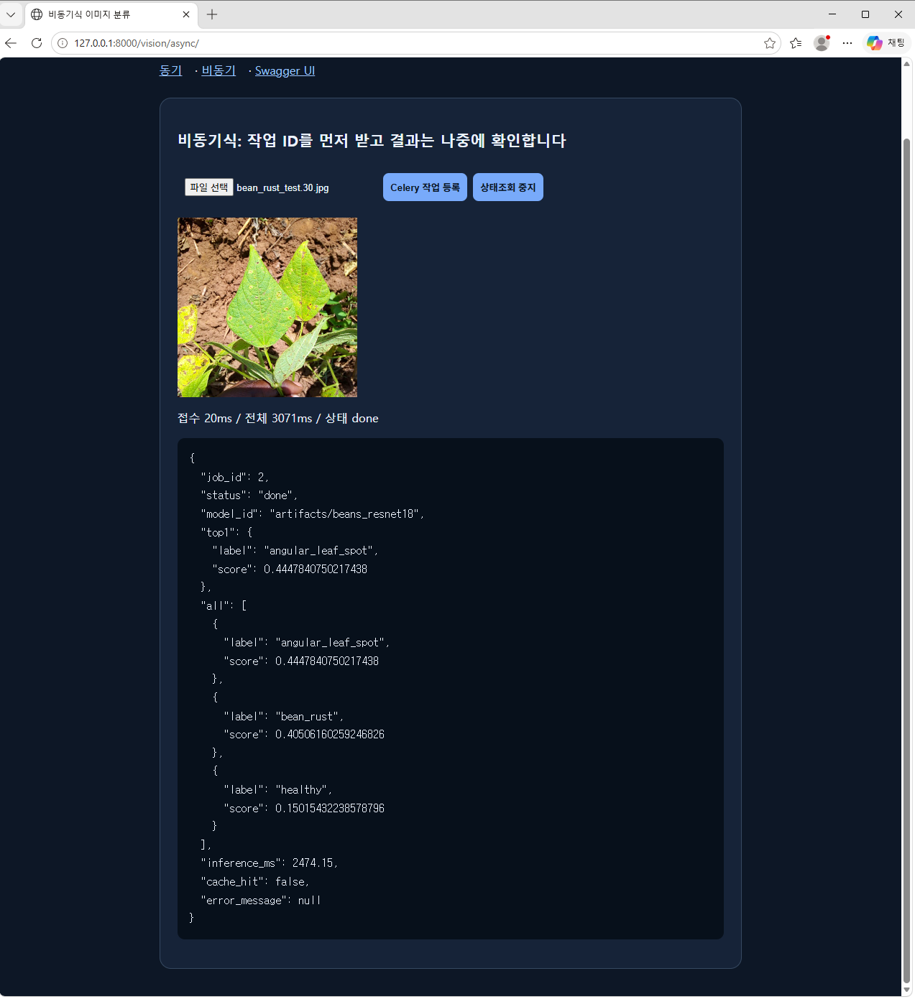 | 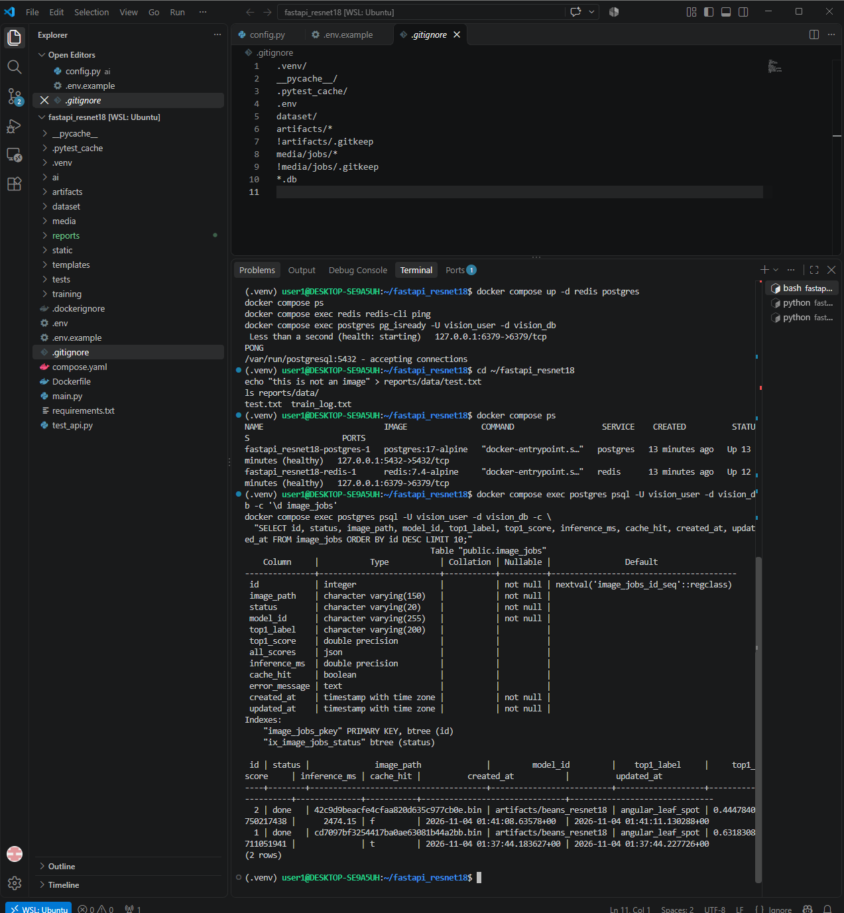 |

---

## ⑥ 성능 비교 (각 5회, warm-up 제외 중앙값, ms)

| 경로 | 캐시 | HTTP 응답 | 결과 확인까지 | 모델 추론 |
|---|---|---:|---:|---:|
| 동기 | MISS | 20.6 | 20.6 | 15.78 |
| 동기 | HIT | **2.1** | 2.1 | null (생략) |
| 비동기 | MISS | **8.5** (접수) | 116.7 | 17.86 |
| 비동기 | HIT | 7.7 (접수) | 113.4 | null (생략) |

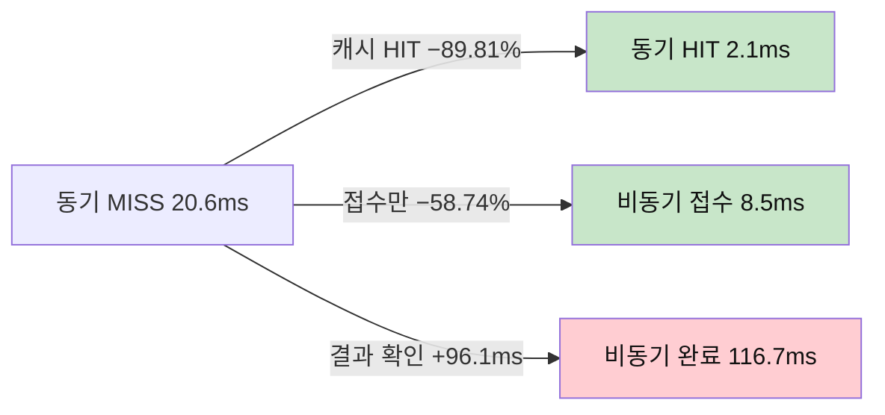

**해석**
- 비동기가 빠른 것은 **접수와 처리를 분리했기 때문**이지, 모델 추론이 빨라진 것이 아니다 (추론 15.78 vs 17.86 ms 로 비슷).
- 결과를 받기까지는 비동기가 더 느리다 → 큐 전달 + 100ms 폴링 간격.
- 캐시 HIT 는 모델을 아예 돌리지 않는다 → `inference_ms = null` 은 "0ms" 가 아니라 **"추론 생략"**.

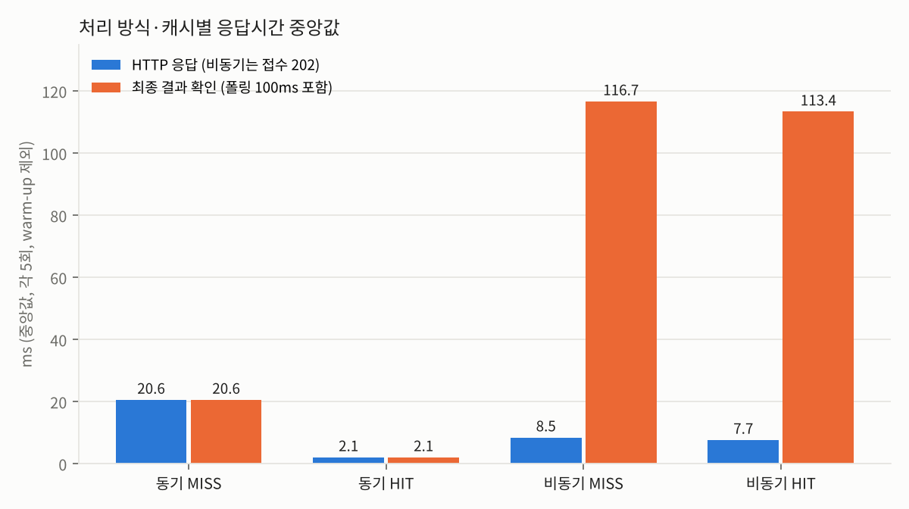

---

## ⑦ 개선 실험 — 실제로 돌려 본 것만

**1단계: 학습 방식** (필수 A → 선택 실험)

| 실험 | 바꾼 것 | Validation | Test (선택 후 1회) |
|---|---|---:|---:|
| **A** Head-only 3ep (서비스 모델) | — | 0.7669 | 0.7188 |
| **C** Head-only 10ep | epoch 만 | 0.8947 | 0.8828 |
| **B** Full Fine-tuning | 백본까지 학습 | **0.9699** | **0.9531** |

**2단계: 추가 성능 실험 1~3차** — B 와 한 가지씩만 바꿔 비교 ([부록 09](../reports/09_추가성능실험_보고서.md))

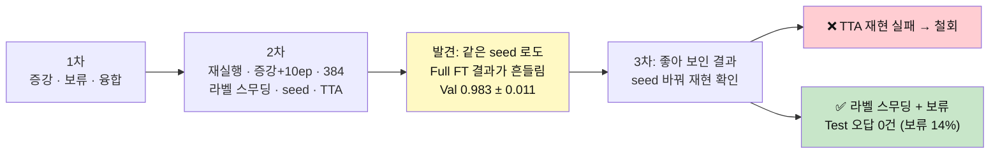

| 시도 | 결과 | 판정 |
|---|---|---|
| 데이터 증강 (seed 3회) | Val 평균 0.950 (비증강 0.983), Test 동일 | ❌ 효과 없음 |
| 해상도 224 → 384 | 흔들림 범위 안, CPU **2.3배 느림** | ❌ 비용만 증가 |
| TTA (뒤집은 사진 평균) | Val 에서만 상승, **Test 재현 실패** | ❌ 우연으로 판정 |
| CNN + HSV 융합 | A **+6.25%p**, B −1.56%p | △ 약한 모델에서만 |
| **라벨 스무딩 + 확인 필요 보류** | 보류 **14.1%** → 그대로 나간 오답 **0건** (B + 보류는 19.5% → 1건) | ✅ **신뢰성 개선** |

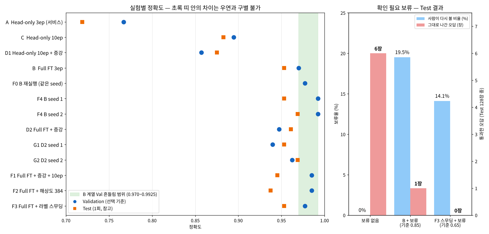

> 💡 **TTA** = 예측할 때 원본·뒤집은 사진들을 함께 넣고 평균 / **라벨 스무딩** = 정답을 100% 대신 90% 로 가르쳐 과한 확신을 줄임 / **확인 필요 보류** = 점수가 기준보다 낮으면 사람에게 넘김 / **흔들림 폭** = 같은 설정을 반복했을 때 결과가 달라지는 범위 — 이 안의 차이는 우연

**OpenCV(교과 9) 분석 — 분석 전용, 서비스 코드 미변경**

| 분석 | 결과 | 결론 |
|---|---|---|
| HSV 병반 면적비 규칙 | Val 0.7143 (항상 "질병" 0.6692 대비 +4.5%p) · 두 질병 면적비 0.318 vs 0.319 | 단독 판정 ✗, **병명 구분 불가** |
| Grad-CAM (잎 주목 비율) | B 정분류 0.842 > 오분류 0.693 | 틀릴 때 **배경(흙·손)** 을 봄 |

| B 오분류: 근거가 엄지손가락에 | A vs B 같은 사진 |
|---|---|
| 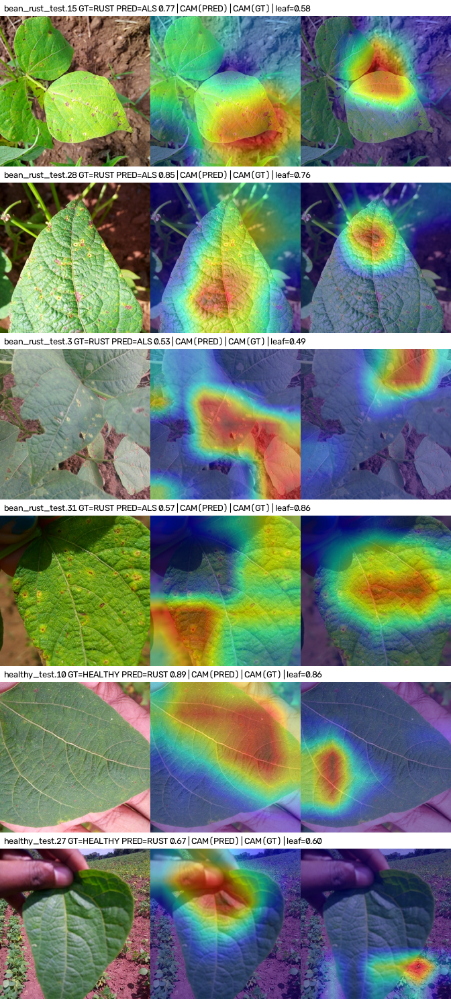 | 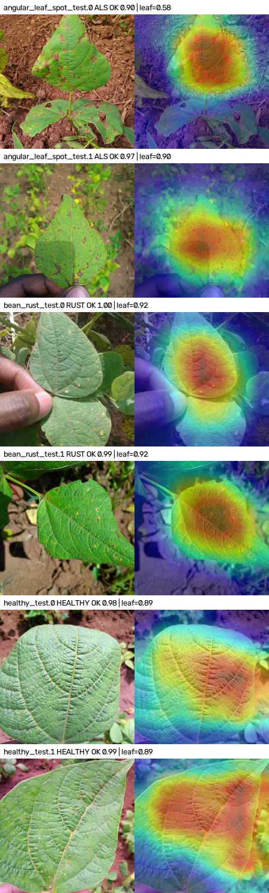 |

---

## ⑧ 결론과 한계

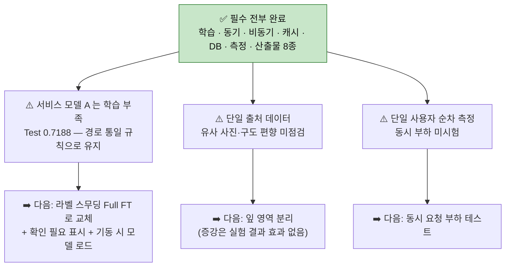

| 원칙 | 지킨 방법 |
|---|---|
| 제공 코드 미수정 | 원본은 그대로, 실험은 복사본(`finetune_plus.py`)과 `reports/tools/` 스크립트로 |
| 한 번에 한 가지 | 모든 추가 실험은 B 와 한 가지만 다르게 |
| 우연 걸러내기 | 반복 측정으로 흔들림 폭을 먼저 재고, 좋아 보인 결과는 재현 확인 |
| Validation / Test 구분 | 모델 선택은 Val 로만, Test 는 선택 후 1회 |
| 구현 / 제안 구분 | 실측한 것만 수치 제시, 나머지는 "미구현 제안" 으로 표기 |

📁 상세: [산출물 1~8 + 부록 09](../reports/) · [재현 안내 README](../README.md) · [발표 대본](발표대본_5분.md) · [작업 정리·코드 리뷰](작업정리_결과해설_코드리뷰.md)
