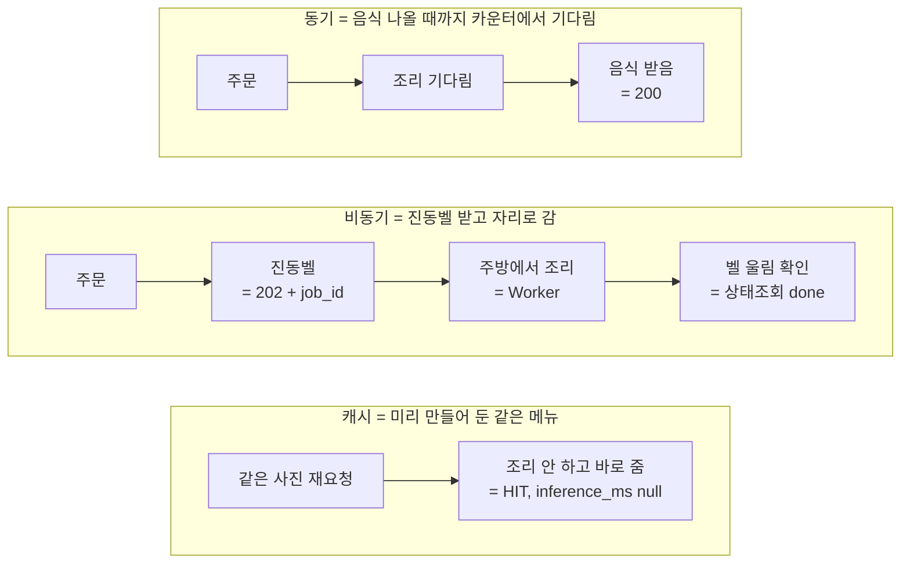
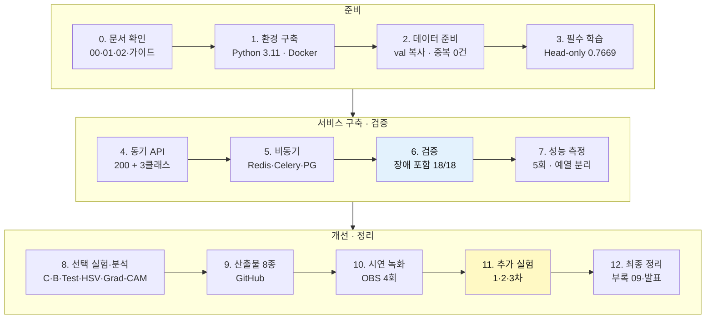

# 발표 대본 (5분)

- 화면: `presentation/README.md` 를 GitHub(또는 Obsidian)에서 열어 두고, 구간마다 해당 번호(①~⑧)로 스크롤한다.
- 분량: 말하는 부분만 약 1,700자(공백 제외) → 보통 속도(분당 350자)로 **약 4분 50초**. 빠듯하니 한 번 소리 내어 재 보고, 넘으면 맨 아래 "줄이는 순서"를 적용한다.
- 영상을 틀 경우: ⑤ 구간에서 녹화본을 1분 재생하며 멘트를 그 위에 얹는다 (영상 길이만큼 따로 시간을 쓰지 않는다).
- **📘 용어 풀이** = 구간마다 붙은 접힌 상자. 발표 때 읽지 않는 공부용 설명 (Obsidian 에서 클릭하면 펼쳐짐).
- **📗 맨 아래 부록** = 전체 작업 과정 상세 해설 (단계 0~12, 구성요소별 역할·검증 방법, 30초 요약). "어떻게 진행했나요?" 질문 대비용.
- `[화면]` = 스크롤 위치, `( )` = 말하지 않는 메모, **굵은 글씨** = 숫자를 또박또박 읽을 곳.

---

## 0:00 ~ 0:20 · 도입 — 맨 위 표

> 안녕하세요, 김지후입니다.
> 제 과제는 콩잎 사진 한 장을 **각진잎반점병, 녹병, 정상** 세 가지로 분류하는 AI를 학습시키고, 이것을 동기 API와 비동기 작업 큐로 서비스한 것입니다.

> [!tip]- 📘 용어 풀이 — 공부용 (발표 때 읽지 않음, 클릭하면 펼쳐짐)
> - **AI 분류 (Image Classification)** — 사진 한 장을 보고 정해진 보기 중 하나를 고르는 일. 이번엔 보기가 3개(각진잎반점병·녹병·정상). 사진 속 '위치'까지 찾는 탐지(Detection)와는 다르다.
> - **API** — 프로그램끼리 대화하는 창구. 브라우저가 "이 사진 분류해 줘" 하고 서버 주소로 요청을 보내면 서버가 결과를 JSON 글자로 돌려준다.
> - **동기 (Synchronous)** — 요청하고 결과가 나올 때까지 그 자리에서 기다리는 방식. 식당 카운터에서 음식 나올 때까지 서 있는 것.
> - **비동기 (Asynchronous)** — 요청을 '접수'만 하고 바로 돌아가는 방식. 결과는 나중에 확인. 진동벨 받고 자리로 가는 것.
> - **작업 큐 (Queue)** — 처리할 일을 줄 세워 두는 대기열. 먼저 들어온 일부터 Worker 가 하나씩 꺼내 처리한다.

---

## 0:20 ~ 1:00 · ① 전체 흐름 · ② 데이터와 학습

[화면] ① 흐름도 → ② 표

> 데이터는 지정된 Beans 데이터셋으로 학습 **1,034장**, 검증 **133장**, 테스트 **128장**이고 세 클래스가 거의 같은 수입니다.
> 원본의 validation 폴더는 제공 코드가 읽는 val 폴더로 복사했고, 1,295장 전체를 해시로 비교해서 **세트 사이에 겹치는 사진이 0장**인 것을 확인했습니다.

[화면] ② ResNet18 그림

> 모델은 microsoft/resnet-18 이고, ImageNet용 출력층 1,000개를 **3개로 교체**했습니다.
> 필수 학습은 freeze-backbone 옵션으로 **분류 헤드만 학습하는 Head-only** 방식이고, 검증 정확도 **0.7669** 가 나왔습니다.

> [!tip]- 📘 용어 풀이 — 공부용 (발표 때 읽지 않음, 클릭하면 펼쳐짐)
> - **Beans 데이터셋** — 우간다 밭에서 찍은 콩잎 사진 모음(Hugging Face 공개). 평가가 '이 데이터만 쓰라'고 지정했다.
> - **Train / Validation / Test** — Train = 공부할 교재(가중치 학습), Validation = 모의고사(좋은 epoch·실험 고르기), Test = 수능(마지막에 딱 1번).
> - **validation → val** — 원본 폴더 이름은 validation 인데, 제공 코드가 val 이라는 이름만 읽어서 복사해 이름을 맞춘 것.
> - **해시 (SHA-256)** — 파일 내용으로 만든 지문 같은 긴 문자열. 1바이트만 달라도 완전히 달라져서, 같은 파일이 두 세트에 섞였는지(누출) 확인하는 데 쓴다.
> - **microsoft/resnet-18** — Microsoft 가 Hugging Face 에 올린 ResNet 18층 모델. ImageNet 으로 미리 학습된 '사진 보는 눈'을 빌려 쓴다.
> - **ImageNet** — 사진 수백만 장·1,000종(개, 자동차, 컵…)으로 된 유명 데이터셋. 여기서 미리 학습한 것을 '사전학습'이라고 한다.
> - **Backbone (백본)** — 모델 앞쪽의 대부분. 사진에서 선·색·질감·모양 같은 특징을 뽑아내는 '눈' 역할.
> - **Head (헤드) / 출력층** — 모델 맨 마지막 층. 백본이 뽑은 특징을 보고 '그래서 어느 클래스인가'를 정하는 '판단' 역할. 원래 1,000칸(ImageNet)인데 3칸으로 바꿨다.
> - **freeze-backbone** — '백본을 얼린다' = 학습 중 백본 가중치를 바꾸지 않게 고정하는 실행 옵션.
> - **Head-only (헤드 온리)** — 백본은 얼리고 헤드만 학습하는 방식. 눈은 그대로 빌리고 판단만 새로 가르친다. 빠르고 안전하지만 콩잎 특유의 반점을 잘 못 볼 수 있다. 학습한 파라미터는 1,539개뿐.
> - **검증 정확도 (Validation Accuracy)** — Validation 133장 중 맞힌 비율. 0.7669 = 102장 정답.

---

## 1:00 ~ 1:35 · ③ 시스템 구조 · ④ 동기 vs 비동기

[화면] ③ 구조도

> 구조는 평가가이드 방식 그대로입니다. Docker 에는 Redis 와 PostgreSQL 만 띄우고, FastAPI 와 Celery Worker 는 WSL 가상환경에서 실행했습니다.
> Redis 는 1번 DB를 결과 캐시로, 2번 DB를 작업 전달용 브로커로 **역할을 나눠** 씁니다.

[화면] ④ 시퀀스도 → 아래 비교표

> 동기는 추론이 끝날 때까지 기다렸다가 **200과 결과**를 돌려줍니다.
> 비동기는 작업을 DB에 queued 로 기록하고 **202와 job_id 만** 바로 돌려준 뒤, Worker 가 따로 추론해서 done 으로 바꿉니다. 그래서 202는 완료가 아니라 **접수**입니다.

> [!tip]- 📘 용어 풀이 — 공부용 (발표 때 읽지 않음, 클릭하면 펼쳐짐)
> - **Docker / Docker Compose** — 프로그램을 '컨테이너'라는 상자에 담아 설치 없이 바로 띄우는 도구. Compose 는 여러 상자를 파일 하나(compose.yaml)로 함께 켜고 끈다.
> - **Redis** — 메모리에 데이터를 저장하는 아주 빠른 저장소. 이번엔 ① 결과 캐시(DB 1번) ② 작업 전달 브로커(DB 2번) 두 역할.
> - **PostgreSQL** — 표(테이블) 형태로 데이터를 오래 보관하는 데이터베이스. 비동기 작업 기록 image_jobs 테이블을 저장한다.
> - **FastAPI** — 파이썬으로 API 서버를 만드는 프레임워크. 요청을 받고 검사하고 결과를 돌려주는 '카운터 직원'.
> - **Uvicorn** — FastAPI 를 실제로 실행해서 8000번 포트로 요청을 받게 해 주는 서버 프로그램.
> - **Celery / Worker** — Celery = 작업 큐 처리 도구. Worker = 큐에서 일을 꺼내 실제로 추론하는 별도 프로그램. '주방'.
> - **WSL / 가상환경(.venv)** — WSL = Windows 안의 리눅스. .venv = 이 프로젝트 전용 파이썬 패키지 상자(다른 프로젝트와 섞이지 않게).
> - **캐시 (Cache)** — 한 번 계산한 결과를 저장해 두고, 같은 요청이 오면 다시 계산하지 않고 바로 꺼내 주는 것.
> - **브로커 (Broker)** — FastAPI 가 Worker 에게 '이 job 처리해' 하고 주문서를 넘기는 중간 전달자. 식당의 주문 꽂이.
> - **HTTP 200 / 202** — 서버가 돌려주는 상태 번호. 200 = 성공·결과 포함, 202 = 받았고 나중에 처리함(접수).
> - **job_id** — 비동기 작업마다 붙는 번호표. 이 번호로 나중에 결과를 조회한다.
> - **queued / running / done / failed** — 작업 상태. 대기 중 → 처리 중 → 완료 / 실패.

---

## 1:35 ~ 2:25 · ⑤ 시연 결과

[화면] ⑤ 흐름 → 표 (영상을 틀 경우 녹화본 0:18~1:33 구간을 재생)

> 평가가이드의 시연 순서대로 확인했습니다.
> 정상 잎 사진을 동기로 보내면 200, **healthy 0.8478**, cache_hit 은 false 입니다.
> 같은 사진을 다시 보내면 **11ms** 만에 오고, cache_hit 이 true, inference_ms 는 null 입니다. 모델을 돌리지 않고 캐시에서 가져왔다는 뜻입니다.
> 녹병 사진을 비동기로 보내면 202 와 job_id **19** 를 받고, Worker 로그에 succeeded 가 찍힌 뒤 상태 조회에서 **done, bean_rust 0.5911** 이 나옵니다.
> PostgreSQL 에는 19번 행이 done 으로, Redis 에는 두 사진의 캐시 키가 남아 있습니다.

> [!tip]- 📘 용어 풀이 — 공부용 (발표 때 읽지 않음, 클릭하면 펼쳐짐)
> - **healthy / bean_rust / angular_leaf_spot** — 클래스 이름. 정상 / 녹병 / 각진잎반점병.
> - **score (0.8478)** — 모델이 그 클래스라고 생각하는 확률. 세 클래스 점수를 더하면 1. 아무렇게나 찍으면 0.33 이다.
> - **cache_hit** — true = 캐시에서 꺼냄(추론 안 함), false = 모델이 새로 추론함.
> - **inference_ms** — 모델 추론에 걸린 시간(밀리초). null = '추론을 안 했다'는 뜻이지 0ms 가 아니다.
> - **HIT / MISS** — 캐시에 있으면 HIT(적중), 없으면 MISS(빗나감).
> - **ms (밀리초)** — 1/1000 초. 11ms = 0.011초.
> - **Worker 로그 received / succeeded** — Worker 가 작업을 '받음' / '성공적으로 끝냄'을 기록한 줄. 별도 프로세스에서 처리됐다는 증거.
> - **행 (row)** — DB 표의 한 줄. 작업 1건 = 1행.
> - **캐시 키 (key)** — Redis 에 저장할 때 붙이는 이름표. 모델 + 사진 내용으로 만들어서 같은 사진이면 같은 키가 된다.
> - **재현 (Reproducibility)** — 같은 조건이면 언제 다시 해도 같은 결과가 나오는 성질. 결과를 믿을 수 있다는 근거.

---

## 2:25 ~ 3:10 · ⑥ 성능 비교

[화면] ⑥ 표 → 흐름도

> 첫 요청은 모델 로딩 때문에 따로 빼고, 5번씩 재서 중앙값으로 비교했습니다.
> 동기 MISS 가 **20.6ms**, 캐시 HIT 는 **2.1ms** 로 약 **90%** 줄었습니다.
> 비동기 접수는 **8.5ms** 로 동기보다 **58.74%** 빠르지만, 이건 모델이 빨라진 게 아니라 **접수와 처리를 분리한 효과**입니다. 실제 추론시간은 15.78 과 17.86 으로 비슷합니다.
> 오히려 결과를 손에 쥐기까지는 비동기가 **116.7ms** 로 더 느린데, 큐 전달과 100ms 폴링 간격 때문입니다.

> [!tip]- 📘 용어 풀이 — 공부용 (발표 때 읽지 않음, 클릭하면 펼쳐짐)
> - **중앙값 (Median)** — 값을 줄 세웠을 때 가운데 값. 한 번 튄 값에 흔들리지 않아 평균보다 대표성이 좋다.
> - **warm-up (웜업)** — 본 측정 전에 한 번 미리 실행해 모델을 메모리에 올려 두는 것. 첫 요청의 로딩 시간이 측정을 왜곡하지 않게 뺀다.
> - **추론 (Inference)** — 학습이 끝난 모델에 사진을 넣어 답을 얻는 과정. 학습(Training)과 반대 말.
> - **폴링 (Polling)** — '다 됐어요?' 하고 일정 간격으로 계속 물어보는 방식. 측정 스크립트는 0.1초, 화면은 1초 간격.
> - **58.74% / 약 90%** — (동기 − 비교값) ÷ 동기 × 100. 예: (20.6 − 8.5) ÷ 20.6 = 58.74%.

---

## 3:10 ~ 4:30 · ⑦ 개선 실험

[화면] ⑦ 1단계 표

> 서비스 모델은 loss 가 계속 내려가는 중에 끝나서, 원본 코드는 그대로 두고 개선 실험을 했습니다.
> 먼저 백본까지 학습하는 Full Fine-tuning 으로 검증 **0.9699**, 테스트 **0.9531** 까지, 기준보다 **20.3%p** 올렸습니다.

[화면] ⑦ 2단계 흐름도 → 판정 표 → 그래프

> 그 위로는 증강, 해상도 384, 라벨 스무딩, 추론할 때 뒤집은 사진 평균을 **하나씩** 시도했습니다. 그런데 같은 설정을 반복해 보니 결과가 **±1.1%p** 흔들려서, 그 폭을 넘는 정확도 개선은 없었습니다. 특히 2차에서 최고였던 뒤집기 평균은 seed 를 바꾼 재현 실험에서 떨어져 **우연으로 판정**했습니다.
> 그래서 방향을 바꿔, 라벨 스무딩으로 틀린 답의 확신도를 낮추고 점수가 낮은 **14%** 만 사람에게 넘기도록 하니, 테스트 오답 6장이 **모두** 걸러졌습니다.

[화면] OpenCV 표 → Grad-CAM 그림

> OpenCV HSV 와 Grad-CAM 으로는 두 질병의 색 면적비가 같고, 틀릴 때 손이나 흙 같은 **배경**을 본다는 원인을 확인했습니다.

> [!tip]- 📘 용어 풀이 — 공부용 (발표 때 읽지 않음, 클릭하면 펼쳐짐)
> - **loss (손실)** — 모델이 얼마나 틀렸는지를 나타내는 벌점. 학습은 이 값을 줄이는 방향으로 가중치를 고친다. 계속 내려가는 중이면 아직 덜 배운 것.
> - **epoch (에폭)** — 학습 데이터 전체를 한 바퀴 다 보는 것. 3 epoch = 교재를 3번 정독.
> - **옵션 (실행 옵션)** — 코드를 고치지 않고 명령어 뒤에 붙이는 설정. --epochs 10, --lr 0.00005 처럼.
> - **Full Fine-tuning** — 백본까지 포함해 모델 전체를 콩잎에 맞게 조금씩 다시 학습하는 방식. 눈까지 콩잎 전문가로 만든다. 망가지지 않게 학습률을 낮게 쓴다.
> - **%p (퍼센트포인트)** — 퍼센트끼리 뺀 차이. 76.69% → 96.99% 는 20.30%p 상승(비율로는 약 26.5% 증가).
> - **OpenCV** — 이미지 처리 라이브러리. 색 변환, 마스크, 윤곽선 찾기 등. 교과 9 의 핵심 도구.
> - **HSV 색공간** — 색을 H(색상)·S(채도)·V(밝기)로 나눈 표현. '초록 범위', '갈색 범위'를 H 하나로 정하기 쉬워 병반 후보를 찾는 데 썼다.
> - **병반 면적비 (lesion ratio)** — 잎 면적 중 병반 후보(초록이 아닌 부분)가 차지하는 비율.
> - **Grad-CAM** — 모델이 판단할 때 사진의 어디를 봤는지 히트맵(빨간 곳 = 중요)으로 보여주는 설명 도구. 정확도는 올리지 않는다.
> - **배경 편향 / 지름길 학습 (Shortcut learning)** — 병 자체가 아니라 손·흙 같은 배경을 단서로 외워 버리는 현상. 정답을 맞혀도 이유가 틀린 것.
> - **증강 (Augmentation)** — 학습 사진을 무작위로 자르고·뒤집고·돌려서 매번 조금씩 다르게 보여주는 것. 배경·구도에 덜 의존하게 하려는 시도였지만 이 데이터에서는 효과가 없었다.
> - **해상도 384** — 모델에 넣는 사진 크기를 224×224 에서 384×384 로 키운 것. 작은 병반을 크게 보려는 시도. 계산이 2.3배 느려졌고 정확도 차이는 없었다.
> - **라벨 스무딩 (Label smoothing)** — 정답을 '100% 이것'이 아니라 '90% 이것'으로 가르치는 것. 모델이 과하게 확신하지 않게 된다. 틀린 답의 최고 점수가 0.89 → 0.63 으로 낮아졌다.
> - **TTA (Test-Time Augmentation)** — 예측할 때 원본과 뒤집은 사진들을 함께 넣어 확률을 평균하는 것. 재학습이 필요 없지만, 이번엔 재현 실험에서 효과가 없어 철회했다.
> - **seed (시드)** — 무작위 계산의 시작 번호. 바꿔서 여러 번 돌리면 결과가 얼마나 흔들리는지 알 수 있다.
> - **흔들림 폭 (±1.1%p)** — 같은 설정으로 4번 학습했을 때 검증 정확도가 0.970~0.9925 사이로 달라진 범위. 이 안의 차이는 '좋아졌다'고 말할 수 없다.
> - **재현 실험** — 좋아 보이는 결과가 우연이 아닌지, 조건(seed)을 바꿔 다시 해 보는 것.
> - **확인 필요 보류** — 모델 점수가 기준(0.65)보다 낮으면 자동 판정하지 않고 사람에게 넘기는 규칙. 14% 를 넘기니 테스트 오답 6장이 전부 여기에 걸렸다.

---

## 4:30 ~ 5:00 · ⑧ 결론과 한계

[화면] ⑧ 흐름도 → 원칙 표

> 정리하면, 학습부터 동기·비동기 서빙, 캐시, DB 기록, 성능 측정까지 필수 항목을 모두 실제로 실행했고, 실환경 통합 테스트 **18개를 모두 통과**했습니다.
> 한계는 서비스 모델이 학습 부족인 Head-only 라는 점, 그리고 데이터가 한 출처라 배경 편향 가능성이 있다는 점입니다.
> 다음 단계는 라벨 스무딩 모델로 교체하면서 확인 필요 표시를 API 에 넣고, 서버 기동 때 모델을 미리 불러오는 것입니다. 감사합니다.

> [!tip]- 📘 용어 풀이 — 공부용 (발표 때 읽지 않음, 클릭하면 펼쳐짐)
> - **서빙 (Serving)** — 학습한 모델을 API 로 열어 다른 사람이 쓸 수 있게 하는 것.
> - **통합 테스트 (Integration test)** — 실제 모델·Redis·PostgreSQL·Celery 를 모두 연결한 상태에서 기능이 맞게 동작하는지 확인하는 시험. 18개 모두 통과.
> - **한계 (Limitation)** — 이번 결과로 말할 수 없는 부분. 숨기지 않고 먼저 말하면 신뢰도가 오른다.
> - **모델 미리 불러오기 (Pre-load)** — 서버 시작할 때 모델을 미리 메모리에 올려 첫 요청도 빠르게 만드는 것. warm-up 을 자동으로 하는 셈.
> - **잎 영역 분리 (Segmentation)** — 사진에서 잎 부분만 잘라 내 배경(흙·손)을 지우는 것. 배경 편향을 줄이려는 다음 개선안.

---

## 시간이 모자랄 때 줄이는 순서

1. ⑦ 마지막 OpenCV·Grad-CAM 문장 생략 (−10초) — 질문이 오면 Q30~32 로 답한다
2. ③ Redis DB 번호 설명 생략 (−7초)
3. ⑥ "실제 추론시간은 15.78 과 17.86 으로 비슷합니다" 생략 (−5초)
- ⑦ 의 "흔들림 ±1.1%p", "우연으로 판정", "14% 보류로 오답 모두 걸러짐" 세 가지는 **줄이지 않는다** (노력의 핵심)

---

## 예상 질문과 답변 (이해용 설명 포함)

각 질문은 세 부분으로 나눴다.
- **💬 답변**: 발표장에서 그대로 말할 문장 (15초 안쪽)
- **💡 이해하기**: 내가 이해하기 위한 설명. 말할 필요는 없다
- **📎 근거**: 추가 질문이 오면 펼쳐 보일 산출물 위치


### 질문 목차 (Q0 + 90개)

| 분류 | 번호 | 분류 | 번호 |
|---|---|---|---|
| A. 데이터 | Q1~3 | H. 실행 환경 | Q38~43 |
| B. 모델·학습 | Q4~12 | I. 전처리·학습 세부 | Q44~50 |
| C. 서빙 구조 | Q13~21 | J. 평가 지표 | Q51~54 |
| D. 성능 측정 | Q22~25 | K. 서빙 설계 선택 | Q55~65 |
| E. 테스트·장애 | Q26~29 | L. 측정·시연 수치 차이 | Q66~70 |
| F. OpenCV·Grad-CAM | Q30~32 | M. 과정과 소감 | Q71~74 |
| G. 평가 범위 | Q33~37 | N. 발표 중 돌발 상황 | Q75~80 |
| **O. 추가 성능 실험** | **Q81~90** | | |

**우선순위:** ⭐ 꼭 준비 = **Q0(최우선)**, Q0-1, **Q81, Q83, Q87, Q88**, Q3, Q5, Q8, Q11, Q13, Q14, Q18, Q19, Q22, Q26, Q31, Q33, Q34, Q36, Q66 (21개). 나머지는 읽고 이해만 해 두면 된다.

### 먼저 외워 둘 숫자 16개

| 숫자 | 뜻 |
|---|---|
| 1,034 / 133 / 128 | Train / Val / Test 장수 |
| 0건 | Split 사이 중복 파일 (누출 없음) |
| 1,539개 | Head-only 에서 학습한 파라미터 수 (512×3 + 3) |
| 0.7669 | 서비스 모델(A) 최고 Val 정확도, Epoch 2 저장 |
| 0.9699 / 0.9531 | Full FT(B) Val / Test |
| +20.30%p | A → B 상승폭 (퍼센트**포인트**) |
| 20.6 ms | 동기 MISS 응답 (추론 15.78) |
| 2.1 ms | 동기 캐시 HIT 응답 |
| 8.5 ms | 비동기 접수(202) 응답 |
| 116.7 ms | 비동기 결과 확인까지 (폴링 100ms 포함) |
| 600초 | Redis 캐시 유지 시간(TTL) |
| 18/18 | 실환경 통합 테스트 통과 |
| **±1.1%p** | Full FT 를 같은 설정으로 4번 학습했을 때 Val 흔들림 (0.970~0.9925) |
| **14.1% / 0건** | 라벨 스무딩 + 보류: Test 에서 사람에게 넘긴 비율 / 그대로 나간 오답 |
| 0.89 → 0.63 | 라벨 스무딩 후 오답의 최고 확신도 |
| ×2.3 | 해상도 384 의 CPU 속도 비용 (14.3 → 33.2 ms) |

### 그림 하나로 이해하는 핵심 개념



---

### ⭐⭐ Q0. "성능을 올리기 위해 무엇을 했나요?" — 가장 나올 가능성이 높은 질문

- 💬 **답변 (30초):**
  > 세 단계로 했습니다. 먼저 학습 방식을 바꿔 Head-only 0.77 에서 Full Fine-tuning 0.97 까지 올렸습니다.
  > 그다음 증강, 해상도 384, 라벨 스무딩, 추론 때 뒤집은 사진 평균을 B 와 한 가지씩만 다르게 실험했는데, 같은 설정을 반복해 보니 결과가 ±1.1%p 흔들려서 그 폭을 넘는 정확도 개선은 없었습니다. 2차에서 가장 좋아 보였던 뒤집기 평균은 재현 실험에서 실패해 우연으로 판정했습니다.
  > 그래서 마지막엔 틀릴 만한 것을 가려내는 쪽으로 바꿔, 라벨 스무딩으로 오답의 확신도를 낮추고 점수가 낮은 14% 만 사람에게 넘기니 테스트 오답이 0건이 됐습니다.

- 💡 **이해하기 — 답변의 뼈대**

  | 단계 | 한 것 | 결과 | 판정 |
  |---|---|---|---|
  | ① 학습 방식 | epoch 3→10 (C), Full FT (B) | Val 0.77 → 0.89 → **0.97** | ✅ 유일한 정확도 개선 |
  | ② 하나씩 바꿔 보기 | 증강, 해상도 384, 라벨 스무딩, TTA | 모두 흔들림 폭(0.970~0.9925) 안 | 정확도 개선 없음 |
  | ③ 흔들림 측정 | 같은 설정 4회 (재실행 + seed 1·2) | Val **0.983 ± 0.011** | 판정 기준 확보 |
  | ④ 재현 확인 | 좋아 보인 TTA 를 seed 바꿔 재실험 | Test 평균 오히려 하락 | ❌ 철회 |
  | ⑤ 신뢰성 | 라벨 스무딩 + 확인 필요 보류 | 보류 14.1%, **통과 오답 0건** | ✅ |
  | (분석) | OpenCV HSV, Grad-CAM, CNN+HSV 융합 | 원인 = 배경, 융합은 약한 모델만 +6.25%p | 원인 파악용 |
  | (속도) | 캐시·비동기 측정 | 20.6 → 2.1ms / 접수 8.5ms | 제공 기능의 효과 검증 |

  - **정직하게 구분할 것 1:** 정확도를 실제로 올린 것은 ① 뿐이다. ②는 "해 봤지만 흔들림 안"이었다고 말한다. "증강으로 올렸다"고 하면 틀린 말이다.
  - **정직하게 구분할 것 2:** ⑤는 정확도가 아니라 **"자동 판정을 믿을 수 있게 만든 것"**이다. 14% 는 사람이 봐야 한다는 비용이 있다.
  - **정직하게 구분할 것 3:** 서비스에 연결된 모델은 여전히 A 다 (평가가이드의 경로 통일 규칙). F3 + 보류는 실험으로 검증하고 적용은 제안으로 남겼다.
  - **이 답의 핵심 강점:** "많이 해 봤다"가 아니라 **"흔들림을 먼저 재고, 좋아 보인 결과를 의심해서 다시 확인했다"**는 점. 틀린 결론(TTA)을 스스로 걸러낸 것이 가장 강한 근거다.

- 🔁 **이어서 나올 질문**
  - "흔들림 폭이 뭔가요?" → **Q81** / "같은 seed 인데 왜 달라요?" → **Q82**
  - "TTA 는 왜 철회했나요?" → **Q83** / "증강은 왜 효과가 없었나요?" → **Q84**
  - "14% 를 사람이 보는 건 비효율 아닌가요?" → **Q87** / "테스트를 여러 번 본 것 아닌가요?" → **Q88**
  - "그럼 왜 서비스엔 안 넣었나요?" → **Q33**, **Q89**
- 📎 **근거:** 산출물 1 · 6장, 산출물 8 · 8-5, **부록 09**

#### Q0-1. Head-only 와 Full FT 말고 다른 방법을 쓰면 더 오르지 않나요?
- 💬 **답변:** 직접 해 봤습니다. 데이터 증강, 해상도 384, 라벨 스무딩, 추론 시 뒤집기 평균을 B 와 한 가지씩만 다르게 실험했는데, 같은 설정의 반복 흔들림 ±1.1%p 를 넘는 정확도 개선은 없었습니다. 대신 라벨 스무딩과 확인 필요 보류를 합쳐 테스트 오답을 0건으로 만들었습니다. 남은 방향은 Grad-CAM 에서 원인으로 나온 배경을 지우는 잎 영역 분리입니다.
- 💡 **이해하기 — 방법 지도 (실험 후 상태)**

  | 방법 | 하는 일 | 결과 |
  |---|---|---|
  | epoch 늘리기 | 더 오래 학습 | ✅ Head-only 에서 +12.8%p |
  | Full Fine-tuning | 백본까지 학습 | ✅ 0.97 (최대 개선) |
  | 데이터 증강 | 사진을 자르고·뒤집고·돌려 다양하게 | ❌ seed 3회 모두 Val 하락 |
  | 해상도 384 | 사진을 크게 넣음 | ❌ 차이 없음, 2.3배 느림 |
  | 라벨 스무딩 | 정답을 90% 로 가르쳐 과신 완화 | − 정확도 같음, 오답 확신도 0.89 → 0.63 |
  | TTA | 예측 때 뒤집은 사진 평균 | ❌ 재현 실패로 철회 |
  | CNN + HSV 융합 | 색 특징을 더해 다시 판정 | △ 약한 모델 A 만 +6.25%p |
  | 확인 필요 보류 | 낮은 점수는 사람에게 | ✅ 스무딩과 합쳐 오답 0건 |
  | 잎 영역 분리 | 배경 지우고 잎만 입력 | 📝 미실시 (다음 과제) |
  | 다른 모델 | EfficientNet·ViT 등 | 📝 미실시 — 지시사항이 ResNet18 (Q36) |
- 📎 **근거:** 부록 09, 산출물 8 · 8-4 · 8-5

---

### A. 데이터

#### Q1. validation 폴더를 왜 val 로 바꿨나요?
- 💬 **답변:** 제공 학습 코드가 `dataset/val` 을 읽도록 되어 있어서, 코드는 그대로 두고 원본 validation 내용을 val 폴더에 복사했습니다. 원본은 따로 보존했습니다.
- 💡 **이해하기:** `finetune.py` 안에 `data / "val"` 이라고 폴더 이름이 박혀 있다. 코드를 고치는 대신 데이터 위치를 코드에 맞춘 것. 평가가이드가 "원본 코드의 경로를 변경하지 말라"고 지시한 부분이다.
- 📎 **근거:** 산출물 1 · 1-1

#### Q2. 데이터 누출은 어떻게 확인했나요?
- 💬 **답변:** 1,295장 전부 SHA-256 해시를 비교해서 Train·Val·Test 사이에 같은 파일이 0건인 것을 확인했습니다. 다만 같은 잎을 다시 찍은 비슷한 사진은 이 방법으로 못 잡아서 한계로 적었습니다.
- 💡 **이해하기:** 해시는 파일 내용의 "지문"이다. 1바이트만 달라도 완전히 다른 값이 나온다. 그래서 **완전히 같은 파일**은 확실히 잡지만, 각도만 조금 다른 사진은 다른 파일로 본다. "누출"이란 시험 문제(Test)가 공부 자료(Train)에 섞여 들어가 점수가 부풀려지는 것.
- 📎 **근거:** 산출물 1 · 1-3, `data/dataset_check.md`

#### Q3. Validation 과 Test 는 뭐가 다른가요?
- 💬 **답변:** Validation 은 학습 중에 어느 epoch 가 좋은지, 어느 실험이 좋은지 고르는 데 썼고, Test 는 선택이 다 끝난 뒤 한 번만 재서 최종 성능을 확인했습니다.
- 💡 **이해하기:** Val = 모의고사 (여러 번 보며 공부 방향을 정함). Test = 수능 (딱 한 번). Test 로 여러 번 고르면 Test 에 맞춘 셈이 되어 점수를 믿을 수 없게 된다.
- 📎 **근거:** 산출물 1 · 6장, 산출물 8 · 8-1

---

### B. 모델과 학습

#### Q4. ResNet18 이 뭔가요? 왜 출력층을 바꿨나요?
- 💬 **답변:** 이미지넷 사진 1,000종을 분류하도록 미리 학습된 18층짜리 CNN 입니다. 저희는 콩잎 3종만 구분하면 되므로 마지막 출력층을 1,000개에서 3개로 교체했습니다.
- 💡 **이해하기:** 앞쪽 층(Backbone)은 "선·색·질감·모양"을 뽑아내는 눈 역할이고, 마지막 층(Head)은 "그래서 무엇인가"를 고르는 판단 역할이다. 눈은 그대로 빌려 쓰고 판단만 새로 가르치는 것이 **전이학습**. 로그의 `found shape [1000, 512] ... instantiated [3, 512]` 가 교체 증거.
- 📎 **근거:** 산출물 1 · 2장, `evidence/head_replace_1000_to_3.png`

#### Q5. Head-only 와 Full Fine-tuning 차이는요?
- 💬 **답변:** Head-only 는 백본을 고정하고 마지막 층 1,539개 파라미터만 학습하고, Full Fine-tuning 은 전체 가중치를 낮은 학습률로 학습합니다. 필수는 Head-only 였고 Full 은 선택 실험으로 했습니다.
- 💡 **이해하기:** Head-only = 기존 눈은 그대로, 판단만 새로 배움 → 빠르지만 콩잎 특유의 반점을 잘 못 볼 수 있음. Full = 눈까지 콩잎에 맞게 조정 → 더 정확하지만 과적합 위험. 1,539 = 입력 512개 × 클래스 3 + 편향 3.
- 📎 **근거:** 산출물 1 · 2장, 6장

#### Q6. Full FT 는 왜 학습률을 낮췄나요? (0.0002 → 0.00005)
- 💬 **답변:** 백본은 이미 잘 학습된 상태라 크게 바꾸면 사전학습 지식이 망가질 수 있어서, 가이드 예시대로 작은 학습률을 썼습니다.
- 💡 **이해하기:** 학습률 = 한 번에 가중치를 얼마나 크게 고치는지. 잘 만든 그림을 조금 손보는 것과 같아서, 붓질을 작게 해야 원래 그림이 안 망가진다.
- 📎 **근거:** 평가가이드 6-1 예시 명령

#### Q7. Epoch 3 도 0.7669 인데 왜 Epoch 2 가 저장됐나요?
- 💬 **답변:** 제공 코드는 이전 최고값보다 **클 때만** 저장합니다. Epoch 3 은 같은 값이라 덮어쓰지 않았습니다.
- 💡 **이해하기:** 코드가 `acc > best_acc` (초과)라서 동점은 무시된다. `>=` 였다면 Epoch 3 이 저장됐을 것.
- 📎 **근거:** 산출물 1 · 3장

#### Q8. 서비스 모델(A) 정확도가 낮은 이유는요?
- 💬 **답변:** 학습 부족입니다. Loss 가 0.99, 0.81, 0.71 로 계속 내려가는 중에 3 epoch 에서 끝났고, epoch 만 10으로 늘린 C 실험에서 0.8947 까지 올라 이를 확인했습니다.
- 💡 **이해하기:** **과소적합(underfitting)** = 덜 배운 상태 (train loss 가 아직 내려가는 중). **과적합(overfitting)** = 너무 외워서 새 문제를 못 푸는 상태 (train loss 는 내려가는데 val 은 떨어짐). A 는 앞의 경우, B 는 epoch 1 이후 뒤의 신호가 보였다.
- 📎 **근거:** 산출물 1 · 3장, 6장

#### Q9. B 는 왜 Epoch 1 이 최고였나요?
- 💬 **답변:** 백본까지 학습하니 1 epoch 만에 0.9699 가 나왔고, 이후 train loss 는 계속 내려가는데 val 은 0.9624 로 떨어져 과적합 신호로 봤습니다. 저장 규칙에 따라 Epoch 1 이 남았습니다.
- 💡 **이해하기:** 학습할 수 있는 파라미터가 많아서 빨리 배우고, 그만큼 빨리 외우기 시작한다. 차이는 133장 중 1장(0.9699 → 0.9624)이라 "경향"으로만 말한다.
- 📎 **근거:** 산출물 1 · 6-1

#### Q10. 실험 C 가 공정한 비교라고 어떻게 말할 수 있나요?
- 💬 **답변:** seed 42 로 고정돼 있어서 C 의 1~3 epoch 결과가 A 와 소수점 넷째 자리까지 같았습니다. 그래서 차이는 epoch 수 하나 때문이라고 말할 수 있습니다. 다만 Full Fine-tuning 은 같은 seed 로도 결과가 조금 흔들려서, 반복 실험으로 그 폭을 따로 쟀습니다.
- 💡 **이해하기:** seed 는 "무작위의 시작점". 같으면 섞는 순서·초기값이 같아 결과가 똑같이 재현된다. 단 이건 Head-only 에서만 완벽히 성립했다. Full FT 는 GPU 계산 순서 차이로 같은 seed 에서도 0.9699 → 0.9774 로 달라졌다 (Q82). 한 번에 한 변수만 바꿔야 원인을 알 수 있다.
- 📎 **근거:** 산출물 1 · 6장 관찰 1

#### Q11. "20.30%p" 와 "20.3%" 는 뭐가 다른가요?
- 💬 **답변:** 0.7669 에서 0.9699 로 오른 것은 76.69% 에서 96.99% 로 20.30 퍼센트포인트 오른 것입니다. 상대적으로는 약 26.5% 증가라서 둘을 구분해서 썼습니다.
- 💡 **이해하기:** %p 는 단순 뺄셈 (96.99 − 76.69). % 는 비율 ((96.99 − 76.69) / 76.69). 가이드가 이 구분을 직접 요구한다.
- 📎 **근거:** 평가가이드 6-3 "성능 결과 표시 예시"

#### Q12. score 0.5911 이면 맞힌 건가요?
- 💬 **답변:** 세 클래스 중 가장 높은 확률이 bean_rust 0.59 라서 정답을 맞혔지만, 확신은 중간 정도입니다. 점수가 낮은 예측일수록 틀릴 가능성이 높아서 "확인 필요" 표시를 개선 제안으로 적었습니다.
- 💡 **이해하기:** score 는 세 클래스 확률의 합이 1 이 되는 값(softmax). 3클래스에서 아무렇게나 찍으면 0.33 이므로 0.59 는 "꽤 기울었지만 확실하진 않음".
- 📎 **근거:** 산출물 8 · 8-4 제안 4

---

### C. 서빙 구조

#### Q13. 동기와 비동기 중 뭐가 더 좋은가요?
- 💬 **답변:** 목적이 다릅니다. 동기는 결과를 바로 받아 단순하고 빠르며, 비동기는 오래 걸리는 작업이나 요청이 몰릴 때 서버가 막히지 않게 해 줍니다. 이번 모델은 추론이 16ms 라 결과만 보면 동기가 더 빨랐습니다.
- 💡 **이해하기:** 비동기는 "속도"가 아니라 "분리"의 기술이다. 추론이 10초 걸리는 모델이라면, 동기는 사용자가 10초 동안 화면만 보고, 비동기는 접수 후 다른 일을 할 수 있다. Worker 를 늘려 처리량도 키울 수 있다.
- 📎 **근거:** 산출물 5 · 비교 결론, 산출물 6

#### Q14. 202 가 뭔가요? 200 과 뭐가 달라요?
- 💬 **답변:** 202 Accepted 는 "요청을 받았고 처리는 나중에 한다"는 뜻입니다. 결과는 job_id 로 상태를 조회해서 done 이 나올 때 확인합니다.
- 💡 **이해하기:** 200 = 음식 받음. 202 = 진동벨 받음. 진동벨을 받았다고 음식이 나온 건 아니다.
- 📎 **근거:** 산출물 3 · API-03, API-04

#### Q15. Celery 와 Worker 는 무슨 역할인가요?
- 💬 **답변:** FastAPI 와 별도 프로세스에서 큐에 쌓인 작업을 꺼내 추론하고 DB 를 갱신합니다. 웹 서버는 접수만 하고, 무거운 일은 Worker 가 합니다.
- 💡 **이해하기:** FastAPI = 카운터 직원, Worker = 주방. 둘이 따로 움직이니 카운터는 계속 손님을 받을 수 있다. `solo, concurrency=1` 은 주방장 1명이 한 번에 하나씩 처리한다는 뜻.
- 📎 **근거:** 산출물 2, `evidence/celery_log.png`

#### Q16. Redis 를 두 가지 용도로 썼다는 게 무슨 뜻인가요?
- 💬 **답변:** DB 1번은 분류 결과 캐시, DB 2번은 FastAPI 가 Worker 에게 job_id 를 넘기는 메시지 브로커로 썼습니다. 같은 Redis 서버지만 번호로 공간을 나눴습니다.
- 💡 **이해하기:** 캐시 = 완성된 음식 보관 선반. 브로커 = 주방에 주문서를 넘기는 주문 꽂이. 한 냉장고의 다른 칸이라고 보면 된다. (3번은 Celery 결과 저장용으로 설정돼 있지만 이번 구조에서는 결과를 PostgreSQL 에서 읽는다.)
- 📎 **근거:** 산출물 2 역할표

#### Q17. 캐시는 같은 사진인지 어떻게 아나요?
- 💬 **답변:** 이미지 바이트의 SHA-256 해시와 모델 경로 해시를 합쳐 키를 만듭니다. 같은 파일이고 같은 모델이면 같은 키라서 HIT 입니다. 10분(600초)이 지나면 지워집니다.
- 💡 **이해하기:** 파일명이 아니라 **내용**으로 비교한다. 같은 사진을 이름만 바꿔 올려도 HIT, 1픽셀만 달라도 MISS. 모델 경로가 키에 들어가서 다른 모델의 결과와 섞이지 않는다.
- 📎 **근거:** 산출물 2, `evidence/redis_keys.png`

#### Q18. inference_ms 가 null 이면 0ms 인가요?
- 💬 **답변:** 아닙니다. 캐시 HIT 라서 모델 추론을 **하지 않았다**는 뜻입니다. 응답 시간 2.1ms 는 Redis 조회 시간입니다.
- 💡 **이해하기:** "0ms 걸렸다"와 "안 했다"는 다르다. 가이드가 특별히 주의하라고 적은 부분.
- 📎 **근거:** 평가가이드 1장 판정 유의, 산출물 6

#### Q19. 첫 요청만 2.5초 걸리는 이유는요?
- 💬 **답변:** 모델이 서버 시작 때가 아니라 프로세스별 첫 요청 때 로드되기 때문입니다. FastAPI 와 Worker 가 각각 한 번씩 겪습니다. 그래서 성능 측정에서는 첫 요청을 warm-up 으로 분리했습니다.
- 💡 **이해하기:** `hf_model.py` 의 `lru_cache` 가 "처음 한 번만 불러오고 이후 재사용"하는 장치다. 또 `services.py` 가 시간 측정을 시작한 다음 모델을 부르기 때문에 `inference_ms` 에도 로딩 시간이 섞인다. 개선하려면 서버 시작 시 미리 로드하면 된다.
- 📎 **근거:** 산출물 6 · 첫 요청 표, 코드 리뷰 R-01

#### Q20. 동기 요청도 DB 에 기록되나요?
- 💬 **답변:** 제공 코드에서는 기록하지 않습니다. `image_jobs` 는 비동기 작업의 상태를 추적하기 위한 테이블입니다.
- 💡 **이해하기:** 비동기는 "나중에 결과를 찾아갈" 장소가 필요해서 DB 에 남긴다. 동기는 응답으로 바로 주니 남길 필요가 없다.
- 📎 **근거:** 산출물 4

#### Q21. running 상태는 왜 못 봤나요?
- 💬 **답변:** 추론이 20ms 안팎이라 running 이 너무 짧게 지나갔습니다. 가이드 기준대로 최종 done, DB 행, Worker 로그로 정상 처리를 판단했습니다.
- 💡 **이해하기:** queued → running → done 순서로 바뀌지만, 상태 조회 간격(화면 1초, 측정 스크립트 100ms)보다 running 이 짧으면 안 잡힌다.
- 📎 **근거:** 평가가이드 STEP 3, 산출물 4 상태 전이

---

### D. 성능 측정

#### Q22. 비동기가 58.74% 빠르다는 건 모델이 빨라졌다는 뜻인가요?
- 💬 **답변:** 아닙니다. 접수 응답만 빨리 돌려준 것이고, 추론 시간은 15.78 과 17.86ms 로 비슷합니다. 결과를 받기까지는 오히려 비동기가 96ms 더 느렸습니다.
- 💡 **이해하기:** (20.6 − 8.5) / 20.6 = 58.74%. 비교한 것은 "HTTP 응답이 오는 시간"이지 "결과가 나오는 시간"이 아니다.
- 📎 **근거:** 산출물 6 · 계산

#### Q23. 비동기 결과 확인은 왜 116ms 나 걸리나요?
- 💬 **답변:** 큐로 전달하고 Worker 가 꺼내는 시간에, 상태 조회를 100ms 간격으로 하는 폴링 시간이 더해졌기 때문입니다. 대부분이 폴링 간격입니다.
- 💡 **이해하기:** 진동벨이 있어도 0.1초마다 확인하는 구조라, 일이 10ms 에 끝나도 다음 확인 시점까지 기다린다. 이건 측정 스크립트(100ms 간격) 기준이고, **브라우저 화면은 1초 간격**이라 화면에서는 최소 1초 이상으로 보인다 (시연 영상 3,068ms = Worker 모델 로딩 2.6초 + 폴링).
- 📎 **근거:** 산출물 6 · 측정 조건

#### Q24. 평균이 아니라 중앙값을 쓴 이유는요?
- 💬 **답변:** 5회 중 1회만 튀는 값이 있으면 평균이 끌려가기 때문입니다. 실제로 동기 1회차가 29ms 로 튀어서 중앙값이 더 대표적입니다.
- 💡 **이해하기:** 중앙값 = 줄 세웠을 때 가운데 값. 극단값 하나에 흔들리지 않는다.
- 📎 **근거:** `data/timings.csv`

#### Q25. 학습은 GPU 인데 서비스는 왜 CPU 인가요?
- 💬 **답변:** 제공 서비스 코드가 `device=-1`, 즉 CPU 로 추론하도록 되어 있습니다. ResNet18 은 작아서 CPU 로도 한 장에 16ms 정도라 충분했습니다.
- 💡 **이해하기:** 학습은 수천 장을 반복 계산해서 GPU 가 필요하지만, 한 장 추론은 CPU 로도 빠르다.
- 📎 **근거:** 산출물 1 · 5장, `ai/hf_model.py`

---

### E. 테스트와 장애

#### Q26. Redis 가 꺼지면 어떻게 되나요?
- 💬 **답변:** 직접 꺼서 확인했습니다. 동기는 캐시 없이 바로 추론해서 200 으로 응답했고, 비동기는 작업을 큐에 넣을 수 없으니 503 을 주고 DB 에 failed 로 남겼습니다.
- 💡 **이해하기:** 동기에게 Redis 는 "있으면 좋은" 캐시라 없어도 동작한다. 비동기에게 Redis 는 "없으면 안 되는" 주문 전달 통로라 접수가 불가능하다.
- 📎 **근거:** 산출물 7, `evidence/redis_down_*.png`

#### Q27. Worker 가 꺼져 있으면요?
- 💬 **답변:** 202 는 정상으로 받지만 job 이 queued 로 남아 있었고, Worker 를 다시 켜자 처리되어 done 이 됐습니다.
- 💡 **이해하기:** 주문서는 주문 꽂이(Redis)에 남아 있다가 주방장이 돌아오면 처리된다. 다만 항상 보장되는 건 아니라서 로그와 DB 로 확인했다고 말한다.
- 📎 **근거:** 산출물 7, `evidence/worker_stopped.png`, `worker_restart_*.png`

#### Q28. 400, 404, 413 은 각각 언제 나오나요?
- 💬 **답변:** 400 은 이미지가 아닌 파일, 413 은 5MB 초과, 404 는 없는 job_id 를 조회할 때입니다. 셋 다 실제로 보내서 확인했습니다.
- 💡 **이해하기:** 4xx 는 "요청한 쪽 잘못", 5xx 는 "서버 쪽 문제". 503 은 서버가 지금 일을 받을 수 없는 상태.
- 📎 **근거:** 산출물 3, 산출물 7

#### Q29. 모의 테스트와 실환경 테스트는 뭐가 다른가요?
- 💬 **답변:** 모의 테스트는 가짜 모델과 가짜 DB 로 HTTP 응답 형식만 확인한 것이고, 실환경 18개는 실제 ResNet18, Redis, PostgreSQL, Celery 를 연결해서 확인했습니다. 두 결과를 따로 적었습니다.
- 💡 **이해하기:** 모의 = 소방 훈련, 실환경 = 실제 불 끄기. 가이드가 "둘을 같은 PASS 로 기록하지 말라"고 했다.
- 📎 **근거:** 산출물 7 · 테스트 구분

---

### F. OpenCV · Grad-CAM 분석

#### Q30. HSV 가 뭐고, 왜 실패했나요?
- 💬 **답변:** 색을 색상·채도·밝기로 나눠 녹색 잎과 노랗거나 갈색인 병반을 구분해 봤습니다. 정상과 질병은 어느 정도 나뉘었지만, 두 질병의 병반 면적비가 0.318 과 0.319 로 같아 병명 구분은 불가능했습니다. 밭 사진이라 흙과 풀이 섞인 것도 원인이었습니다.
- 💡 **이해하기:** RGB 는 빛의 섞임이라 "초록색 범위"를 정하기 어렵고, HSV 는 H(색상) 하나로 "초록" 범위를 정하기 쉽다. 하지만 녹병과 반점병은 둘 다 갈색 점이라 **색만으로는** 구분이 안 된다. 실패도 "왜 CNN 이 필요한지"를 보여주는 결과다.
- 📎 **근거:** 산출물 8 · 8-2, `figures/hsv/`

#### Q31. Grad-CAM 이 뭔가요? 정확도를 올리나요?
- 💬 **답변:** 모델이 판단할 때 사진의 어느 부분을 봤는지 히트맵으로 보여주는 설명 도구입니다. 정확도를 올리지는 않고, 틀린 이유를 분석하는 데 썼습니다.
- 💡 **이해하기:** 마지막 합성곱 층의 특징맵에 "이 클래스 점수에 얼마나 기여했나"(기울기)를 곱해 위치별 중요도를 그린다. 빨간 곳 = 모델이 근거로 삼은 곳.
- 📎 **근거:** 산출물 8 · 8-3

#### Q32. Grad-CAM 으로 무엇을 알게 됐나요?
- 💬 **답변:** 맞힌 사진은 잎을 84% 보고, 틀린 사진은 69% 만 보고 나머지는 흙이나 손을 봤습니다. 정상 잎을 녹병으로 틀린 사진은 근거가 엄지손가락에 있었습니다.
- 💡 **이해하기:** 이것을 **지름길 학습(shortcut learning)** 의심이라고 한다. 예: 녹병 사진이 대부분 손에 들고 찍혔다면, 모델이 "손 = 녹병"으로 잘못 외울 수 있다. 그래서 다음 개선으로 잎 영역 분리를 제안했다. 단, 오분류가 6건뿐이라 "경향"이지 "확정"이 아니다.
- 📎 **근거:** 산출물 8 · 8-3, `figures/gradcam/`

---

### G. 평가 범위

#### Q33. 0.95 짜리 Full FT 를 왜 서비스에 안 썼나요?
- 💬 **답변:** 평가가이드가 서비스 모델 경로를 `artifacts/beans_resnet18` 로 통일하라고 했고 필수는 Head-only 입니다. Full FT 는 선택 실험이라 별도 폴더에 저장해 덮어쓰지 않았고, 교체는 개선 제안 1순위로 적었습니다.
- 💡 **이해하기:** 이미 측정한 결과(DB, 캐시, 성능)가 모두 A 모델 기준이라, 바꾸면 증빙이 섞인다.
- 📎 **근거:** 평가가이드 2장, 산출물 8 · 8-4

#### Q34. Test 정확도는 제공 코드에 없는데 어떻게 쟀나요?
- 💬 **답변:** 맞습니다. 학습 코드는 Test 를 재지 않습니다. 모델 선택이 끝난 뒤 별도 스크립트 `evaluate_test.py` 로 한 번만 쟀고, 이 수치로 모델을 고르지 않았습니다.
- 💡 **이해하기:** 가이드는 "측정하지 않았으면 미측정이라고 쓰라"고 했다. 측정했기 때문에 쓸 수 있고, 측정 방법을 공개했다.
- 📎 **근거:** 산출물 1 · 7장, `reports/tools/evaluate_test.py`

#### Q35. 제공 코드를 수정했나요?
- 💬 **답변:** 수정하지 않았습니다. 실험은 실행 옵션만 바꿨고, 측정·분석 스크립트는 `reports/tools/` 에 따로 추가했습니다.
- 💡 **이해하기:** epoch, lr, freeze 옵션 변경은 "코드 수정"이 아니라 "실행 설정"이다. 가이드 6-1 이 이 구분을 명시한다.
- 📎 **근거:** README 8장

#### Q36. 다른 모델(EfficientNet, ViT 등)을 쓰면 더 좋지 않나요?
- 💬 **답변:** 정확도는 오를 수 있지만, 이 평가는 `microsoft/resnet-18` 사용이 지시사항이라 ResNet18 안에서 할 수 있는 방법을 먼저 다 해 봤습니다. Full FT 에서 0.97 이 나왔고 그 위로는 반복 흔들림 ±1.1%p 를 넘는 차이가 안 나왔습니다. 검증 133장으로는 그 이하의 차이를 판정할 수 없어서, 모델을 바꿔도 "좋아졌다"고 말할 근거를 만들기 어렵다고 판단했습니다.
- 💡 **이해하기:** Grad-CAM 에서 틀린 이유가 "배경을 봐서"였다. 더 큰 모델도 배경이 같으면 같은 지름길을 배울 수 있다. 그래서 다음 순서는 데이터 쪽(잎 영역 분리)이다. 증강은 해 봤지만 효과가 없었다 (Q84).
- 📎 **근거:** 평가가이드 0장 지시사항 2

#### Q37. 이 모델을 실제 농장에서 쓸 수 있나요?
- 💬 **답변:** 아직은 어렵습니다. 데이터가 한 출처(우간다 밭, 자연광)라서 다른 환경에서 검증하지 않았고, 동시 사용자 부하도 시험하지 않았습니다. 이 두 가지를 한계로 적었습니다.
- 💡 **이해하기:** 같은 분포의 Test 에서 0.95 라도, 조명·카메라·품종이 다른 현장에서는 떨어질 수 있다(도메인 차이). 한계를 먼저 말하면 신뢰도가 오른다.
- 📎 **근거:** 산출물 8 · 9장

---

---

## 추가 예상 질문 (Q38~Q80)

### H. 실행 환경

#### Q38. 왜 Windows 가 아니라 WSL 에서 실행했나요?
- 💬 **답변:** 평가가이드가 WSL2 Ubuntu 가상환경 실행을 기준으로 하고, Celery 는 Windows 를 공식 지원하지 않아서 리눅스 환경이 안정적입니다.
- 💡 **이해하기:** WSL = Windows 안의 리눅스. 서버 프로그램 대부분이 리눅스 기준으로 만들어져 있다.
- 📎 **근거:** 평가가이드 3장 실행환경 판정

#### Q39. Docker 에 FastAPI 와 Worker 는 왜 안 넣었나요? compose.yaml 에는 있던데요.
- 💬 **답변:** 평가가이드 구조가 Docker 는 Redis·PostgreSQL, FastAPI·Worker 는 WSL 가상환경입니다. compose 파일에 web·worker 도 정의돼 있어서 서비스 이름을 지정해 `docker compose up -d redis postgres` 로 두 개만 띄웠습니다.
- 💡 **이해하기:** 이름 없이 `docker compose up -d` 를 치면 web 컨테이너도 8000 포트를 잡아서, WSL 의 FastAPI 와 충돌한다. README 5장에 경고로 적어 둔 부분.
- 📎 **근거:** README 5장, 코드 리뷰 R-11

#### Q40. uv 는 왜 썼나요?
- 💬 **답변:** Ubuntu 26.04 에 Python 3.11 이 없어서, uv 로 3.11 가상환경을 만들었습니다. 오류 기록 E-01 에 남겼습니다.
- 💡 **이해하기:** uv 는 파이썬 버전 설치 + 가상환경 생성을 한 번에 해 주는 도구. 패키지는 그대로 pip 로 설치했다.
- 📎 **근거:** 산출물 7 E-01

#### Q41. 다른 사람이 이 저장소만 받아서 재현할 수 있나요?
- 💬 **답변:** 네. 데이터셋과 모델 가중치는 용량 때문에 저장소에서 뺐지만, README 에 데이터 다운로드 주소, 폴더 배치, 학습 명령을 적어서 다시 만들 수 있게 했습니다.
- 💡 **이해하기:** 가이드가 "GitHub 에서 제외한 파일의 확보·배치 절차를 명시"하라고 했다. 가중치는 seed 가 고정이라 같은 환경이면 같은 결과가 나온다.
- 📎 **근거:** README 2·4장

#### Q42. .env 는 왜 안 올렸나요?
- 💬 **답변:** 비밀번호 같은 설정이 들어가는 파일이라 `.gitignore` 로 제외했고, 대신 형식만 보여 주는 `.env.example` 을 올렸습니다.
- 💡 **이해하기:** 공개 저장소에 비밀번호가 올라가면 누구나 볼 수 있다. Redis·PostgreSQL 포트도 `127.0.0.1` 에만 열려 있어 외부에서는 접속할 수 없다.
- 📎 **근거:** README 8장

#### Q43. MODEL_PATH 를 바꾸면 무엇을 해야 하나요?
- 💬 **답변:** FastAPI 와 Celery Worker 를 **둘 다** 재시작해야 합니다. 모델이 각 프로세스에 따로 로드되어 있어서 하나만 재시작하면 서로 다른 모델로 답할 수 있습니다.
- 💡 **이해하기:** 모델은 한 번 로드되면 `lru_cache` 로 계속 재사용된다. 설정 파일을 바꿔도 이미 켜진 프로세스는 모른다. 캐시 키에 모델 경로가 들어가서 이전 모델의 캐시와는 섞이지 않는다.
- 📎 **근거:** 평가가이드 2장 "모델 경로 변경 후 FastAPI와 Celery Worker를 모두 재시작"

---

### I. 전처리와 학습 세부

#### Q44. 이미지를 모델에 넣기 전에 어떤 처리를 하나요?
- 💬 **답변:** RGB 로 바꾼 뒤 microsoft/resnet-18 의 전처리기 설정 그대로 224 크기에 맞추고 ImageNet 평균·표준편차로 정규화합니다. 학습과 서비스가 같은 전처리기 파일을 씁니다.
- 💡 **이해하기:** 사전학습 때와 같은 방식으로 넣어 줘야 백본이 "익숙한" 입력을 받는다. 학습 때 `processor.save_pretrained` 로 저장한 `preprocessor_config.json` 을 서비스의 pipeline 이 그대로 읽는다.
- 📎 **근거:** `artifacts/beans_resnet18/preprocessor_config.json`, 산출물 1 · 4장

#### Q45. 손실 함수와 옵티마이저는 뭔가요?
- 💬 **답변:** 3클래스 분류라 교차 엔트로피 손실이고, 옵티마이저는 AdamW 입니다. 둘 다 제공 코드 기본값입니다.
- 💡 **이해하기:** 교차 엔트로피 = 정답 클래스 확률이 낮을수록 벌점이 커지는 함수. Hugging Face 모델에 labels 를 넣으면 자동으로 계산된다. AdamW = 파라미터마다 보폭을 자동 조절하는 경사하강법.
- 📎 **근거:** `training/finetune.py`

#### Q46. 데이터 증강은 왜 안 했나요?
- 💬 **답변:** 했습니다. 원본 학습 코드는 그대로 두고 복사본에 증강만 넣어 B 와 비교했는데, seed 3개 모두 검증 정확도가 평균 0.950 으로 비증강 0.983 보다 낮았고 테스트는 같았습니다. 그래서 이 데이터에서는 효과가 없다고 판정했습니다.
- 💡 **이해하기:** 증강 = 사진을 돌리고·자르고·뒤집어 학습 데이터를 다양하게 만드는 것. 원래 질문 제목이 "왜 안 했나"였는데, 실제로 해 본 결과 "효과 없음"으로 바뀌었다. 이유는 Q84.
- 📎 **근거:** 부록 09 · 3-1, 5-1

#### Q47. 클래스 불균형 문제는 없나요?
- 💬 **답변:** 세 클래스가 345, 348, 341 장으로 거의 같아서 불균형 문제는 없고, 그래서 정확도를 주 지표로 써도 됩니다. 클래스별 정밀도·재현율도 함께 기록했습니다.
- 💡 **이해하기:** 만약 정상이 90%라면, 무조건 "정상"이라고만 해도 정확도 90% 가 나온다. 균형이 맞으면 이런 착시가 없다.
- 📎 **근거:** 산출물 1 · 1-2

#### Q48. 처음부터 학습하지 않고 사전학습 모델을 쓴 이유는요?
- 💬 **답변:** 학습 이미지가 1,034장뿐이라 처음부터 학습하면 특징을 충분히 배우기 어렵습니다. 이미 수백만 장으로 배운 백본을 가져오면 적은 데이터로도 높은 정확도를 낼 수 있습니다.
- 💡 **이해하기:** 그림을 처음 배우는 사람보다 이미 그림을 잘 그리는 사람에게 콩잎 그리기를 가르치는 게 빠르다.
- 📎 **근거:** 평가가이드 1장 "Hugging Face 사전학습 가중치 활용"

#### Q49. Head-only 면 백본은 완전히 그대로인가요?
- 💬 **답변:** 백본의 **가중치**는 고정됩니다. 다만 학습 모드로 돌기 때문에 BatchNorm 층의 평균·분산 통계값은 콩잎 데이터로 갱신됩니다. 코드 리뷰에서 확인한 부분입니다.
- 💡 **이해하기:** BatchNorm 의 통계값은 학습으로 배우는 가중치가 아니라 "들어온 데이터의 평균을 기록하는 값"이라서 `requires_grad=False` 로는 멈추지 않는다. 엄격하게 고정하려면 백본을 `eval()` 로 둬야 한다. (심화 질문이라 먼저 꺼낼 필요는 없다.)
- 📎 **근거:** 작업정리 문서 코드 리뷰 R-02

#### Q50. batch size 8, epoch 3 은 어떻게 정했나요?
- 💬 **답변:** 평가가이드와 01 문서의 기본 명령 그대로입니다. 대신 epoch 만 바꾼 실험 C 로 3 epoch 가 부족하다는 것을 확인했습니다.
- 💡 **이해하기:** 하이퍼파라미터를 임의로 고르지 않고 지시대로 한 뒤, 한 변수씩 바꿔 영향을 측정했다는 점이 핵심.
- 📎 **근거:** 산출물 1 · 2장, 6장

---

### J. 평가 지표

#### Q51. 혼동행렬에서 무엇을 알 수 있나요?
- 💬 **답변:** 가장 많이 헷갈린 것은 녹병을 각진잎반점병으로 본 경우입니다. A 모델에서 13장, Full FT 에서도 남은 오류 6장 중 4장이 이 경우였습니다. 두 병 모두 갈색 반점이라 시각적으로 비슷하기 때문입니다.
- 💡 **이해하기:** 혼동행렬 = 행은 정답, 열은 예측. 대각선이 맞힌 수, 나머지가 틀린 수. HSV 분석에서 두 병의 면적비가 같았던 것과도 이어진다.
- 📎 **근거:** `data/test_eval_A_head_e3.md`, `test_eval_B_full_e3.md`

#### Q52. Precision, Recall, F1 은 뭐가 다른가요?
- 💬 **답변:** Precision 은 "그 클래스라고 예측한 것 중 맞은 비율", Recall 은 "실제 그 클래스 중 찾아낸 비율", F1 은 둘의 조화평균입니다. 서비스 모델은 녹병 Recall 이 0.53 으로 가장 낮았습니다.
- 💡 **이해하기:** 녹병 Recall 0.53 = 실제 녹병 43장 중 23장만 녹병이라고 찾았다. 병을 놓치면 위험하므로 질병 진단에서는 Recall 이 특히 중요하다.
- 📎 **근거:** `data/test_eval_A_head_e3.md`

#### Q53. 정상 잎은 잘 맞히던데 왜 그런가요?
- 💬 **답변:** 정상은 반점이 없는 초록 잎이라 두 질병과 차이가 커서, 서비스 모델에서도 Recall 0.93 으로 가장 높았습니다. 다만 Head-only 는 질병을 정상으로 본 경우가 13장 있었습니다.
- 💡 **이해하기:** "병이 있다/없다"는 쉽고, "어떤 병이냐"가 어렵다. HSV 규칙도 정상 vs 질병은 어느 정도 나눴지만 병명은 못 나눴다.
- 📎 **근거:** `data/test_eval_A_head_e3.md`

#### Q54. 점수가 낮으면 "확인 필요"로 보류한다는 제안, 효과가 있나요?
- 💬 **답변:** 실제로 측정했습니다. 서비스 모델 A 는 맞힌 것도 점수가 낮아서 효과가 없었고, Full FT 모델 B 는 19.5% 보류로 오답이 6장에서 1장으로 줄었습니다. 라벨 스무딩 모델 F3 은 14.1% 만 보류하고 오답 0장이었습니다.
- 💡 **이해하기:** 보류는 "자신 없을 때만 사람에게 넘기는" 규칙이라, 모델이 **자신 있게 틀리면** 못 잡는다. B 는 healthy_test.10 을 녹병 0.89 로 확신하며 틀렸는데, 라벨 스무딩이 이런 과신을 0.63 이하로 낮춰서 잡을 수 있게 됐다. 기준(0.65)은 검증 데이터로만 정했다.
- 📎 **근거:** 부록 09 · 3-2, 5-2, `data/review_flag.md`

---

### K. 서빙 설계 선택

#### Q55. 왜 FastAPI 를 썼나요?
- 💬 **답변:** 제공 코드가 FastAPI 기반이고, 요청 형식 검증과 Swagger 문서(`/docs`)를 자동으로 만들어 주어 API 명세를 확인하기 쉽습니다.
- 📎 **근거:** 산출물 3

#### Q56. FastAPI 의 BackgroundTasks 로도 비동기가 되지 않나요? 왜 Celery 인가요?
- 💬 **답변:** BackgroundTasks 는 같은 웹 서버 프로세스 안에서 돌아서, 서버가 재시작되면 작업이 사라지고 처리량을 따로 늘릴 수 없습니다. Celery 는 별도 Worker 와 Redis 큐를 써서 작업이 큐에 남고 Worker 를 따로 늘릴 수 있습니다.
- 💡 **이해하기:** Worker 를 끄고 접수했을 때 job 이 queued 로 기다렸다가 재시작 후 처리된 것(T-13, T-14)이 큐가 분리된 덕분이다.
- 📎 **근거:** 산출물 7 T-13, T-14

#### Q57. 브로커로 RabbitMQ 가 아니라 Redis 를 쓴 이유는요?
- 💬 **답변:** 이미 캐시용으로 Redis 를 쓰고 있어서 추가 서비스 없이 브로커까지 맡길 수 있고, 제공 구조가 그렇게 설계돼 있습니다. 대규모·높은 신뢰성이 필요하면 RabbitMQ 를 검토할 수 있습니다.
- 📎 **근거:** `ai/config.py`, 산출물 2

#### Q58. 왜 PostgreSQL 인가요? SQLite 는 안 되나요?
- 💬 **답변:** FastAPI 와 Worker 라는 두 프로세스가 동시에 같은 DB 를 읽고 써야 해서, 동시 접속에 강한 서버형 DB 인 PostgreSQL 을 씁니다. 제공 구조도 그렇습니다.
- 💡 **이해하기:** SQLite 는 파일 하나짜리 DB 라 여러 프로세스가 동시에 쓰면 잠금 문제가 생기기 쉽다.
- 📎 **근거:** 산출물 4

#### Q59. 상태 조회를 폴링 말고 WebSocket 으로 하면 안 되나요?
- 💬 **답변:** 가능하고, 완료 즉시 알려 줄 수 있어 결과 확인 지연이 줄어듭니다. 다만 제공 코드는 폴링 방식이고, 그래서 비동기 최종 시간에 폴링 간격이 포함된다는 점을 측정 조건에 적었습니다.
- 💡 **이해하기:** 폴링 = 0.1초마다 "다 됐어요?" 묻기. WebSocket = 다 되면 서버가 먼저 알려 줌.
- 📎 **근거:** 산출물 6 측정 조건

#### Q60. 요청이 동시에 많이 들어오면 어떻게 되나요?
- 💬 **답변:** 이번에는 한 사용자가 순서대로 보낸 경우만 측정해서, 동시 부하는 한계로 적었습니다. 구조상 비동기는 큐에 쌓이고 Worker 가 하나씩 처리하므로, Worker 수를 늘리는 방식으로 확장할 수 있습니다.
- 💡 **이해하기:** 현재 Worker 는 `concurrency=1` = 한 번에 1건. 동기 API 는 서버 스레드에서 같은 모델을 동시에 쓰므로 CPU 경합이 생길 수 있다(코드 리뷰 R-09). 측정하지 않은 것은 "측정하지 않았다"고 말한다.
- 📎 **근거:** 산출물 8 · 9장 한계

#### Q61. 캐시 TTL 600초가 지나면 어떻게 되나요?
- 💬 **답변:** 키가 자동으로 지워져서 같은 사진을 보내도 다시 MISS 가 되고, 새로 추론해서 다시 저장합니다. 실제로 10:33 에 만든 키가 만료된 것을 확인했습니다.
- 💡 **이해하기:** TTL = 유통기한. 오래된 결과가 무한정 쌓이지 않게 한다.
- 📎 **근거:** 산출물 7 T-12

#### Q62. 동기에서 쓴 사진을 비동기로 보내면요?
- 💬 **답변:** Worker 도 같은 Redis 캐시를 써서 HIT 가 됩니다. 실제로 job 1 이 `cache_hit: true` 로 0.023초 만에 끝났습니다.
- 💡 **이해하기:** 캐시 키가 "모델 + 이미지 내용"이라, 어느 경로로 들어왔는지는 상관없다.
- 📎 **근거:** 산출물 7 T-09, `evidence/async_hit.png`

#### Q63. 이미지는 DB 에 저장하나요?
- 💬 **답변:** 아니요. 이미지는 `media/jobs` 폴더에 파일로 저장하고, DB 에는 파일 이름과 결과만 저장합니다.
- 💡 **이해하기:** 큰 바이너리를 DB 에 넣으면 DB 가 무거워진다. 파일명은 사용자 파일명이 아니라 무작위 uuid 라서, 이상한 파일명으로 경로를 조작하는 공격을 막는다.
- 📎 **근거:** 산출물 4

#### Q64. 이상한 파일을 올리면 어떻게 막나요?
- 💬 **답변:** 5MB 넘으면 413, JPEG·PNG·WEBP 가 아니거나 열 수 없으면 400 입니다. 1,200만 픽셀이 넘으면 이미지를 풀기 전에 거부해서 압축 폭탄도 막습니다.
- 💡 **이해하기:** 압축 폭탄 = 파일은 작은데 풀면 엄청 커져서 메모리를 고갈시키는 이미지. 디코딩 **전에** 크기를 검사하는 것이 핵심.
- 📎 **근거:** 산출물 3, 산출물 7 T-06·T-07, `ai/services.py`

#### Q65. Worker 가 작업 도중 갑자기 죽으면요?
- 💬 **답변:** 이번에는 정상 종료만 시험했습니다. 제공 코드 설정상 처리 중에 죽으면 그 job 이 running 으로 남을 수 있어서, 운영이라면 재전달 설정과 시간 초과 감시가 필요하다고 리뷰에 적었습니다.
- 💡 **이해하기:** Celery 기본값은 "작업을 받는 순간 받았다고 확인"이라, 받은 뒤 죽으면 큐에서도 사라지고 DB 에는 running 으로 남는다.
- 📎 **근거:** 작업정리 문서 코드 리뷰 R-06

---

### L. 측정·시연 수치 차이

#### Q66. 시연 영상의 동기 MISS 는 2,496ms 인데 보고서는 20.6ms 입니다. 왜 다른가요?
- 💬 **답변:** 영상은 서버를 켜고 첫 요청이라 모델 로딩 시간이 들어갔고, 보고서는 첫 요청을 warm-up 으로 빼고 5회 중앙값을 낸 값입니다. 첫 요청 시간은 보고서에 따로 기록했습니다.
- 📎 **근거:** 산출물 6 · 첫 요청 표

#### Q67. 영상의 캐시 HIT 는 11ms 인데 보고서는 2.1ms 입니다.
- 💬 **답변:** 측정 방법이 다릅니다. 영상은 브라우저 화면에서 잰 1회 값이라 화면 처리와 녹화 프로그램 부하가 섞여 있고, 보고서는 스크립트로 같은 조건에서 5회 잰 중앙값입니다.
- 💡 **이해하기:** 비교는 같은 조건끼리만 한다. 영상은 "동작 증명", 보고서는 "성능 측정"이다.
- 📎 **근거:** 산출물 6 측정 조건 (httpx, 브라우저 아님)

#### Q68. 5회 측정이면 충분한가요?
- 💬 **답변:** 가이드 예시가 조건별 5회이고, 값의 흩어짐이 작아서 경향을 보기에는 충분했습니다. 다만 통계적으로 확정하려면 더 많은 반복과 동시 부하 시험이 필요하다고 한계에 적었습니다.
- 📎 **근거:** 산출물 6, `data/timings.csv`

#### Q69. 보고서에는 job 이 15번까지인데 영상은 19번입니다.
- 💬 **답변:** 보고서 작성 후 시연을 녹화하면서 16~19번이 추가로 생겼습니다. 영상의 19번 행이 화면의 job_id 와 같은 것을 DB 에서 확인했습니다.
- 💡 **이해하기:** job_id 는 DB 가 자동으로 1씩 늘려 주는 번호라 지워도 재사용되지 않는다.
- 📎 **근거:** 시연 영상 81~84초

#### Q70. 같은 사진이면 항상 같은 결과가 나오나요?
- 💬 **답변:** 네. 시연에서 나온 0.8478, 0.5911 이 오전 측정 때와 소수점 넷째 자리까지 같았습니다. 추론에는 무작위 요소가 없기 때문입니다.
- 💡 **이해하기:** 학습 때는 섞기·드롭아웃 같은 무작위가 있지만, 추론(eval)은 같은 입력 → 같은 출력이다.
- 📎 **근거:** 발표 README ⑤

---

### M. 과정과 소감

#### Q71. 가장 어려웠던 점은요?
- 💬 **답변 예시:** 코드보다 환경이었습니다. Python 3.11 이 없었고, Docker 가 WSL 에서 안 잡혔고, Redis 포트가 이미 쓰이고 있었습니다. 원인을 하나씩 찾아 산출물 7 에 오류 기록으로 남겼습니다.
- 💡 **이해하기:** 실제 겪은 오류 3건(E-01~03)을 근거로 말하면 구체적이다. **본인 경험대로 바꿔 말해도 된다.**
- 📎 **근거:** 산출물 7 오류 이력

#### Q72. 이번 과제로 무엇을 배웠나요?
- 💬 **답변 예시:** 비동기가 빠르다는 말을 그대로 믿으면 안 된다는 것입니다. 접수는 빨라도 결과까지는 더 느렸습니다. 그리고 정확도가 높은 모델도 배경을 보고 판단할 수 있다는 것을 Grad-CAM 으로 알게 됐습니다.
- 💡 **이해하기:** "측정해 보니 예상과 달랐다"는 답이 가장 설득력 있다. 본인이 가장 와닿은 것으로 바꿔도 된다.

#### Q73. 다시 한다면 무엇을 다르게 하겠어요?
- 💬 **답변 예시:** 서버 시작 시 모델을 미리 불러오고, 시연 전에 warm-up 을 꼭 하겠습니다. 모델 쪽은 Full Fine-tuning 과 잎 영역 분리를 먼저 시도하겠습니다.
- 📎 **근거:** 산출물 8 · 8-4

#### Q74. 이 과제를 혼자 다 했나요? AI 도구를 썼나요?
- 💬 **답변:** **사실대로** 답한다. 예: "개념 이해와 문서 정리에 AI 도움을 받았고, 학습·서버 실행·측정·캡처·녹화는 제 환경에서 직접 했습니다."
- 💡 **이해하기:** 이 질문은 숨기면 오히려 위험하다. 직접 실행한 증거(내 환경 버전, 학습 로그, 캡처, 녹화본)가 충분하니, 무엇을 직접 했는지 구체적으로 말하는 것이 가장 강한 답이다. 그리고 이 Q&A 를 이해해 두는 것이 "직접 했다"는 가장 좋은 증명이다.

---

### N. 발표 중 돌발 상황

#### Q75. "지금 바로 한 번 돌려 보세요" 라고 하면?
- 💬 **대응:** 터미널 3개만 열면 됩니다. 아래 순서를 외워 두거나 메모장에 띄워 둔다.
  ```bash
  # 터미널 1
  cd ~/fastapi_resnet18 && docker compose up -d redis postgres && docker compose ps
  # 터미널 2
  cd ~/fastapi_resnet18 && source .venv/bin/activate && celery -A ai.celery_app:celery_app worker --loglevel=info --pool=solo --concurrency=1
  # 터미널 3
  cd ~/fastapi_resnet18 && source .venv/bin/activate && uvicorn main:app --host 127.0.0.1 --port 8000
  ```
  브라우저 `http://127.0.0.1:8000/vision/sync/` 에서 `demo` 폴더 사진을 올린다. 첫 요청은 2~4초 걸린다고 **미리 말한다.**
- 💡 **이해하기:** 발표 전에 미리 다 켜 두고 warm-up 요청을 한 번씩 보내 두면 즉석 시연에서 지연이 없다.

#### Q76. 영상이 재생되지 않으면?
- 💬 **대응:** "영상 대신 캡처로 보여드리겠습니다" 하고 README ⑤ 의 캡처 3장과 표로 설명한다. 내용은 같다.

#### Q77. 시간이 1분 남았다고 하면?
- 💬 **대응:** ⑦ 개선 실험에서 "Full Fine-tuning 으로 0.97 까지 올랐고, Grad-CAM 으로 오류 원인이 배경이라는 것을 확인했습니다" 한 문장 → ⑧ 결론 첫 문장 → 감사합니다.

#### Q78. 다이어그램이 안 보이면? (Obsidian/GitHub 렌더링 문제)
- 💬 **대응:** `reports/figures/diagrams/` 의 PNG(구조도, 시퀀스도)를 연다. 산출물 2·5 에 같은 그림이 이미지로 들어 있다.

#### Q79. 질문을 잘 못 알아들었을 때는?
- 💬 **대응:** "질문을 제가 ○○로 이해했는데 맞을까요?" 하고 되묻는다. 추측으로 다른 답을 하는 것보다 낫다.

#### Q80. 답을 정말 모를 때는?
- 💬 **대응:** 아래 "모르는 질문이 나왔을 때" 틀을 쓴다.

---

### O. 추가 성능 실험 (부록 09)

#### Q81. ⭐ "흔들림 폭"이 뭐고, 왜 쟀나요?
- 💬 **답변:** 같은 설정으로 Full Fine-tuning 을 4번 학습했더니 검증 정확도가 0.970 에서 0.9925 사이로 달라졌습니다. 평균 0.983, 표준편차 0.011 입니다. 이 범위 안의 차이는 우연과 구별이 안 되기 때문에, 새 방법이 이 폭을 넘어야만 "좋아졌다"고 판정했습니다.
- 💡 **이해하기:** 같은 학생이 같은 모의고사를 4번 봐도 점수가 조금씩 다른 것과 같다. 검증 133장에서 한 장은 0.75%p 라서, 3장(약 2%p) 차이는 운으로도 생긴다. 이걸 재지 않았다면 F1(0.985)이나 F2(0.985)를 "B(0.9699)보다 1.5%p 좋아졌다"고 잘못 말했을 것이다.
- 📎 **근거:** 부록 09 · 4-1, 그래프의 초록 띠

#### Q82. 같은 seed 인데 왜 결과가 달라요?
- 💬 **답변:** GPU 비결정성 때문입니다. Full Fine-tuning 은 백본의 합성곱 층까지 기울기를 계산하는데, GPU 가 병렬로 더하는 순서가 실행마다 달라서 아주 작은 차이가 생기고 그게 쌓입니다. 백본을 학습하지 않는 Head-only 는 이 계산이 없어서, 실제로 A 와 C 가 소수점 넷째 자리까지 같았습니다.
- 💡 **이해하기:** 소수 덧셈은 순서에 따라 마지막 자리가 미세하게 달라진다 (예: (a+b)+c ≠ a+(b+c) 인 경우가 있음). GPU 는 수천 개를 동시에 더하느라 순서가 매번 다르다. 완전히 고정하려면 결정적 연산 설정을 켜야 하는데, 그러면 느려지고 제공 코드도 바꿔야 해서 대신 **반복 측정으로 흔들림을 쟀다.**
- 📎 **근거:** 부록 09 · 4-1, 산출물 1 · 6-1 해석 1

#### Q83. ⭐ TTA 는 뭐고, 왜 철회했나요?
- 💬 **답변:** TTA 는 예측할 때 원본과 좌우·상하로 뒤집은 사진 4장의 확률을 평균하는 방법입니다. 2차 실험에서 증강 모델에 적용하니 테스트 0.9766 으로 최고가 나왔지만, seed 를 바꾼 재현 실험에서는 오히려 평균 0.8%p 떨어졌습니다. 그래서 우연으로 판정하고 철회했습니다.
- 💡 **이해하기:** TTA 는 검증 데이터에서는 거의 항상 올랐다. 그런데 검증 133장에서 "가장 좋은 방식"을 고르면, 실력보다 검증에 우연히 잘 맞은 쪽이 뽑힌다(선택 편향). 그래서 좋아 보이는 결과일수록 조건을 바꿔 다시 확인해야 한다. 이 질문은 **실패를 숨기지 않고 스스로 걸러냈다**는 걸 보여줄 기회다.
- 📎 **근거:** 부록 09 · 4-3, 5-1, `data/tta_eval.md`, `data/tta_round3.md`

#### Q84. 증강은 왜 효과가 없었다고 보나요?
- 💬 **답변:** 정확한 원인은 실험하지 않았지만, 두 가지로 봅니다. 첫째, Full Fine-tuning 만으로 이미 0.97 이라 더 오를 여지가 작았습니다. 둘째, 증강은 문제를 어렵게 만들어 학습을 느리게 하는데 3 epoch 로는 부족했을 수 있습니다. 10 epoch 로 늘린 F1 도 흔들림 범위 안이었습니다.
- 💡 **이해하기:** "원인은 측정하지 않았다"를 먼저 말하고 가설로 답하는 것이 정직하다. 증강 학습 곡선은 0.917 → 0.925 → 0.947 처럼 천천히 올랐다. 또 Beans 데이터는 같은 밭에서 비슷한 구도로 찍혀서, 증강이 만드는 '다양함'이 테스트에 꼭 필요한 다양함이 아니었을 수도 있다.
- 📎 **근거:** 부록 09 · 3-1, 4-2, 5-1

#### Q85. 해상도를 키우면 작은 병반이 잘 보일 텐데 왜 안 썼나요?
- 💬 **답변:** 384 로 키워 실험했는데 검증 0.985 로 흔들림 범위 안이었고, 테스트는 0.9375 로 오히려 낮았습니다. 반면 CPU 추론은 14.3 에서 33.2ms 로 2.3배 느려져서, 비용만 늘어난다고 판단했습니다.
- 💡 **이해하기:** 해상도를 1.7배 키우면 계산량은 제곱으로 약 2.9배 늘어난다. 서비스는 CPU 로 돌기 때문에 이 비용이 그대로 응답시간이 된다. "정확도 + 비용"을 함께 본 판단이다.
- 📎 **근거:** 부록 09 · 4-2, 산출물 6 · 10장, `data/model_compare.md`

#### Q86. 라벨 스무딩은 정확도가 같은데 왜 의미가 있나요?
- 💬 **답변:** 정확도는 같았지만 틀린 답의 확신도가 최고 0.89 에서 0.63 으로 낮아졌습니다. 모델이 "자신 있게 틀리는" 경우가 줄어서, 점수가 낮은 것만 사람에게 넘기는 보류 규칙과 합치면 오답을 모두 걸러낼 수 있었습니다.
- 💡 **이해하기:** 라벨 스무딩은 정답을 '100% 이것' 대신 '90% 이것'으로 가르친다. 그래서 모델이 극단적인 점수(0.99)를 덜 낸다. 틀릴 때도 0.5~0.6 정도로 "애매하게" 틀리게 되니, 애매한 것만 골라내면 오답이 걸린다. **정확도가 아니라 '점수를 믿을 수 있는 정도'를 개선한 것.**
- 📎 **근거:** 부록 09 · 4-2, 5-2

#### Q87. ⭐ 14% 를 사람이 다시 봐야 하면 비효율 아닌가요?
- 💬 **답변:** 비용이 있는 건 맞습니다. 다만 보류 없이 쓰면 128장 중 6장이 틀린 채로 나가고, 보류를 쓰면 18장만 사람이 보고 나머지 110장은 전부 맞았습니다. 같은 기준을 B 모델에 쓰면 19.5% 를 보고도 1장이 새어 나갔으니, 같은 목표에 사람 일을 줄인 셈입니다. 보류율과 오답의 교환 비율은 기준값으로 조절할 수 있습니다.
- 💡 **이해하기:** 농작물 병 진단은 틀리면 방제 시기를 놓친다. "86% 는 자동, 14% 만 전문가 확인"은 실제 현장에서 자주 쓰는 방식이다. 기준을 낮추면 보류는 줄고 오답은 늘어나는 교환 관계라서, 기준값 표(부록 09 · `review_flag.md`)를 보여 주면 된다.
- 📎 **근거:** 부록 09 · 5-2, `data/review_flag.md`

#### Q88. ⭐ 여러 모델의 테스트 결과를 봤으면 테스트를 여러 번 쓴 것 아닌가요?
- 💬 **답변:** 테스트 값을 기록은 했지만, 모델이나 기준값을 고르는 데는 한 번도 쓰지 않았습니다. 선택은 전부 검증 데이터로 했습니다. 다만 값을 많이 보면 우연히 높은 값이 섞일 수 있다는 점은 맞아서, 2차에서 테스트가 좋아 보인 TTA 를 3차에서 seed 를 바꿔 다시 확인했고, 재현되지 않아 철회했습니다.
- 💡 **이해하기:** 이 질문은 날카로운 지적이라 인정하고 대응한 사실로 답하는 게 좋다. 핵심은 **(1) 선택은 Val, (2) Test 는 참고, (3) Test 에서 좋아 보인 것은 재현 실험으로 검증.** 한계로도 산출물 8 · 9장에 적어 두었다.
- 📎 **근거:** 산출물 8 · 9장 한계, 부록 09 · 1장 원칙

#### Q89. 결과가 좋은 F3 + 보류를 왜 서비스에 넣지 않았나요?
- 💬 **답변:** 평가가이드가 서비스 모델 경로를 `artifacts/beans_resnet18` 로 통일하라고 했고, 이미 측정한 DB·캐시·응답시간·시연 증빙이 모두 A 기준이라 바꾸면 증빙이 섞입니다. 그래서 실험으로 효과를 확인하고, 적용 방법은 제안으로 남겼습니다. 바꾸면 모델 경로 교체와 응답에 "확인 필요" 표시 하나를 추가하면 되고, 속도 손해는 없습니다.
- 💡 **이해하기:** F3 은 A 와 같은 ResNet18 이라 CPU 시간도 14.3ms 로 같다. 즉 교체 비용이 거의 없다는 것까지 측정해 둔 상태다.
- 📎 **근거:** 부록 09 · 7장, 산출물 8 · 8-4

#### Q90. CNN 에 HSV 색 특징을 합친 결과는 어떻게 해석하나요?
- 💬 **답변:** 약한 모델 A 에서는 테스트 +6.25%p 로 도움이 됐고, 강한 모델 B 에서는 −1.56%p 로 오히려 방해가 됐습니다. HSV 특징이 CNN 이 부족한 부분은 메우지만, CNN 이 이미 잘하면 정보가 겹치거나 잡음이 된다고 봅니다.
- 💡 **이해하기:** 융합 = CNN 점수 3개 + 색 특징 6개를 두 번째 분류기(RF·LR)에 넣어 다시 판정. HSV 규칙 단독으로는 못 쓴다던 결론(Q30)이 "약한 모델의 보조로는 쓸모 있다"로 한 단계 나아갔다. 한계: Train 은 CNN 이 학습한 사진이라 못 쓰고 Val 안에서 교차검증했다.
- 📎 **근거:** 부록 09 · 3-3, `data/fusion_analysis.md`

---

### 모르는 질문이 나왔을 때

> "그 부분은 이번에 측정하지 않았습니다. 측정한 것은 ○○이고, 확인하려면 △△ 방법으로 같은 조건에서 비교하겠습니다."

모르는 것을 추측으로 답하면 감점이다. **"측정한 것과 안 한 것을 구분한다"**가 이 평가가이드 전체를 관통하는 원칙이고, 그대로 답하면 오히려 좋은 인상을 준다.

---

# 📗 부록: 전체 작업 과정 상세 해설 (공부·질의응답용, 발표 때 읽지 않음)

> "어떻게 진행했나요?", "그건 어떤 역할이에요?", "그걸 어떻게 확인했어요?" 같은 질문에 대비해 **처음부터 끝까지 한 일을 순서대로** 정리했다.
> 각 단계는 **무엇을 → 왜 → 어떻게 → 결과 → 증거 위치** 순서다. 영어 용어는 처음 나올 때 괄호로 풀었다.

## 0. 한눈에 보는 전체 흐름



## 핵심 구성요소 — 역할과 검증 방법 한눈에

| 구성요소 | 하는 일 (비유) | 어떻게 검증했나 | 확인된 결과 |
|---|---|---|---|
| **ResNet18 모델** | 콩잎 사진을 보고 3가지 중 하나로 판정하는 '두뇌' | Val·Test 정확도, 서비스 응답 라벨 | Val 0.7669 (A), 3클래스 응답 |
| **FastAPI** (파이썬 웹 서버) | 요청을 받고 검사하고 결과를 돌려주는 '카운터 직원' | `/health`, 정상·오류 요청 | 200 / 400 / 404 / 413 |
| **동기 API** | 추론이 **끝날 때까지 기다렸다가** 결과를 줌 (카운터에서 음식 기다리기) | 사진 업로드 → 응답 코드·라벨·점수 | 200, healthy 0.8478 |
| **비동기 API** | **접수만 하고 번호표(job_id)를 즉시** 줌, 추론은 따로 (진동벨) | 202 + job_id → 상태 조회로 done 확인 | 202 → job 19 → done |
| **Celery Worker** (작업 처리 프로그램) | 큐에서 일을 꺼내 **별도 프로세스에서 추론** ('주방') | Worker 로그, 껐다 켜기 | received → succeeded / 끄면 queued 대기, 켜면 처리 |
| **Redis 캐시 (DB 1번)** | 같은 사진 결과를 **10분 저장**, 재요청 시 추론 생략 (미리 만든 메뉴) | 같은 사진 2번 → `cache_hit`·`inference_ms`·시간 비교 | MISS 20.6ms → HIT 2.1ms, `inference_ms: null` |
| **Redis 브로커 (DB 2번)** | FastAPI → Worker 로 **job_id 전달** 통로 (주문 꽂이) | Redis 를 일부러 끄고 비동기 요청 | 503 + DB 에 failed 기록 |
| **PostgreSQL** (데이터베이스) | 비동기 작업의 **상태·결과를 표로 저장** (주문 장부) | SQL 로 `image_jobs` 행 조회 | 19번 행 done · bean_rust |
| **Docker Compose** | Redis·PostgreSQL 을 설치 없이 상자(컨테이너)로 띄움 | `docker compose ps` | 둘 다 healthy |

**"검증"이란:** 설계대로 동작하는지 **실제로 돌려서 증거(캡처·로그·숫자)를 남긴 것**. 정상 상황뿐 아니라 **고장 상황을 일부러 만들어서** 어떻게 반응하는지까지 확인했다 → 통합 테스트 18개 (산출물 7).

---

## 단계 0. 평가 문서 확인

- **무엇을:** 00(모델 선정), 01(학습·동기 API), 02(Redis·Celery 비동기), 평가가이드 4개 문서를 기준으로 정함.
- **왜:** 개인 평가라 **문서 범위를 벗어나지 않는 것**이 첫 원칙. 평가가이드는 "필수 / 선택 / 제안"을 구분하고, 샘플 수치를 본인 결과로 바꾸라고 요구한다.
- **어떻게:** 실행 방식은 평가가이드 그대로 — **Docker 에는 Redis·PostgreSQL 만**, FastAPI·Worker 는 WSL 가상환경.
- **결과:** 모델 `microsoft/resnet-18` (Apache-2.0), 데이터 Beans 3클래스, 산출물 8종 + README 를 목표로 확정.

## 단계 1. 환경 구축

- **무엇을:** WSL2 Ubuntu 에 프로젝트 폴더 `~/fastapi_resnet18`, 파이썬 가상환경(`.venv` = 이 프로젝트 전용 패키지 상자), Docker 준비.
- **실제로 생긴 문제 3개와 해결** (산출물 7 오류 기록):

| 번호 | 문제 | 원인 | 해결 |
|---|---|---|---|
| E-01 | `python3.11` 이 없음 | Ubuntu 26.04 기본이 Python 3.14 | **uv**(파이썬 설치·가상환경 도구)로 3.11.18 설치 |
| E-02 | WSL 에서 `docker` 명령이 없음 | Docker Desktop 연동 설정을 WSL 이 다시 안 읽음 | `wsl --shutdown` 후 재접속 |
| E-03 | Redis 6379 포트 충돌 | WSL 에 따로 설치된 redis-server 가 포트 점유 | 제공 `compose.yaml` 은 그대로 두고 WSL redis-server 를 중지 |

- **결과:** Python 3.11.18, torch 2.15 (GPU RTX 3060), Docker 29.9.2. 버전 기록은 `data/setup_and_test_log.md`.
- **이 단계의 의미:** 오류를 숨기지 않고 **현상 → 원인 → 조치 → 재확인** 순서로 기록 = 가이드의 "실제로 확인했는지" 요구 충족.

## 단계 2. 데이터 준비

- **무엇을:** Hugging Face 의 Beans 데이터(train / validation / test)를 내려받아 원본은 `~/beans_source` 에 보존, 실행용은 `dataset/` 에 복사.
- **왜 validation → val:** 제공 학습 코드가 `dataset/val` 이라는 이름만 읽음. 코드를 고치는 대신 폴더 이름을 맞췄다 (가이드 지시).
- **누출 점검:** 1,295장 전부 **SHA-256 해시**(파일 내용의 지문)를 비교 → 세트 사이 같은 파일 **0건**. 시험 문제(Test)가 교재(Train)에 섞이지 않았다는 증거.
- **결과:** Train 1,034 / Val 133 / Test 128, 세 클래스 거의 같은 수 (불균형 없음).
- **증거:** 산출물 1 · 1장, `data/dataset_check.md`, `reports/tools/check_dataset.py`

## 단계 3. 필수 학습 (Head-only)

- **무엇을:** `python -m training.finetune ... --epochs 3 --batch-size 8 --freeze-backbone`
- **원리:** ResNet18 의 앞부분(**백본** = 특징을 뽑는 '눈')은 ImageNet 에서 배운 그대로 **고정**하고, 마지막 **헤드**(판단 층)만 1,000칸 → 3칸으로 바꿔 학습. 학습한 숫자는 1,539개뿐.
- **결과:** Val 0.6617 → **0.7669** → 0.7669. 저장 규칙이 "이전보다 **클 때만**"이라 Epoch 2 가 저장됨. loss 가 계속 내려가는 중 = **덜 배운 상태**.
- **생성 파일:** `artifacts/beans_resnet18/` 에 config.json · model.safetensors(43MB) · preprocessor_config.json · training_report.json
- **증거:** 산출물 1 · 2~4장, `data/train_log.txt`

## 단계 4. 동기 API 연결

- **무엇을:** `.env` 에 `MODEL_PATH=artifacts/beans_resnet18` 을 적어, 서버가 내가 학습한 모델을 쓰게 함.
- **확인:** `/vision/sync/` 화면에서 세 클래스 사진을 1장씩 올림 → 3장 모두 정답, 응답의 `model_id` 가 학습 모델 경로 (ImageNet 라벨이 아님).
- **발견:** 첫 요청만 4초 → 모델을 **첫 요청 때 불러오기** 때문 (코드 리뷰 R-01). 두 번째부터 약 18ms.
- **증거:** 산출물 1 · 5장, 산출물 3

## 단계 5. 비동기 구성 (Redis · Celery · PostgreSQL)

- **무엇을:** 터미널 3개로 실행
  1. `docker compose up -d redis postgres` — Redis·PostgreSQL 기동 (이름을 꼭 지정. 안 하면 web 컨테이너도 떠서 8000 포트 충돌)
  2. `celery -A ai.celery_app:celery_app worker --pool=solo --concurrency=1` — Worker 기동 (한 번에 1건)
  3. `uvicorn main:app --host 127.0.0.1 --port 8000` — FastAPI 기동
- **비동기 한 건이 처리되는 순서:**
  1. 브라우저가 사진 전송 → FastAPI 가 크기·형식 검사
  2. 사진을 `media/jobs/<무작위이름>.bin` 으로 저장, DB 에 **queued** 행 생성
  3. Redis 2번(브로커)에 job_id 를 넣고 **202 + job_id** 를 즉시 반환
  4. Worker 가 job_id 를 꺼내 DB 를 **running** 으로 바꾸고, 캐시 확인 → 없으면 추론
  5. 결과를 DB 에 **done** 으로 저장 (실패하면 failed + 오류 메시지)
  6. 브라우저가 1초마다 상태 조회 → done 이 되면 결과 표시
- **증거:** 산출물 2(구조), 3(API), 4(DB), 5(처리 흐름 시퀀스도)

## 단계 6. 검증 (통합 테스트 18개)

**모의 테스트**(가짜 모델·가짜 DB 로 응답 형식만 확인) 1+4개와 **실환경 통합 테스트**(진짜 모델·Redis·PostgreSQL·Celery 연결) 18개를 **구분해서** 기록했다.

| 묶음 | 확인한 것 | 결과 |
|---|---|---|
| 기동 | Docker 2개 healthy, `/health` 200 | ✅ |
| 동기 | 정상 추론, 캐시 MISS → HIT | MISS 3,972ms(첫 요청) → HIT 13ms, `inference_ms: null` |
| 비동기 | 202 → done, Worker 와 동기의 캐시 공유 | job 2 done / job 1 은 Worker 가 HIT (0.023초) |
| DB · Redis | `image_jobs` 테이블·행, 캐시 키 존재, 10분 뒤 만료 | ✅ |
| 잘못된 입력 | 텍스트 파일 → 400, 5.8MB 파일 → 413, 없는 job → 404 | ✅ |
| **장애 상황** | Worker 를 끄고 접수 → queued 로 대기 → 켜자 처리됨 | ✅ |
| **장애 상황** | Redis 를 끄고 동기 요청 → 캐시 없이 추론해서 200 유지 | ✅ (폴백) |
| **장애 상황** | Redis 를 끄고 비동기 요청 → 503 + DB 에 failed 기록 | ✅ |

- **왜 장애까지:** 정상일 때만 확인하면 "되는 것 같다" 수준이다. 일부러 고장을 내서 **실패해도 기록이 남고, 복구되면 다시 처리되는지**를 본 것이 검증의 핵심.
- **증거:** 산출물 7, `evidence/` 캡처

## 단계 7. 성능 측정

- **무엇을:** `reports/tools/measure_timings.py` 로 동기·비동기 × 캐시 MISS·HIT 를 **5번씩** 측정.
- **공정하게 재려고 한 것:** 첫 요청(모델 로딩)은 **warm-up**(예열)으로 빼고 따로 기록, 평균 대신 **중앙값**(튀는 값에 강함), `cache_hit` 는 응답에서 읽어 기록(추측 아님).
- **결과:** 동기 MISS 20.6ms / HIT 2.1ms / 비동기 접수 8.5ms / 결과까지 116.7ms
- **해석:** 비동기 접수가 58.74% 빠른 건 **접수와 처리를 나눈 효과**이지 모델이 빨라진 게 아니다. 결과까지는 오히려 느리다 (큐 + 폴링 간격).
- **증거:** 산출물 6, `data/timings.csv`

## 단계 8. 선택 실험과 분석

| 무엇을 | 왜 | 결과 |
|---|---|---|
| **C**: Head-only, epoch 10 | A 가 덜 배운 건지 확인 (epoch 하나만 바꿈) | Val 0.8947 → 학습 부족 맞음 |
| **B**: Full Fine-tuning (백본까지 학습) | 가이드 선택 실험 | Val **0.9699** |
| **Test 1회 평가** | 제공 코드는 Test 를 안 잼 → 별도 스크립트 `evaluate_test.py` | A 0.7188 / C 0.8828 / B 0.9531 (고르는 데는 안 씀) |
| **HSV 분석** (OpenCV 색 분석) | 교과 9 기법으로 병반을 색으로 찾을 수 있는지 | 정상 vs 질병은 일부 구분, **두 질병은 구분 불가** (면적비 0.318 vs 0.319) |
| **Grad-CAM** (모델이 본 곳 히트맵) | 왜 틀리는지 | 틀릴 때 손·흙 같은 **배경**을 봄 |

- **증거:** 산출물 1 · 6장, 산출물 8 · 8-1~8-3

## 단계 9. 산출물 8종 + README 작성, GitHub 커밋

- **무엇을:** 가이드 양식대로 01~08 작성, 숫자는 전부 실제 결과로 교체, 캡처는 `evidence/`, 원본 데이터는 `data/`, 그래프는 `figures/`.
- **원칙:** 측정 안 한 건 "미측정", 구현 안 한 건 "제안(미구현)"으로 표시. 제공 코드는 수정하지 않음.
- **저장소:** GitHub `Jihoo2/Test_resnet18` 에 단계별 커밋.

## 단계 10. 시연 녹화 (OBS)

| 회차 | 문제 | 고친 것 |
|---|---|---|
| 1 | 화면이 두 번 겹쳐 잡힘, OBS 창이 보임 | 캡처 소스 1개, 해상도 맞춤, OBS 최소화 |
| 2 | 비동기에 같은 사진을 써서 캐시 HIT 가 됨, 이전 오류 로그가 남음 | 다른 사진 사용, Worker 화면 정리 |
| 3 | 고른 사진을 모델이 틀림 | 미리 정답 확인된 사진(healthy_test.11, bean_rust_test.11)으로 교체 |
| **4 (최종)** | — | 시연 순서 전부, 정답 2건, 점수가 오전 측정과 소수점 4자리까지 같음 (재현) |

## 단계 11. 추가 성능 실험 (1~3차)

**원칙:** 원본 학습 코드는 그대로, 복사본(`finetune_plus.py`)으로 **한 번에 한 가지만** 바꿈 → **Val 로만 판정** → Test 는 참고 → **좋아 보이면 다시 확인**.

| 회차 | 한 것 | 알게 된 것 |
|---|---|---|
| **1차** | 데이터 **증강**(사진을 자르고·뒤집고·돌려 다양하게), 확인 필요 **보류**(낮은 점수는 사람에게), CNN + HSV **융합**(색 특징을 더해 다시 판정) | 증강 → 하락 / 보류 → B 모델에서 오답 6 → 1장 / 융합 → 약한 A 모델만 +6.25%p |
| **2차** | B 와 한 가지씩: 같은 설정 재실행, 증강 + epoch 10, **해상도 384**, **라벨 스무딩**(정답을 90% 로 가르쳐 과신 완화), **seed**(무작위 시작 번호) 1·2, **TTA**(예측할 때 뒤집은 사진 평균) | **같은 seed 로도 Full FT 결과가 흔들림** (GPU 계산 순서 차이) → 4번 학습해 **흔들림 폭 ±1.1%p** 측정. 384·스무딩·증강+10ep 모두 그 폭 안. TTA 가 Test 0.9766 으로 최고처럼 보임 |
| **3차** | 좋아 보인 TTA 를 seed 바꿔 재현 확인, 스무딩 + 보류 | **TTA 재현 실패 → 우연으로 판정, 철회.** 스무딩 + 보류 → **Test 보류 14.1%, 그대로 나간 오답 0건** |

- **최종 결론:** 정확도는 Full FT 의 약 0.96~0.97 이 한계. 그 이상은 정확도를 올리는 대신 **틀릴 만한 것을 가려내는 방식**으로 개선.
- **가장 큰 노력 포인트:** ① 흔들림 폭을 먼저 쟀다 ② 좋아 보인 결과(TTA)를 의심해서 다시 확인하고 철회했다 ③ 결과에 맞춰 방향(정확도 → 신뢰성)을 바꿨다.
- **증거:** 부록 09, `data/` 의 train_log·test_eval·review_flag·tta·fusion·model_compare 파일

## 단계 12. 최종 정리

- 산출물 1·6·8 에 추가 실험 반영, **부록 09** 신설, README 갱신
- 바로잡은 것 2가지: "seed 42 로 재현된다" → **Head-only 만** 완전 재현 / 2차 때의 TTA 설명 → 철회
- 발표 자료: 발표 README(①~⑧), 이 대본(예상 질문 91개 + 용어 풀이), 작업정리·코드리뷰 문서, Figma 코드리뷰 보드

---

## 이 과정 전체를 30초로 말한다면

> 평가 문서 범위 안에서, 데이터 누출 점검부터 시작해 Head-only 학습, 동기·비동기 서빙, Redis 캐시와 PostgreSQL 기록까지 실제로 구성했습니다. 정상 동작뿐 아니라 Worker 와 Redis 를 일부러 꺼서 장애 대응까지 18개 항목으로 검증했고, 응답시간은 예열을 분리해 5번씩 쟀습니다. 그다음 Full Fine-tuning 으로 정확도를 0.97 까지 올렸고, 추가 실험에서는 흔들림 폭을 먼저 재서 우연히 좋아 보인 결과를 걸러내고, 라벨 스무딩과 보류 규칙으로 테스트 오답을 0건으로 만들었습니다.
