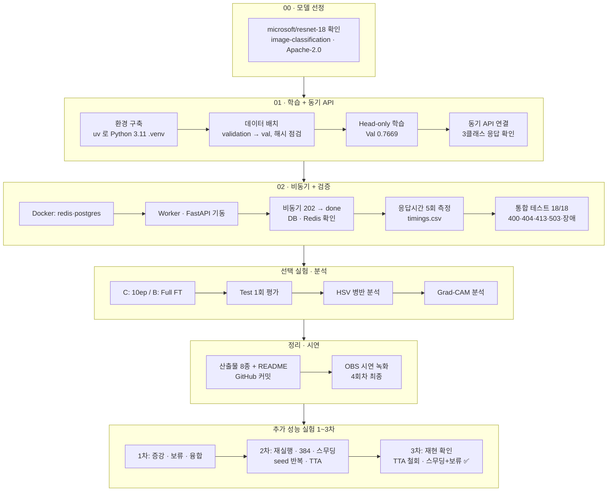
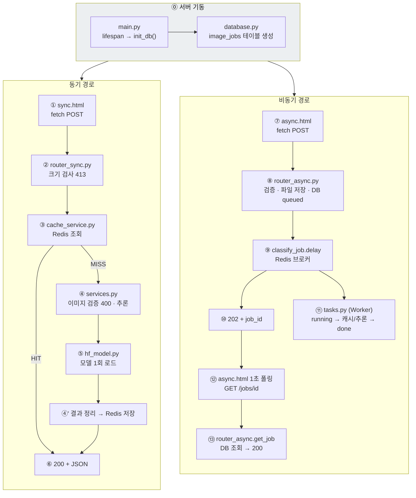
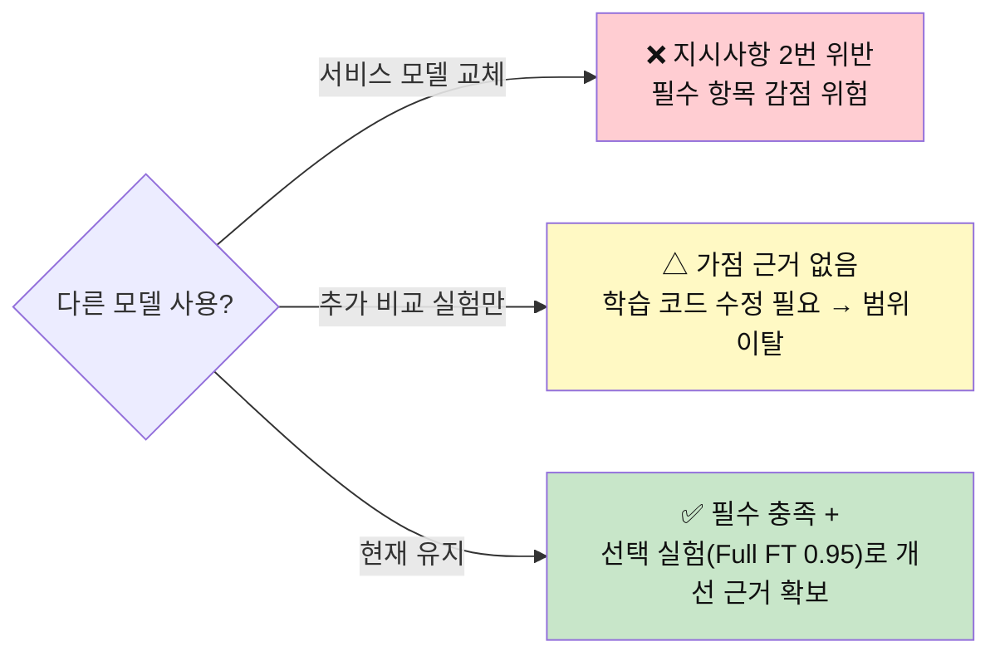

# 오늘 한 작업 정리 · 결과 해설 · 코드 리뷰

작성: 김지후 · 2026-11-04 · 발표 준비·질의응답 대비용 (제출 산출물 1~8 · 부록 09 와 별개)

---

## 1. 오늘 한 일 — 순서대로

| 단계 | 한 일 | 결과·근거 |
|---|---|---|
| 환경 | Ubuntu 26.04 에 Python 3.11 이 없어 **uv** 로 3.11.18 가상환경 생성 | 산출물 7 E-01 |
| 데이터 | 원본 `~/beans_source` 보존, `dataset/{train,val,test}` 로 복사, SHA-256 중복 점검 | 1,034 / 133 / 128, 누출 0건 |
| 필수 학습 | `--freeze-backbone` 3 epoch | Best Val **0.7669** (Epoch 2 저장) |
| 동기 API | `.env` `MODEL_PATH=artifacts/beans_resnet18` | `model_id` 로 학습 모델 연결 확인 |
| 비동기 | Docker 는 redis·postgres 만, Worker·FastAPI 는 `.venv` | job 202 → done, DB·Redis 확인 |
| 문제 해결 | Docker WSL 연동 (`wsl --shutdown`), Redis 6379 충돌 (WSL redis-server 중지) | 산출물 7 E-02, E-03 |
| 측정 | 조건별 5회, warm-up 분리 | 동기 20.6 / HIT 2.1 / 접수 8.5 / 완료 116.7 ms |
| 테스트 | 모의 1+4 passed, 실환경 18/18 | Redis 장애·Worker 정지까지 포함 |
| 선택 실험 | 옵션만 바꿔 C(10ep), B(Full FT) | Val 0.8947 / **0.9699** |
| 분석 | HSV 병반 규칙, Grad-CAM | 개선 주장 없이 원인 분석만 |
| 시연 | OBS 녹화 4회 (화면 겹침 → 캐시 HIT 이미지 → 오답 이미지 → 최종) | 최종본 정답 2건, 시연 순서 전부 포함 |
| 추가 실험 1차 | 증강(D1·D2), 확인 필요 보류(A·B), CNN+HSV 융합(A·B) | 증강 하락, 보류는 B 에서만, 융합은 A 에서만 효과 |
| 추가 실험 2차 | B 와 한 가지씩: 재실행, 증강+10ep, 384, 라벨 스무딩, seed 1·2, TTA | **같은 seed 로도 흔들림 발견** (Val 0.983 ± 0.011). 정확도 개선은 그 폭 안 |
| 추가 실험 3차 | 증강 seed 1·2 + TTA 고정 재현, 스무딩 + 보류 | **TTA 재현 실패 → 철회**, 스무딩 + 보류 **Test 오답 0건 (보류 14.1%)** |

---

## 2. 결과 해설 — 숫자가 뜻하는 것

### 2-1. 학습

| 숫자 | 뜻 | 발표에서 주의 |
|---|---|---|
| Val **0.7669** (A) | 검증 133장 중 102장 정답 | Epoch 3 도 0.7669 였지만 저장 조건이 `>` 라 **Epoch 2 가중치**가 남음 |
| Loss 0.99 → 0.81 → 0.71 | 아직 내려가는 중 = **학습 부족** | "과적합" 아님 |
| C 의 1~3 epoch = A 와 소수점 4자리 동일 | seed 42 로 **재현됨** → A 와 C 차이는 epoch 수 하나 | 실험 설계가 공정하다는 근거. 단 **Head-only 만** 그렇다 (2-3) |
| B: 1 epoch 만에 0.9699, 이후 0.9624 | 백본이 콩잎에 적응. 이후 train loss 는 계속 내려가는데 val 은 하락 = **과적합 신호** | 그래서 Epoch 1 저장 |
| Test 0.7188 / 0.8828 / 0.9531 | 선택 후 **1회** 측정 | Test 로 모델을 고르지 않았음을 꼭 말하기 |
| 0.7669 → 0.9699 | **+20.30%p** | "20% 향상" 이라고 말하지 않기 |

### 2-2. 서비스·성능

| 숫자 | 뜻 |
|---|---|
| 동기 MISS 20.6ms (추론 15.78) | HTTP 왕복 ≈ 5ms + 모델 추론 ≈ 16ms |
| 동기 HIT 2.1ms | Redis 조회만, 모델 미실행 → `inference_ms: null` |
| 비동기 접수 8.5ms | 검증 + 파일 저장 + DB insert + 큐 등록까지. **추론은 포함 안 됨** |
| 비동기 완료 116.7ms | 큐 전달 + Worker 추론 17.86ms + **폴링 간격 100ms** 가 대부분 |
| 비동기 HIT 7.7 / 113.4ms | Worker 도 같은 Redis 캐시를 써서 **동기에서 본 사진은 비동기에서도 HIT** |
| 첫 요청 2,457~3,934ms | 모델 로딩 포함 (아래 R-01) |

### 2-3. 추가 성능 실험 — 숫자가 뜻하는 것 (상세: 부록 09)

| 숫자 | 뜻 | 발표에서 주의 |
|---|---|---|
| B 재실행(F0) 0.9774 ≠ B 0.9699 | **같은 seed 인데 결과가 다름** = GPU 비결정성 (Full FT 만) | "seed 고정이면 항상 같다"고 말하지 않기 |
| Val 0.983 ± 0.011 (0.970~0.9925) | Full FT 를 4번 학습했을 때의 흔들림 폭 | 이 안의 차이는 "개선"이라 말하지 않기 |
| F1 0.985, F2 0.985, F3 0.9774 | 증강+10ep / 384 / 라벨 스무딩 — 모두 흔들림 폭 안 | "1.5%p 올랐다"고 말하면 틀림 |
| 증강 Val 0.950 vs 비증강 0.983 | seed 3번 모두 증강이 낮음 (폭의 약 3배) | 이건 우연이 아닌 차이 → "효과 없음" |
| F2 CPU 33.2ms (×2.3) | 해상도 384 의 비용 | 정확도와 비용을 함께 판단 |
| TTA: 2차 +1.56·+3.12%p → 3차 −2.34·−1.56%p | 좋아 보인 결과가 재현에서 사라짐 | **철회한 사실을 숨기지 말고 강점으로** |
| 오답 확신도 0.89 → 0.63 | 라벨 스무딩이 과신을 낮춤 | 정확도는 그대로 |
| 보류 14.1% / 통과 오답 0건 | 스무딩 + 확인 필요 보류, Test 128장 중 18장만 사람이 확인 | 표본(오답 6장)이 작음, "항상 0건"이 아님 |
| A 융합 +6.25%p / B 융합 −1.56%p | 색 특징은 약한 모델만 도움 | 조건부 결과 |

### 2-4. 오늘 시연 영상 (최종본)

| 장면 | 값 | 의미 |
|---|---|---|
| 동기 MISS | healthy_test.11 → healthy 0.8478, 2,496ms | 정답. warm-up 을 안 해서 로딩 포함 |
| 동기 HIT | 11ms, `cache_hit: true` | 캐시 동작 |
| 비동기 | bean_rust_test.11 → 접수 39ms, job 19, done, bean_rust 0.5911 | 정답. Worker 도 첫 요청이라 2,628ms |
| Worker 로그 | succeeded in 2.66s | 별도 프로세스에서 처리됨 |
| DB / Redis | 19 done / 키 2개 | 상태·캐시 기록 |

> 오전 측정 때 같은 두 사진의 점수와 소수점 4자리까지 같음 → 추론이 결정적(deterministic)이고 재현됨.

---

## 3. 코드 리뷰 (제공 코드 — 수정하지 않고 관찰만)

평가 규칙상 제공 코드는 그대로 두었다. 아래는 "실제 운영 서비스라면 무엇을 바꿀까?" 하는 관점의 리뷰다. **★ 표시는 오늘 결과에 실제로 영향을 준 항목**이다.

### 3-0. 리뷰 범위 — 제공 파일 전부

| 영역 | 파일 | 리뷰 |
|---|---|---|
| 설정 | `ai/config.py`, `.env.example` | ✅ |
| 모델 | `ai/hf_model.py`, `ai/services.py` | ✅ |
| 캐시 | `ai/cache_service.py` | ✅ |
| 큐 | `ai/celery_app.py`, `ai/tasks.py` | ✅ |
| DB | `ai/database.py`, `ai/models.py` | ✅ |
| API | `ai/router_sync.py`, `ai/router_async.py`, `ai/router_web.py`, `main.py` | ✅ |
| 화면 | `templates/base.html`, `sync.html`, `async.html`, `static/style.css` | ✅ |
| 학습 | `training/finetune.py` | ✅ |
| 테스트 | `tests/test_api.py`, `test_api.py`(01용) | ✅ |
| 배포 | `requirements.txt`, `Dockerfile`, `.dockerignore`, `compose.yaml`, `.gitignore` | ✅ |

---

### 3-1. 실행 순서로 읽는 코드

| 순서 | 파일 · 함수 | 하는 일 | 핵심 코드 |
|---|---|---|---|
| ⓪ | `main.py` · `lifespan` | 서버 시작 시 DB 테이블 생성 (Docker 가 먼저 켜져 있어야 함) | `init_db()` |
| ⓪ | `ai/database.py` | 연결 풀 생성, 끊긴 연결 자동 확인 | `create_engine(DATABASE_URL, pool_pre_ping=True)` |
| ① | `templates/sync.html` | 파일을 FormData 로 감싸 전송, 브라우저에서 시간 측정 | `fetch('/api/sync/classify/',{method:'POST',body:form})` |
| ② | `ai/router_sync.py` · `classify_sync` | 5MB+1 바이트만 읽어 초과 시 413 | `image.file.read(MAX_UPLOAD_BYTES + 1)` |
| ③ | `ai/cache_service.py` · `classify_with_cache` | 키로 Redis 조회 → 있으면 HIT 표시 후 반환 | `return {**result, "cache_hit": True, "inference_ms": None}` |
| ④ | `ai/services.py` · `load_rgb_image` | 형식·픽셀 수 검사 후 RGB 변환, 실패 시 400 | `if source.width * source.height > MAX_IMAGE_PIXELS` |
| ⑤ | `ai/hf_model.py` · `get_classifier` | 프로세스당 1번만 모델 로드, CPU 사용 | `@lru_cache(maxsize=1)` · `device=-1` |
| ④' | `ai/services.py` · `classify_image_bytes` | 추론·정렬·시간 기록 → Redis 에 600초 저장 | `get_redis().setex(key, 600, ...)` |
| ⑦ | `templates/async.html` | 접수 후 **1초마다, 최대 60번** 상태 조회 | `await sleep(1000)` |
| ⑧ | `ai/router_async.py` · `enqueue_classify` | 검증 → `media/jobs/<uuid>.bin` 저장 → DB queued | `ImageJob(image_path=filename, status="queued")` |
| ⑨ | `ai/router_async.py` | 큐 등록, 실패하면 failed 기록 + 503 | `classify_job.delay(job_id)` |
| ⑩ | 〃 | 즉시 202 반환 | `status_code=202` |
| ⑪ | `ai/tasks.py` · `classify_job` | done 이면 건너뜀 → running → 캐시/추론 → done, 예외 시 failed | `job.status = "running"; db.commit()` |
| ⑫⑬ | `ai/router_async.py` · `get_job` | DB 행을 JSON 으로. done 일 때만 결과, failed 일 때만 오류 | `if job.status == "done" else None` |

---

### 3-2. 잘 된 점

| 파일 | 내용 | 확인 |
|---|---|---|
| `router_sync.py`, `router_async.py` | 최대 크기+1 바이트만 읽음 → 큰 파일로 메모리 고갈 방지 | 413 PASS |
| `services.py` | 형식 화이트리스트 + **디코딩 전 픽셀 수 검사** → 압축 폭탄 방어 | 400 PASS |
| `services.py` | `exif_transpose` 로 휴대폰 사진 회전 보정 | — |
| `router_async.py` | 저장 파일명 uuid → 경로 조작 차단 | — |
| `router_async.py` | 큐 등록 실패 시 failed 기록 + 503 | T-16 PASS |
| `cache_service.py` | Redis 장애 시 추론으로 폴백 (timeout 1초) | T-15 PASS |
| `services.py` | 캐시 키 = 모델 경로 해시 + 이미지 SHA-256 | — |
| `tasks.py` | done 이면 재처리 안 함 (중복 전달에 안전) | — |
| `database.py` | `expire_on_commit=False` → commit 후에도 `job.id` 사용 가능, `pool_pre_ping` → DB 재시작 후 끊긴 연결 자동 복구 | — |
| `models.py` | `status` 에 인덱스, 시간은 timezone 포함 UTC | `\d image_jobs` 인덱스 2개 |
| `tests/test_api.py` | `DATABASE_URL` 을 **import 전에** SQLite 로 바꿔 실제 DB 를 건드리지 않음. 실패 경로(503, failed 기록)까지 테스트 | 4 passed |
| `compose.yaml` | 포트 `127.0.0.1` 바인딩, healthcheck + `depends_on: service_healthy`, 학습용 trainer 는 `profiles` 로 분리 | healthy |
| `.dockerignore`, `.gitignore` | `.env`, dataset, artifacts, media 제외 → 비밀·대용량 유출 방지 | — |

---

### 3-3. 개선 포인트

| ID | 위치 | 관찰 | 영향 | 운영이라면 |
|---|---|---|---|---|
| **R-01 ★** | `services.py` `classify_image_bytes` | 타이머 시작 **다음에** `get_classifier()` 호출 → 첫 요청의 `inference_ms` 에 모델 로딩 포함 | 첫 요청 2,457 / 2,628ms. warm-up 분리로 대응 | 기동 시 미리 로드 (`lifespan`, `worker_process_init`) |
| **R-02 ★** | `finetune.py` `--freeze-backbone` | 가중치는 고정되지만 `model.train()` 이라 백본 **BatchNorm 통계는 갱신** | "Head-only" 여도 백본 통계 변화 | 백본을 `eval()` 로 고정 |
| **R-03 ★** | `finetune.py` 저장 조건 | `acc > best_acc` → 동점이면 앞 epoch 유지 | A 는 Epoch 2 저장 | 동점 기준 명시 |
| **R-12 ★** | `templates/async.html` | 폴링 간격 **1초**, 최대 60회 후 **조용히 멈춤** | 화면의 비동기 전체 시간은 최소 1초 (영상 3,068ms). 측정 스크립트는 100ms 로 따로 잼 | 간격 단축 또는 WebSocket, 시간 초과 메시지 |
| R-04 | `finetune.py` | 증강·스케줄러 없음, `num_workers=0` | 구도 편향에 취약 | Train 에만 증강 |
| R-05 | `services.py` `cache_key` | 모델을 **경로 문자열**로 식별 → 같은 경로에 재학습하면 600초 동안 옛 결과 HIT | 실험별 폴더라 미발생 | 가중치 해시를 키에 포함 |
| R-06 | `tasks.py`, `celery_app.py` | `acks_late` 기본값 False → 처리 중 Worker 가 죽으면 running 으로 영구 잔류, 재시도 없음 | 미발생 (정상 정지만 시험) | `acks_late=True` + 재시도 + 시간 초과 감시 |
| R-07 | `router_async.py` | 파일을 DB 기록 **전에** 저장, 정리 로직 없음 | 실패 시 고아 파일 | 실패 시 삭제, 주기 정리 |
| R-08 | `celery_app.py` | Result backend(DB/3) 설정했지만 결과는 PostgreSQL 에서만 읽음 | 불필요한 Redis 기록 | `task_ignore_result=True` |
| R-09 | `router_sync.py` | `def` 엔드포인트 → 스레드풀에서 같은 모델 동시 사용 | 동시 요청 시 CPU 경합 (미측정) | 동시성 제한 |
| R-10 | `config.py` | DB 비밀번호 기본값이 코드에 있음 | 실습용은 무방 | `.env` 필수화 |
| R-11 | `compose.yaml` | web·worker 도 정의 → 서비스명 없이 `up -d` 하면 8000 충돌 | README 경고로 대응 | trainer 처럼 `profiles` 로 분리 |
| R-13 | `templates/sync.html` | 안내 문구가 "정상/불량 분류" — 다른 예제(cap_quality)에서 남은 표현 | 기능 영향 없음, 화면 문구만 콩잎과 불일치 | "콩잎 3클래스"로 수정 |
| R-14 | `router_async.py` + `tasks.py` | API 에서 이미지를 한 번 디코딩해 검증하고, Worker 가 또 디코딩 | CPU 중복 (작은 비용), 대신 잘못된 파일이 큐에 안 들어감 | 의도된 설계로 유지 가능 |
| R-15 | `main.py` `init_db` | `create_all` 은 **없는 테이블만** 만듦 → 컬럼을 바꿔도 기존 테이블에 반영 안 됨 | 이번엔 스키마 변경 없음 | Alembic 마이그레이션 |
| R-16 | `requirements.txt`, `Dockerfile` | 버전을 범위로만 지정, 테스트 도구(pytest·httpx)가 운영 의존성에 섞임. Dockerfile 은 torch 2.5.1 CPU 를 따로 고정 | 내 환경(torch 2.15) 과 Docker 버전이 다를 수 있음 → 설치 버전을 `setup_and_test_log.md` 에 기록해 대응 | lock 파일, 개발/운영 분리 |
| R-17 | `tests/test_api.py` | Redis **예외** 폴백 경로, running 상태, TTL 만료는 모의 테스트에 없음 | 실환경 T-12·T-15 로 보완 | 해당 케이스 추가 |
| R-18 | `services.py` | `top_k=5` 지만 클래스가 3개라 3개만 반환, pipeline 이 이미 정렬한 결과를 다시 정렬 | 영향 없음 | `top_k=None` 또는 클래스 수 |
| R-19 | `sync.html`, `async.html` | `URL.createObjectURL` 미리보기를 해제하지 않음, `alert()` 사용 | 장시간 사용 시 메모리 소량 누적 | `revokeObjectURL` |

---

### 3-4. 리뷰에서 얻은 발표용 포인트 3개

1. **"첫 요청이 느린 이유를 코드로 설명할 수 있다"** — R-01. `services.py` 의 타이머 위치와 `hf_model.py` 의 `lru_cache`.
2. **"Head-only 의 정확한 의미를 안다"** — R-02. 가중치 고정 ≠ BatchNorm 통계 고정.
3. **"화면 시간과 측정 시간이 다른 이유를 안다"** — R-12. 화면은 1초 폴링, 측정 스크립트는 100ms 폴링.

---

### 3-5. 내가 만든 보조 스크립트 (`reports/tools/`)

| 파일 | 역할 | 설계 원칙 |
|---|---|---|
| `check_dataset.py` | 클래스별 개수, SHA-256 중복 | 원본 읽기만 |
| `measure_timings.py` | 동기/비동기 × MISS/HIT 5회, warm-up 분리, **100ms 폴링** | `cache_hit` 값을 **응답에서 읽어** 기록 (가정 아님) |
| `evaluate_test.py` | Test 1회 평가, 혼동행렬·F1 | 모델 선택 후에만 실행 |
| `hsv_lesion_analysis.py` | HSV 잎·병반 마스크, 임계값은 **Train 으로 결정** 후 Val 확인 | Test 미사용 |
| `gradcam_analysis.py` | `resnet.encoder.stages[-1]` 히트맵, 잎 마스크 안 비율 | 설명용, 성능 주장 없음 |
| `predict_split.py` | 검증·테스트 사진마다 세 클래스 확률을 CSV 로 저장 (predict = 예측, split = 데이터 묶음) | 보류·융합 분석의 입력 |
| `review_flag_analysis.py` | 확인 필요 보류 분석 (review = 다시 보기, flag = 표시). 기준값을 Val 로 고르고 Test 1회 | 선택 규칙을 실행 전에 고정 |
| `fusion_analysis.py` | CNN 확률 + HSV 특징 융합 (fusion = 합치기). LR·RF 를 Val 5겹 교차검증으로 비교 | Train 은 누출 위험으로 미사용 |
| `tta_eval.py` | TTA 평가 (eval = 평가). `--mode hv4` 로 방식을 고정하면 재현 확인용 | 방식 선택은 Val |
| `model_benchmark.py` | 모델 비교표: 정확도 + 파라미터 수 + 파일 크기 + CPU 1장 시간 (benchmark = 같은 조건 성능 측정) | 서비스와 같은 CPU·1장씩 |
| `run_extra_experiments.sh` / `run_boost_round2.sh` / `run_boost_round3.sh` | 1·2·3차 실험을 순서대로 한 번에 실행하는 셸 스크립트 (run = 실행, boost = 끌어올리기, round = 회차) | 이미 학습된 폴더는 건너뜀 |

**학습 코드 복사본 (`training/`)** — 원본 `finetune.py` 는 그대로 두고 복사본만 고쳤다.

| 파일 | 원본과 다른 점 | 옵션 설명 |
|---|---|---|
| `finetune_aug.py` | Train 증강만 추가 (aug = augmentation, 증강) | — |
| `finetune_plus.py` | 옵션 5개 추가. **옵션을 안 주면 원본과 같은 동작** | `--aug` 증강 켜기 / `--image-size 384` 입력 크기 / `--label-smoothing 0.1` 라벨 스무딩 / `--seed 1` 무작위 시작 번호 / `--base-model` 기반 모델 바꾸기 |

---

## 4. 다른 모델을 쓰면 점수에 영향이 있을까?

**결론: 서비스 모델을 다른 모델로 바꾸면 점수는 오르기보다 깎일 가능성이 크다. 지금 구성을 유지하는 것이 맞다.**

| 근거 | 평가가이드 원문 기준 |
|---|---|
| 지시사항 2번 | "`microsoft/resnet-18` 의 1,000개 출력층을 3개 클래스 출력층으로 대체한 학습 코드를 실행" — 모델이 **지정**돼 있음 |
| 1장 평가 개념 | "ResNet18 — Hugging Face 사전학습 가중치를 활용했는지 확인" |
| 6-1 선택 실험 | 허용된 비교는 **같은 코드의 옵션 변경**(Head-only vs Full FT)뿐 |
| 성능 주장 규칙 | 같은 분할·전처리·환경·지표가 아니면 "개선" 이라고 단정 금지 |

- 정확도만 놓고 보면 EfficientNet·ConvNeXt·ViT 같은 모델이 더 높을 수는 있다. 하지만 이 평가는 **정확도 경쟁이 아니라 지정된 절차를 정확히 실행하고 증명했는지**를 본다.
- 이미 같은 ResNet18 로 **Full FT 0.9531 (Test)** 를 얻었고, Grad-CAM 에서 오류 원인이 모델 용량이 아니라 **배경 편향**으로 보였다.
- **추가 실험 후 판단 근거가 하나 더 생겼다:** Full FT 의 반복 흔들림이 ±1.1%p 라서, Val 133장으로는 그보다 작은 차이를 판정할 수 없다. 모델을 바꿔 0.98 이 나와도 "좋아졌다"고 증명하기 어렵다.
- 그래서 다음 개선 순서는 "모델 교체"가 아니라 **"F3(라벨 스무딩) 서비스 적용 + 확인 필요 표시 → 잎 영역 분리"** 다. 증강은 실험 결과 효과가 없어 제외.
- 질문을 받으면: *"지시사항이 ResNet18 이어서 그 안에서 할 수 있는 방법을 먼저 다 해 봤습니다. Full FT 0.97 위로는 반복 흔들림을 넘는 차이가 없어서, 모델을 바꿔도 개선을 증명하기 어렵다고 판단했습니다."*
