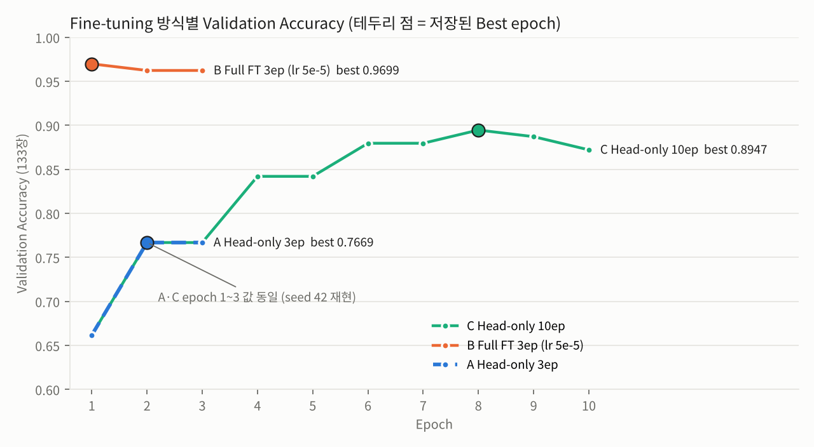
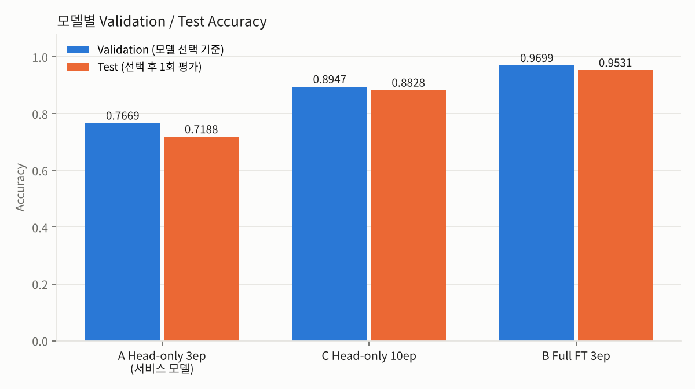
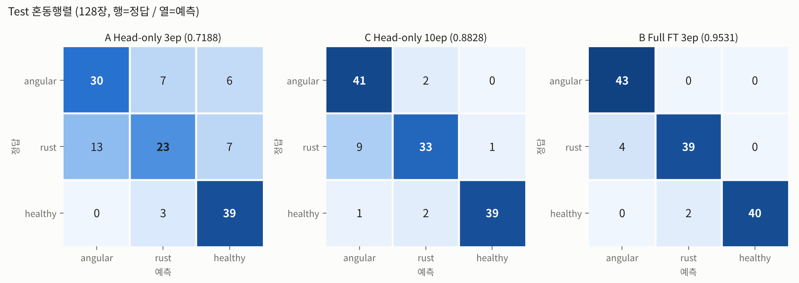
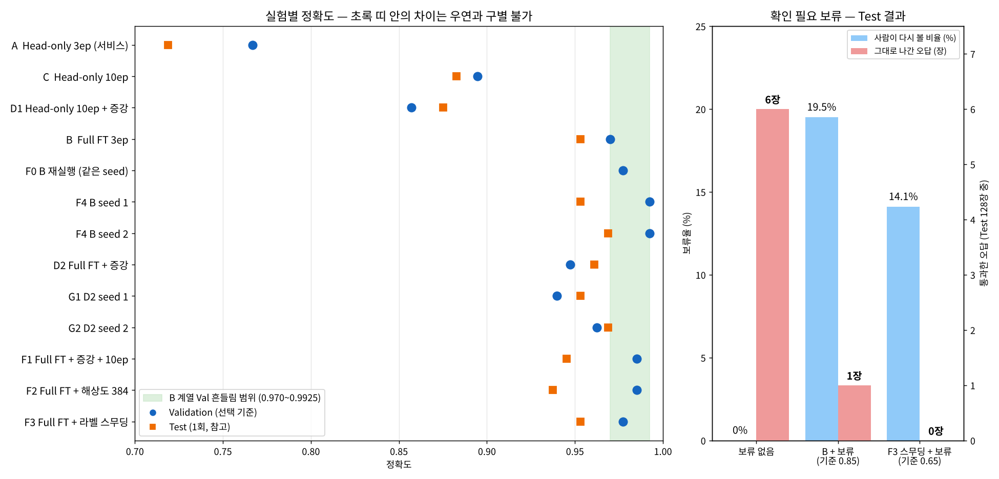

# 산출물 1. ResNet18 콩잎 3클래스 Fine-tuning 결과보고서

| 항목 | 내용 |
|---|---|
| 평가 대상 | 콩잎 이미지 3클래스 분류 (Image Classification) |
| 기준 모델 | `microsoft/resnet-18` (Hugging Face, Apache-2.0, ImageNet 1,000클래스 사전학습) |
| 데이터 | `AI-Lab-Makerere/beans` (Hugging Face, MIT 표기) — `train.zip`, `validation.zip`, `test.zip` |
| **서비스 연결 모델** | **Head-only Fine-tuning** (`--freeze-backbone`) → `artifacts/beans_resnet18/` |
| 학습 코드 | `training/finetune.py` (01 제공 코드 그대로, 수정 없음) |
| 학습 입력 | `dataset/train`, `dataset/val` |
| 보관 데이터 | `dataset/test` (학습·모델 선택에 사용하지 않음, 선택 완료 후 1회 평가만 수행) |
| 실험 상태 | 필수 Head-only 학습 완료 (2026-11-04 10:10) / 선택 실험 2건 완료 (6장) |

---

## 1. 데이터 구성

### 1-1. 원본 → 코드 실행용 매핑

| 제공 원본 (보존) | 코드 실행용 (복사) | 용도 |
|---|---|---|
| `~/beans_source/train/` | `dataset/train/` | 가중치 학습 |
| `~/beans_source/validation/` | `dataset/val/` | 학습 중 성능 확인 · Best 모델 선택 |
| `~/beans_source/test/` | `dataset/test/` | 학습 미사용 (선택 완료 후 1회 평가, 서비스 시연 입력) |

`validation`은 원본 폴더명, `val`은 제공 코드(`finetune.py`의 `data / "val"`)가 읽는 폴더명이다. 원본은 `~/beans_source`에 그대로 두고 `cp -r`로 복사했다. 정답 라벨은 폴더명을 따른다.

### 1-2. 클래스별 실제 이미지 수

| 클래스 | Train | Validation | Test |
|---|---:|---:|---:|
| angular_leaf_spot (각진잎반점병) | 345 | 44 | 43 |
| bean_rust (녹병) | 348 | 45 | 43 |
| healthy (정상) | 341 | 44 | 42 |
| **합계** | **1,034** | **133** | **128** |

- 학습 로그 첫 줄 `클래스: ['angular_leaf_spot', 'bean_rust', 'healthy'] / Train: 1034, Val: 133` 과 **일치**
- 증빙: `evidence/dataset_count.png`, `data/dataset_check.md`

### 1-3. 중복·누출 점검

| 점검 | 결과 |
|---|---|
| 방법 | 1,295장 전부 SHA-256 해시 비교 (`reports/tools/check_dataset.py`) |
| **Split 간 동일 파일 (누출)** | **0건** |
| 같은 Split 안 동일 파일 | 0건 |
| 폴더 구조 | 3 Split × 3클래스, 모든 폴더에 이미지 존재, `train/train` 같은 중첩 없음 |
| 한계 | 바이트가 같은 파일만 탐지. **같은 잎을 다시 찍은 유사 사진은 미점검** |

증빙: `evidence/dataset_check.png`

---

## 2. 실행 설정 (필수: Head-only)

```bash
python -m training.finetune --data dataset --output artifacts/beans_resnet18 --epochs 3 --batch-size 8 --freeze-backbone
```

| 파라미터 | 값 | 근거 |
|---|---|---|
| base_model | microsoft/resnet-18 | `BASE_MODEL` |
| 출력층 | **512→1000 을 512→3 으로 교체**, 새 헤드 무작위 초기화 | 로그 `classifier.1.weight: found shape [1000, 512] ... instantiated [3, 512]` (`evidence/head_replace_1000_to_3.png`) |
| 학습 파라미터 | 이름이 `classifier.` 로 시작하는 것만 `requires_grad=True` (1,539개) | `--freeze-backbone` |
| epochs / batch | 3 / 8 | 실행 옵션 |
| learning rate | 0.0002 (AdamW) | 기본값 |
| 전처리 | `AutoImageProcessor` (microsoft/resnet-18), 증강 없음 | 제공 코드 |
| seed | 42 (`random`, `torch`) | 제공 코드 |
| 저장 규칙 | Validation Accuracy 가 이전 최고값보다 **클 때만** 저장 (`acc > best_acc`) | 제공 코드 |
| 학습 장치 | **cuda — NVIDIA GeForce RTX 3060 12GB** | `torch.cuda.is_available() == True` |
| 실행 환경 | Windows + WSL2 Ubuntu 26.04.1 LTS, Python 3.11.18, torch 2.15.0+cu132, transformers 4.57.6 | `data/setup_and_test_log.md` |

---

## 3. 학습 결과 (Head-only, `training_report.json` 원문 수치)

| Epoch | Train Loss | Validation Accuracy |
|---:|---:|---:|
| 1 | 0.9924 | 0.6617 |
| 2 | 0.8108 | **0.7669** |
| 3 | 0.7078 | 0.7669 |

- **Best Validation Accuracy: 0.7669** (102/133)
- **저장된 가중치 = Epoch 2.** Epoch 3 도 0.7669 이지만 저장 조건이 `>` (초과)라서 덮어쓰지 않았다.
- 해석: Loss 가 0.99 → 0.81 → 0.71 로 계속 내려가는 중에 끝났다 → **학습 부족(underfitting) 상태**. 6장의 실험 C 로 확인했다.
- 증빙: `evidence/train_log.png`, 원본 `artifacts/beans_resnet18/training_report.json`, `data/train_log.txt`

---

## 4. 생성 파일 확인

```text
-rw-r--r-- 808  config.json               (id2label: angular_leaf_spot / bean_rust / healthy)
-rw------- 43M  model.safetensors
-rw-r--r-- 352  preprocessor_config.json
-rw-r--r-- 468  training_report.json
```
- [x] config.json  - [x] model.safetensors  - [x] preprocessor_config.json  - [x] training_report.json

증빙: `evidence/model_folder.png`

---

## 5. 서비스 연결 확인

- `.env`: `MODEL_PATH=artifacts/beans_resnet18` — 응답 `model_id` 가 `artifacts/beans_resnet18` 로 나와 학습 모델 연결 확인 (ImageNet 라벨 아님)
- 01 단계 동기 화면에서 클래스별 1장씩 확인 (서비스 추론은 `device=-1`, CPU):

| 입력 (dataset/test) | 정답 | 예측 top1 | score | inference_ms | 일치 |
|---|---|---|---:|---:|---|
| angular_leaf_spot_test.0.jpg | angular_leaf_spot | angular_leaf_spot | 0.4623 | 4082.7 (첫 요청, 모델 로딩 포함) | ✅ |
| bean_rust_test.0.jpg | bean_rust | bean_rust | 0.6051 | 18.42 | ✅ |
| healthy_test.0.jpg | healthy | healthy | 0.6369 | 18.19 | ✅ |

증빙: `evidence/ui_sync_angular.png`, `evidence/ui_sync_rust.png`, `evidence/ui_sync_healthy.png`
※ 이 표는 연결 확인용 개별 시연이며 Test Accuracy 가 아니다.

---

## 6. 선택 실험 — Fine-tuning 방식 비교 (평가가이드 6-1)

같은 데이터 분할 · 같은 Validation 133장 · 같은 seed 42 · 같은 GPU. 결과는 **별도 폴더**에 저장하여 서비스 모델(A)을 덮어쓰지 않았다. `finetune.py` 수정 없이 **실행 옵션만** 바꿨다.

| 실험 | A 대비 바꾼 것 | 명령 옵션 | 저장 위치 |
|---|---|---|---|
| **A. Head-only** (기준선, 필수) | — | `--epochs 3 --freeze-backbone` | `artifacts/beans_resnet18` |
| **C. Head-only 10ep** | **epoch 하나만** | `--epochs 10 --freeze-backbone` | `artifacts/beans_resnet18_head_e10` |
| **B. Full Fine-tuning** | 백본 학습 + lr (가이드 예시 그대로) | `--epochs 3 --lr 0.00005` | `artifacts/beans_resnet18_full` |

### 6-1. Validation 결과

| Epoch | A loss / acc | C loss / acc | B loss / acc |
|---:|---|---|---|
| 1 | 0.9924 / 0.6617 | 0.9924 / 0.6617 | 0.4407 / **0.9699** |
| 2 | 0.8108 / **0.7669** | 0.8108 / 0.7669 | 0.1556 / 0.9624 |
| 3 | 0.7078 / 0.7669 | 0.7078 / 0.7669 | 0.0855 / 0.9624 |
| 4 | | 0.6454 / 0.8421 | |
| 5 | | 0.6012 / 0.8421 | |
| 6 | | 0.5554 / 0.8797 | |
| 7 | | 0.5520 / 0.8797 | |
| 8 | | 0.5107 / **0.8947** | |
| 9 | | 0.5184 / 0.8872 | |
| 10 | | 0.4942 / 0.8722 | |
| **Best** | **0.7669** (ep2, 102/133) | **0.8947** (ep8, 119/133) | **0.9699** (ep1, 129/133) |



**해석**
1. **재현성:** C 의 Epoch 1~3 값이 A 와 소수점 4자리까지 같다 → Head-only 는 seed 42 로 완전히 재현되며, A→C 차이는 epoch 수 한 가지 때문이다. **단, Full FT(B)는 같은 seed 로 다시 학습해도 Val 이 0.9699 → 0.9774 로 달라졌다** (GPU 비결정성 — 백본의 합성곱 역전파 계산 순서가 매번 미세하게 달라짐. Head-only 는 이 계산을 하지 않아 재현됨). seed 를 바꾼 반복까지 포함한 Full FT 의 Val 흔들림은 **0.983 ± 0.011** (최저~최고 3장) → [부록 09](09_추가성능실험_보고서.md) 4-1.
2. **A 는 학습 부족이었다:** epoch 만 늘려 **+12.78%p** (76.69% → 89.47%).
3. **Head-only 는 0.87~0.89 에서 정체:** C 는 epoch 8 이후 더 오르지 않았다. 반면 B 는 **1 epoch 만에 0.9699** (A 대비 **+20.30%p**, C 대비 +7.52%p).
4. **B 의 과적합 신호:** Train loss 는 0.44 → 0.09 로 계속 내려가는데 Val 은 0.9699 → 0.9624 로 하락 → 저장 규칙에 따라 Epoch 1 가중치 저장.
5. **단서:** B 는 가이드 예시대로 백본 학습 여부와 학습률을 **함께** 바꿨으므로, B−C 차이 7.52%p 전부를 "백본 학습 효과"로 단정하지 않는다. 다만 Grad-CAM(산출물 8)에서 B 의 주목 영역이 배경에서 병반으로 이동한 것이 관찰되어 백본 적응을 지지하는 정성적 근거가 있다.

증빙: `evidence/train_log_full.png`, `evidence/train_log_head_e10.png`, `data/train_log_full.txt`, `data/train_log_head_e10.txt`

### 6-2. Test 1회 평가 (별도 측정 절차)

제공 코드는 Test 지표를 계산하지 않으므로 **별도 스크립트** `reports/tools/evaluate_test.py`(제공 코드 수정 없음)로 측정했다. **모델 선택은 Validation 으로 이미 끝난 뒤** 각 모델당 1회 실행했고, 이 결과로 모델·하이퍼파라미터를 다시 고르지 않았다.

| 모델 | Validation (선택 기준) | **Test Accuracy** | Macro F1 | 오분류 |
|---|---:|---:|---:|---:|
| A Head-only 3ep (서비스) | 0.7669 | **0.7188** (92/128) | 0.7109 | 36 |
| C Head-only 10ep | 0.8947 | **0.8828** (113/128) | 0.8829 | 15 |
| B Full FT 3ep | 0.9699 | **0.9531** (122/128) | 0.9532 | 6 |

| 클래스별 (P / R / F1) | A | C | B |
|---|---|---|---|
| angular_leaf_spot | 0.698 / 0.698 / 0.698 | 0.804 / 0.954 / 0.872 | 0.915 / **1.000** / 0.956 |
| bean_rust | 0.697 / 0.535 / 0.605 | 0.892 / 0.767 / 0.825 | 0.951 / 0.907 / 0.929 |
| healthy | 0.750 / 0.929 / 0.830 | 0.975 / 0.929 / 0.951 | **1.000** / 0.952 / 0.976 |




- **Validation 순위(A<C<B)가 Test 에서도 유지**되고 Val−Test 차이는 1.2~4.8%p 로 작다.
- **가장 큰 혼동: bean_rust → angular_leaf_spot** (A 13건, C 9건, B 4건). 두 질병 모두 갈색 반점이 생겨 시각적으로 유사하다.
- **세 모델 모두 틀린 이미지:** healthy_test.10, bean_rust_test.15·28·3·31 → 산출물 8 의 Grad-CAM 분석 대상.
- **서비스 대조 검증:** A 의 Test 평가(GPU)에서 bean_rust_test.30 → angular 0.4447, 실제 비동기 API(CPU) job 2 → 0.4448 / bean_rust_test.10: 0.3824 vs 측정 0.3825. 오차 0.0001(GPU·CPU 연산 차) → **서비스가 학습 모델을 정확히 사용**한다.
- 원본: `data/test_eval_{A_head_e3,C_head_e10,B_full_e3}.md`, `data/test_pred_*.csv`

### 6-3. 추가 성능 실험 요약 (상세: [부록 09](09_추가성능실험_보고서.md))

같은 데이터·같은 Val 133장에서 B 와 **한 가지씩만** 바꿔 비교했다. 원본 `finetune.py` 는 그대로 두고 복사본(`finetune_aug.py`, `finetune_plus.py`)을 썼다.

| 실험 | 바꾼 것 | Best Val | Test | 판정 |
|---|---|---:|---:|---|
| D1 | C + 데이터 증강 | 0.8571 | 0.8750 | 하락 |
| D2 / G1 / G2 | B + 데이터 증강 (seed 42·1·2) | 0.9474 / 0.9398 / 0.9624 | 0.9609 / 0.9531 / 0.9688 | Val 일관 하락, Test 동일 → 효과 없음 |
| F0 | B 재실행 (같은 seed) | 0.9774 | — | **GPU 비결정성 확인** |
| F4 | B seed 1 / 2 | 0.9925 / 0.9925 | 0.9531 / 0.9688 | 흔들림 측정 |
| F1 | 증강 + epoch 10 | 0.9850 | 0.9453 | 흔들림 범위 안 |
| F2 | 해상도 224 → 384 | 0.9850 | 0.9375 | 범위 안, CPU 2.3배 느림 |
| F3 | 라벨 스무딩 0.1 | 0.9774 | 0.9531 | 정확도 같음, 오답 확신도 0.89 → 0.63 |

- **정확도:** Full FT(약 0.96~0.97)를 넘는 개선은 흔들림 폭(±1.1%p) 밖에서 확인되지 않았다. 추론 시 뒤집기 평균(TTA)은 2차에서 좋아 보였으나 3차 재현 실험에서 실패해 철회했다.
- **신뢰성:** F3 + "확인 필요" 보류(점수 < 0.65 는 사람에게)로 **Test 보류 14.1%, 그대로 나간 오답 0건** (B + 보류는 19.5% 보류에 오답 1건).



---

## 7. 결과 판정

| 항목 | 판정 |
|---|---|
| Head-only Fine-tuning 학습 및 모델 파일 4종 생성 | **완료** (Best Val 0.7669) |
| `MODEL_PATH=artifacts/beans_resnet18` 로 동기·비동기 서비스 연결 | **완료** |
| 데이터 누출 점검 | **완료** (Split 간 0건) |
| 선택 실험 (Full FT, epoch 비교) | **완료** (Full FT Val 0.9699) |
| Test 정량평가 | **별도 스크립트로 1회 측정** (A 0.7188 / C 0.8828 / B 0.9531) |
| 추가 성능 실험 (증강·해상도·라벨 스무딩·seed 반복·TTA·보류·융합) | **완료** — 정확도 한계 확인, 라벨 스무딩 + 보류로 Test 오답 0건 (보류 14.1%) → [부록 09](09_추가성능실험_보고서.md) |

**한계:** 서비스 모델(A)은 학습 부족 상태라 Test 0.7188 로 낮다(평가가이드에 따라 서비스 경로는 A 유지). 데이터 증강은 추가 실험에서 효과가 없었다(부록 09). Full FT 는 GPU 비결정성 때문에 같은 seed 로도 Val ±1~3장 흔들린다. 유사 사진 누출 미점검. 단일 출처 데이터(촬영 조건 제한).
