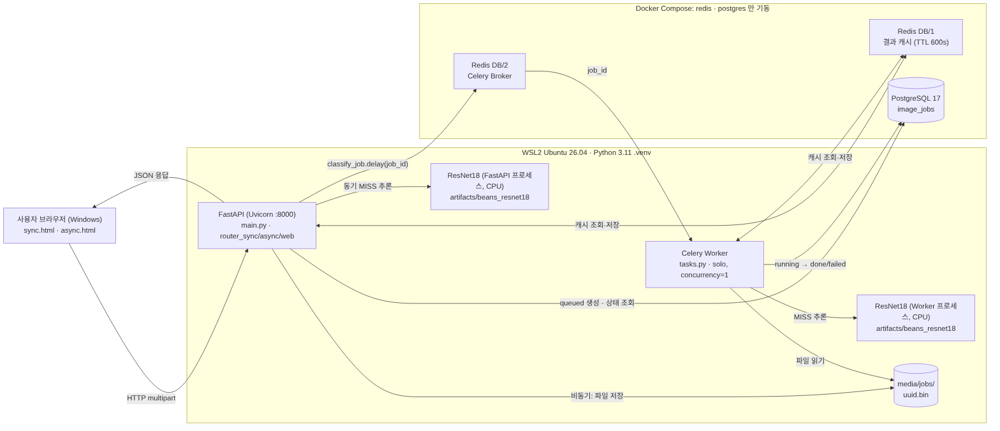
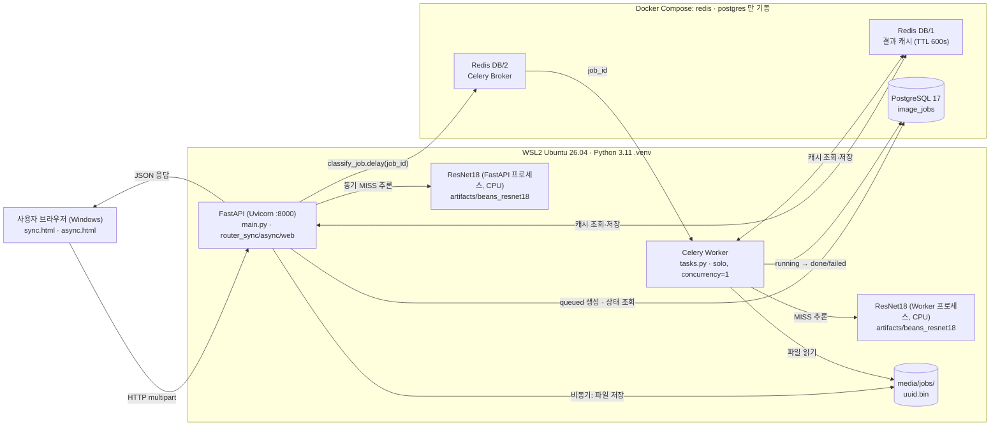
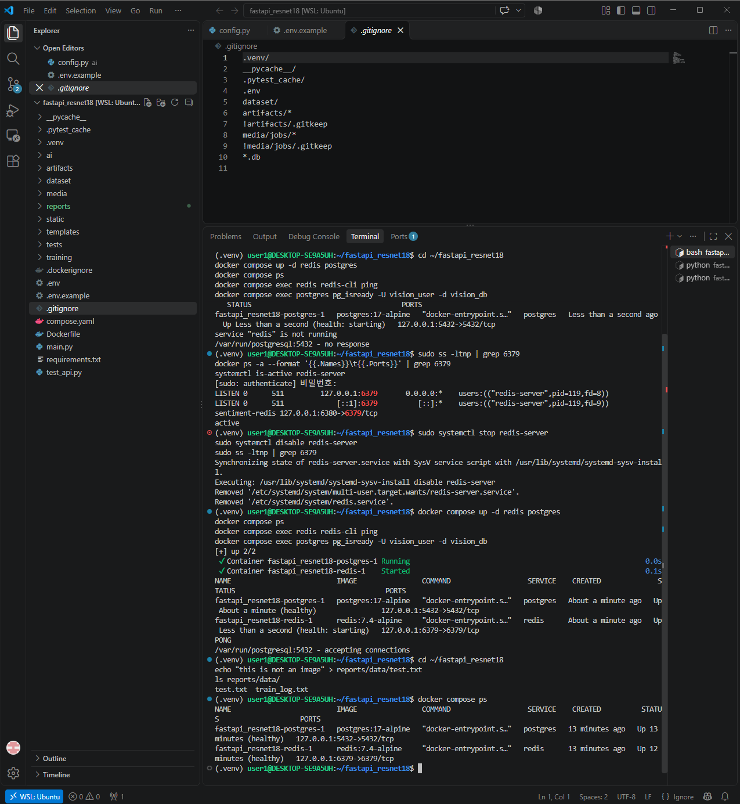

# 산출물 2. 전체 시스템 아키텍처 설계서

## 1. 구성도

## 2. 컴포넌트 역할

| 컴포넌트 | 실행 위치 | 사용 파일 / 서비스 | 역할 |
|---|---|---|---|
| 브라우저 | Windows 웹브라우저 | `templates/sync.html`, `templates/async.html`, `static/style.css` | 업로드 · 결과 표시 · 비동기 1초 간격 상태 폴링 |
| FastAPI | WSL2 `.venv`, Uvicorn 127.0.0.1:8000 | `main.py`, `ai/router_web.py`, `ai/router_sync.py`, `ai/router_async.py` | HTTP 요청·검증·응답, 기동 시 `init_db()` 로 `image_jobs` 생성 |
| 이미지 검증 | FastAPI·Worker 프로세스 | `ai/services.py` `load_rgb_image()` | 5MB · 1200만 픽셀 · JPEG/PNG/WEBP |
| ResNet18 | FastAPI 와 Worker **각 프로세스에서 별도 로드** (CPU, `device=-1`) | `ai/hf_model.py` (`lru_cache`, 첫 요청 시 1회 로드), `artifacts/beans_resnet18/` | 3클래스 분류 |
| Redis Cache | Docker `redis` **DB/1** | `ai/cache_service.py` | `vision:classify:{모델경로 해시16}:{이미지 SHA-256}` 키로 결과 600초 재사용 |
| Redis Broker | Docker `redis` **DB/2** (Result backend DB/3) | `ai/celery_app.py` | Celery 작업 메시지 전달 |
| PostgreSQL | Docker `postgres` 127.0.0.1:5432 | `ai/database.py`, `ai/models.py` | 비동기 작업 상태·결과 |
| Celery Worker | WSL2 `.venv` 별도 터미널 | `ai/tasks.py` `classify_job()` | 비동기 추론·DB 갱신 |
| 업로드 저장소 | WSL2 파일시스템 | `media/jobs/<uuid>.bin` | 비동기 이미지 원본 (DB 에는 파일명만) |

## 3. 실행 환경 (실측)

| 항목 | 값 |
|---|---|
| 운영체제 | Windows + **WSL2 Ubuntu 26.04.1 LTS** (kernel 6.18.54.1-microsoft-standard-WSL2) |
| GPU | NVIDIA GeForce RTX 3060 12GB (학습·Test 평가·분석에 사용, **서비스 추론은 CPU**) |
| CPU / RAM | 12th Gen Intel(R) Core(TM) i7-12700 / WSL 할당 메모리 15GiB (swap 4GiB) |
| Python | 3.11.18 (`uv venv --python 3.11` — Ubuntu 26.04 기본은 3.14, 오류 E-01 참고) |
| 주요 패키지 | torch 2.15.0+cu132, transformers 4.57.6, fastapi 0.162.0, uvicorn 0.54.0, sqlalchemy 2.1.8, psycopg 3.3.7, redis 6.4.0, celery 5.6.3, pillow 12.3.0 |
| Docker | Docker 29.9.2 / Compose v5.6.1 (Docker Desktop, WSL integration) |
| Docker 서비스 | `redis:7.4-alpine`, `postgres:17-alpine` — `docker compose up -d redis postgres` |
| 서버 프로세스 | `uvicorn main:app --host 127.0.0.1 --port 8000` |
| 워커 프로세스 | `celery -A ai.celery_app:celery_app worker --loglevel=info --pool=solo --concurrency=1` |
| 모델 경로 | `.env` → `MODEL_PATH=artifacts/beans_resnet18` |
| 접속 주소 | WSL 프로세스는 `ai/config.py` 기본값 `127.0.0.1:6379`, `127.0.0.1:5432` 사용 |

## 4. 실행 방식 결정

| 문서 | 실행 방식 |
|---|---|
| 02 제공 문서 | `docker compose up -d --build` 로 web·worker·redis·postgres 4개 모두 Docker |
| **평가가이드 (채택)** | **Redis·PostgreSQL 만 Docker, FastAPI·Celery 는 WSL `.venv`** |

- 채점 기준 문서인 평가가이드의 방식을 따랐다. `compose.yaml` 은 **수정하지 않고** 서비스 이름을 지정해 `redis`, `postgres` 만 기동했다.
- `compose.yaml` 의 `web`·`worker`·`trainer` 서비스는 정의만 있고 **기동하지 않았다** (`docker compose ps` 에 2개만 표시).
- 그래서 **Docker 안에 FastAPI·Celery 가 없다.**

## 5. 데이터 흐름 검증 결과

| 경로 | 흐름 | 실측 확인 |
|---|---|---|
| 동기 MISS | 브라우저 → FastAPI → Redis(MISS) → ResNet18 → Redis 저장 → 200 | angular_leaf_spot_test.30: 3,972ms (FastAPI 첫 요청, 모델 로딩 포함) |
| 동기 HIT | 브라우저 → FastAPI → Redis(HIT) → 200, `inference_ms=null` | 같은 이미지 재요청: **13ms** |
| 비동기 | 브라우저 → FastAPI → media 저장·DB queued → Broker → 202 → Worker → DB running→done → 상태조회 | job 2: 접수 20ms → done 3,071ms (Worker 첫 요청) |
| 캐시 공유 | 동기에서 저장한 캐시를 Worker 가 재사용 | job 1 (동기에서 쓴 이미지): `cache_hit=true`, Worker 처리 0.023초 |
| Redis 장애 | 동기: 캐시 폴백으로 추론 계속 / 비동기: Broker 등록 실패 503 | 산출물 7 T-14, T-15 |

- 동기 요청은 제공 코드상 `image_jobs` 에 저장하지 않는다.
- Redis Cache(DB/1)와 Broker(DB/2)는 **같은 Redis 서버의 다른 DB 번호**다. 따라서 Redis 서버 장애는 두 역할에 동시에 영향을 주지만, 코드의 대응은 다르다 (캐시는 폴백, 브로커는 503).
