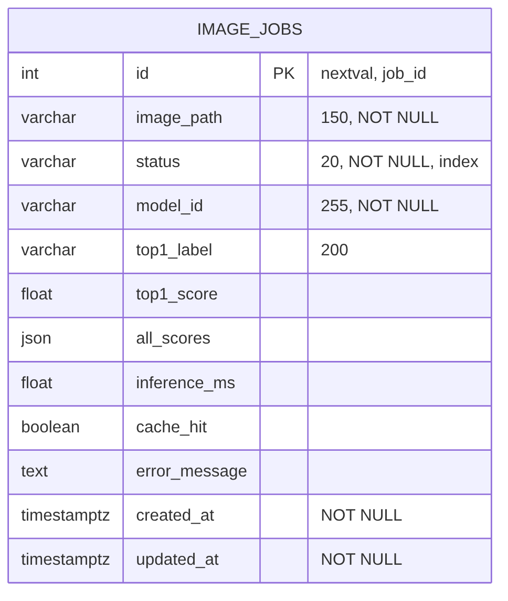
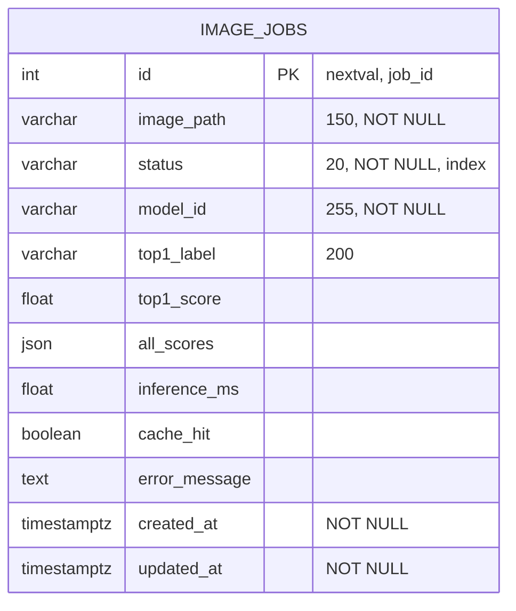
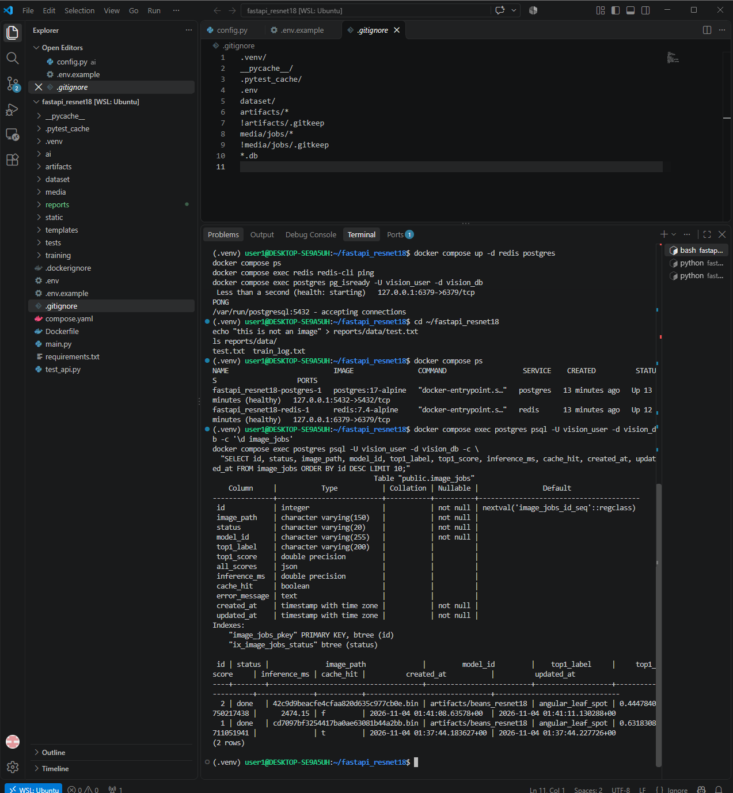
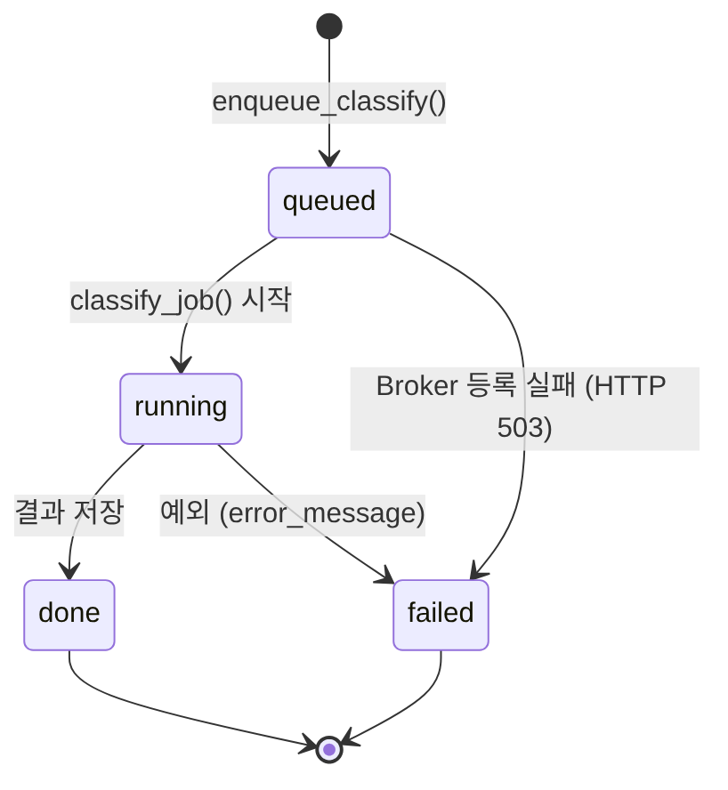
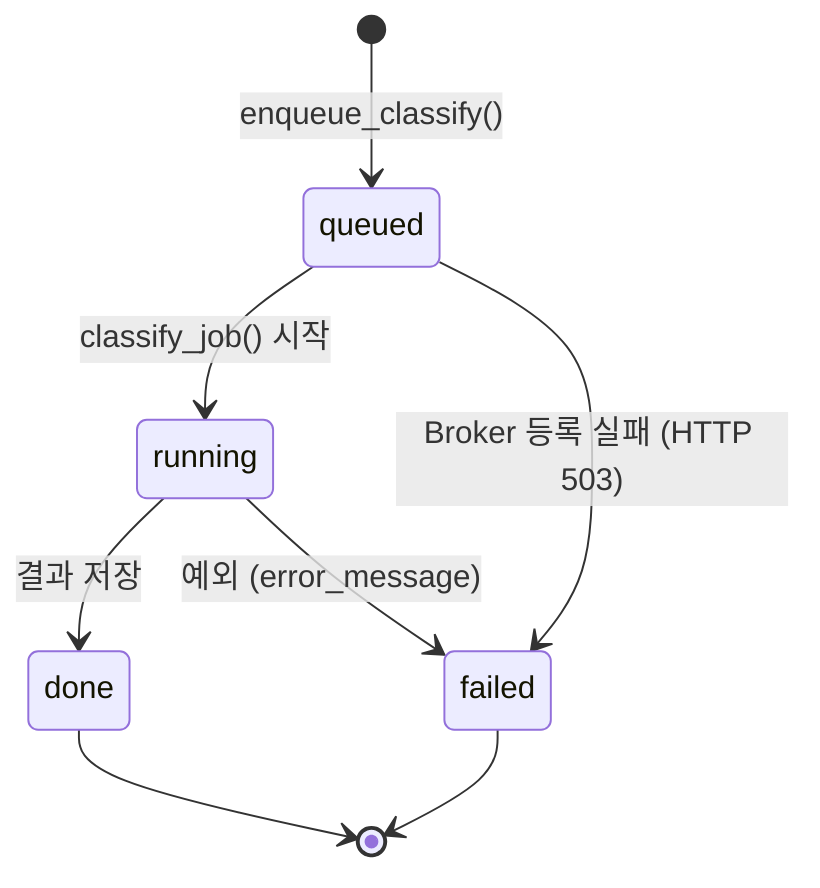
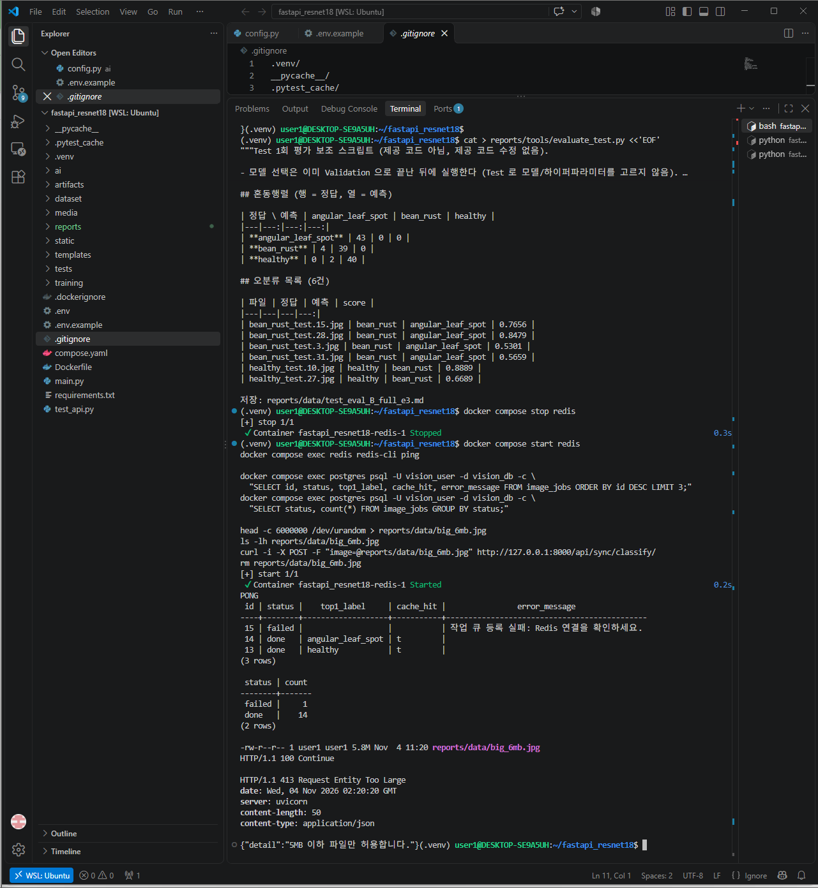

# 산출물 4. 데이터베이스 구조 및 작업이력

**DB:** PostgreSQL 17 (`postgres:17-alpine`, DB `vision_db`, 사용자 `vision_user`) · **테이블:** `image_jobs` (1개) · **PK:** `id`
**저장 대상:** 비동기 추론 작업의 상태·결과 · **생성:** FastAPI 기동 시 `init_db()` → `Base.metadata.create_all()`

## 1. ERD





단일 테이블이며 FK·관계 테이블은 없다.

## 2. 컬럼 정의 (실제 `\d image_jobs` 결과 기준)

| 컬럼 | SQLAlchemy 정의 | PostgreSQL 자료형 | Nullable | 실측 예시 | 사용 목적 |
|---|---|---|---|---|---|
| id | `Integer, primary_key` | integer, `nextval('image_jobs_id_seq')` | not null | 2 | 작업번호 = `job_id` |
| image_path | `String(150)` | character varying(150) | not null | `42c9d9beacfe4cfaa820d635c977cb0e.bin` | `media/jobs/` 안 파일명 (사용자 파일명 미사용) |
| status | `String(20), default="queued", index=True` | character varying(20) | not null | `done` | 처리 상태 |
| model_id | `String(255), default=""` | character varying(255) | not null | `artifacts/beans_resnet18` | 사용 모델 식별 |
| top1_label | `String(200)` | character varying(200) | null | `angular_leaf_spot` | 최종 라벨 |
| top1_score | `Float` | double precision | null | 0.4447840750217438 | 최고 점수 |
| all_scores | `JSON` | json | null | `[{"label":..., "score":...}, ...]` | 클래스별 점수 |
| inference_ms | `Float` | double precision | null | 2474.15 / (HIT 이면 NULL) | 모델 추론시간 |
| cache_hit | `Mapped[bool \| None]` | boolean | null | f | Redis 캐시 재사용 여부 |
| error_message | `Text` | text | null | `작업 큐 등록 실패: Redis 연결을 확인하세요.` | 실패 원인 (최대 1500자) |
| created_at | `DateTime(timezone=True), default=utcnow` | timestamp with time zone | **not null** | 2026-11-04 01:41:08.63578+00 | 접수 시각 (UTC) |
| updated_at | `DateTime(timezone=True), default/onupdate=utcnow` | timestamp with time zone | **not null** | 2026-11-04 01:41:11.130288+00 | 마지막 변경 시각 (UTC) |

**인덱스 (실측):** `"image_jobs_pkey" PRIMARY KEY, btree (id)`, `"ix_image_jobs_status" btree (status)`

**확인 사항**
- `created_at`·`updated_at` 이 NOT NULL 인 이유: `Mapped[datetime]` 을 Optional 없이 선언했기 때문.
- `\d` 의 Default 칸이 `id` 외에 비어 있는 이유: `default="queued"`, `default=utcnow` 는 **DB 서버 기본값이 아니라 SQLAlchemy(Python) 쪽에서** INSERT 시 값을 넣는 방식이다.
- 시간은 UTC 저장: `01:41` = 한국시간 10:41.



## 3. 상태 전이





| 전이 | 실측 여부 | 근거 |
|---|---|---|
| queued → running → done | ✅ (14건) | job 1~14 |
| `queued` 장시간 유지 | ✅ | job 3: Worker 정지 중 9초 이상 queued (`evidence/worker_stopped.png`) |
| queued → **failed** (Broker 실패) | ✅ (1건) | job 15: Redis 정지 상태에서 접수 → 503 + failed 기록 |
| running → failed (Worker 예외) | 실환경 미발생 | 모의 테스트 `test_worker_failure_records_failed` 로만 확인 |
| `running` 직접 관찰 | 미관찰 | 처리 시간이 짧아(0.02~2.5초) 폴링 사이에 지나감. 최종 상태·Worker 로그로 판단 |

## 4. 조회 결과

```bash
docker compose exec postgres psql -U vision_user -d vision_db -c \
  "SELECT id, status, image_path, model_id, top1_label, top1_score, inference_ms, cache_hit, created_at, updated_at FROM image_jobs ORDER BY id DESC LIMIT 10;"
```

**시연 직후 (2건)**

| id | status | image_path | top1_label | top1_score | inference_ms | cache_hit | 판정 |
|---:|---|---|---|---:|---:|---|---|
| 2 | done | 42c9d9…cb0e.bin | angular_leaf_spot | 0.4448 | 2474.15 | f | Worker 첫 추론 (모델 로딩 포함). 정답 bean_rust → 모델 오분류 |
| 1 | done | cd7097…a2bb.bin | angular_leaf_spot | 0.6318 | NULL | t | 동기에서 저장한 캐시를 Worker 가 재사용 |

**전체 테스트 후 (최근 3건)**

| id | status | top1_label | cache_hit | error_message | 판정 |
|---:|---|---|---|---|---|
| 15 | **failed** | NULL | NULL | 작업 큐 등록 실패: Redis 연결을 확인하세요. | Redis 정지 중 접수 → 503 |
| 14 | done | angular_leaf_spot | t | NULL | 성능 측정 (비동기 HIT) |
| 13 | done | healthy | t | NULL | 성능 측정 (비동기 HIT) |

**상태별 건수**
```sql
SELECT status, count(*) FROM image_jobs GROUP BY status;
```
| status | 건수 |
|---|---:|
| done | **14** |
| failed | **1** |



## 5. 저장 정책 요약

| 항목 | 내용 |
|---|---|
| 이미지 원본 | `media/jobs/<uuid>.bin` (DB 에 바이너리 미저장, `.gitignore` 로 저장소 제외) |
| 동기 요청 | DB 행 생성 안 함 (제공 코드) |
| 비동기 job 1~15 | 시연 1~3, 측정 4~14 (warm-up 포함), Redis 장애 테스트 15 |
