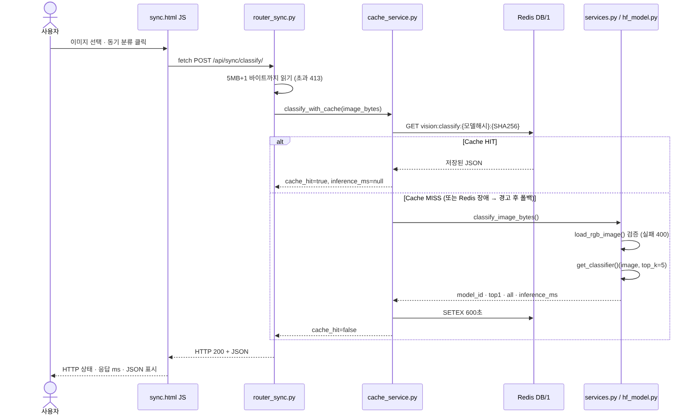
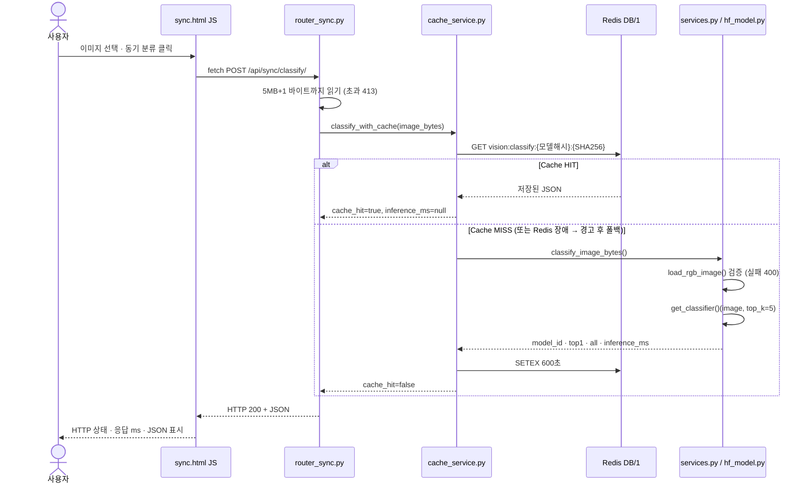
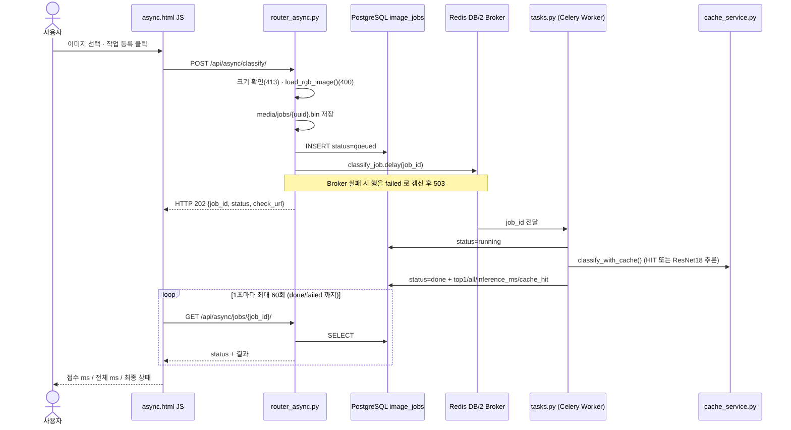
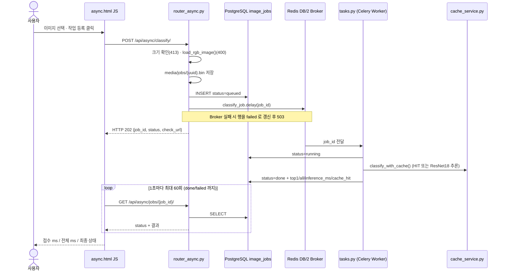

# 산출물 5. AI 분석 버튼 처리 파이프라인

## A. 동기 버튼 (`/vision/sync/` → "동기 분류")

## B. 비동기 버튼 (`/vision/async/` → "Celery 작업 등록")

## C. 실제 코드 연결표

| 단계 | 파일 | 함수·처리 | 다음 단계 |
|---|---|---|---|
| 동기 1 | `templates/sync.html` | `send.onclick` → `fetch()` | `POST /api/sync/classify/` |
| 동기 2 | `ai/router_sync.py` | `classify_sync()` — 5MB+1 읽기, 초과 413 | `classify_with_cache()` |
| 동기 3 | `ai/cache_service.py` | `cache_key()` → `get_redis().get()` | HIT 반환 / MISS → `classify_image_bytes()` |
| 동기 4 | `ai/services.py` | `load_rgb_image()` (400) → `get_classifier()(image, top_k=5)` | `top1`, `all`, `inference_ms` |
| 동기 5 | `ai/hf_model.py` | `pipeline("image-classification", model=MODEL_PATH, device=-1)` + `lru_cache` | 프로세스당 1회 로드 |
| 동기 6 | `ai/cache_service.py` | `setex(key, 600, json)` (실패 시 경고만) | 200 응답 |
| 비동기 1 | `templates/async.html` | `fetch()` POST | `POST /api/async/classify/` |
| 비동기 2 | `ai/router_async.py` | `enqueue_classify()` — 검증·파일 저장·`ImageJob(queued)` | `classify_job.delay()` → 202 (실패 503) |
| 비동기 3 | `ai/celery_app.py` | `celery_app` (broker DB/2, backend DB/3) | Worker 전달 |
| 비동기 4 | `ai/tasks.py` | `classify_job()` — running → `classify_with_cache()` → done / failed | DB 갱신 |
| 비동기 5 | `templates/async.html` | 1초 간격 `fetch(check_url)`, 최대 60회 | `GET /api/async/jobs/{id}/` |
| 비동기 6 | `ai/router_async.py` | `get_job()` | 상태·결과 JSON |

## D. 실측으로 확인한 버튼 동작

| 시나리오 | 화면 표시 | 의미 | 증빙 |
|---|---|---|---|
| 동기, 서버 첫 요청 | `HTTP 200 / 응답까지 3972ms` | 모델 로딩 포함 | `evidence/sync_miss.png` |
| 동기, 같은 이미지 | `HTTP 200 / 응답까지 13ms`, `cache_hit: true` | 추론 생략 | `evidence/sync_hit.png` |
| 동기, txt 파일 | `HTTP 400 / 응답까지 10ms` | 이미지 검증 실패 | `evidence/api_sync_400.png` |
| 비동기, 캐시 있는 이미지 | `접수 39ms / 전체 1050ms / 상태 done` | 1초 폴링 한 번에 완료 | `evidence/async_hit.png` |
| 비동기, 새 이미지 | `접수 20ms / 전체 3071ms / 상태 done` | Worker 첫 추론(2.49초) | `evidence/ui_async.png`, `evidence/celery_log.png` |
| 비동기, Worker 정지 | `접수 21ms / 전체 9135ms / 상태 queued` | 접수는 성공, 처리자 없음 | `evidence/worker_stopped.png` |
| 비동기, Worker 재시작 | `접수 21ms / 전체 41426ms / 상태 done` | 큐에 남은 작업을 재시작 4ms 후 수신 | `evidence/worker_restart_ui.png`, `evidence/worker_restart_log.png` |
| 비동기, Redis 정지 | `등록 실패 HTTP 503` | Broker 없음 | `evidence/redis_down_async_503.png` |

## E. 비교 결론
- **동기:** HTTP 응답 안에 분류 결과가 들어 있다. 사용자는 추론이 끝날 때까지 기다린다.
- **비동기:** HTTP 202 로 접수만 먼저 받고 결과는 별도 상태조회로 확인한다. Worker 가 꺼져 있어도 접수는 성공하고 작업은 큐에 남는다.
- 두 경로는 **같은 `classify_with_cache()` · 같은 체크포인트 · 같은 Redis 캐시**를 사용한다 (동기에서 처리한 이미지를 비동기로 보내면 Worker 에서 HIT).
- ResNet18 은 FastAPI 와 Worker 프로세스에 **각각** 로드되므로, 두 프로세스 모두 첫 요청에서 로딩 시간(2.5~4초)이 발생한다.
