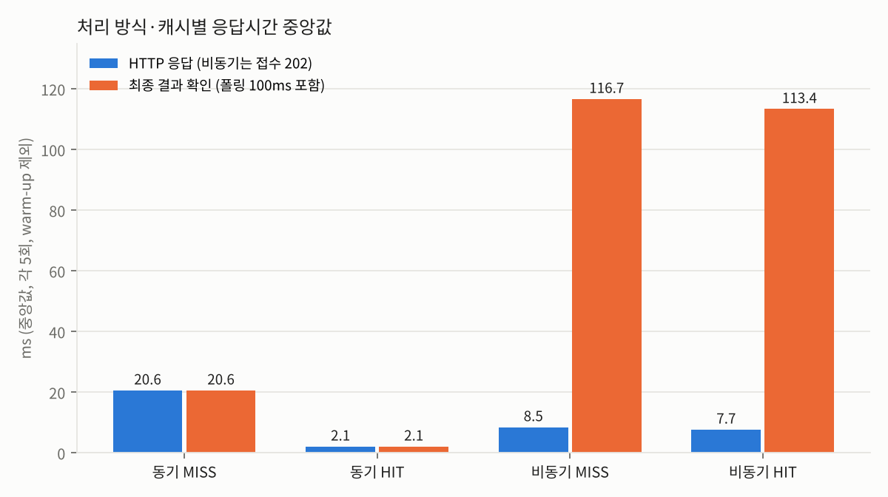

# 산출물 6. 성능 측정 및 비교 보고서

## 1. 실험 조건

| 조건 | 값 |
|---|---|
| 측정 도구 | `reports/tools/measure_timings.py` (httpx 클라이언트, 브라우저 아님. 제공 코드 미수정) |
| 측정 시각 | 2026-11-04 10:48:02 (KST) |
| 이미지 | `dataset/test` 의 서로 다른 실제 이미지, 3클래스 번갈아 선택 (`image` 열). 시연에 쓴 `test.30`·`test.31` 과 겹치지 않음 |
| 모델 | `artifacts/beans_resnet18` (FastAPI·Worker 동일 체크포인트, **CPU 추론**) |
| 실행환경 | WSL2 Ubuntu 26.04.1, Python 3.11.18, Redis·PostgreSQL Docker, FastAPI·Worker `.venv` |
| 반복 | 조건별 5회 |
| 캐시 구분 | 응답의 `cache_hit` 값으로 기록 (가정 아님) |
| Worker | Celery `solo`, `concurrency=1` |
| 워밍업 | 동기 1회·비동기 1회를 별도 기록하고 비교에서 제외 (`note=warmup`) |
| 비동기 최종시간 | POST 시작 → 상태조회에서 `done` 확인까지. **상태조회 간격 100ms 포함** |
| 측정 순서 | ① 동기 새 이미지 5장 → ② 같은 5장 재요청 → ③ 비동기 또 다른 새 이미지 5장 → ④ ①의 5장을 비동기로 |

```bash
python reports/tools/measure_timings.py --repeat 5
```

## 2. 지표 정의

| 지표 | 의미 |
|---|---|
| `http_ms` | 요청 1건의 HTTP 응답시간 (동기 = 결과 포함, 비동기 = 접수 202 만) |
| `final_ms` | 분류 결과를 손에 쥐기까지 (동기는 `http_ms` 와 동일) |
| `inference_ms` | 서버 내부 모델 추론시간 (`services.py` 측정). HIT 이면 `null` = **추론 생략** |

## 3. 원본 측정표 (ms, warm-up 제외) — `data/timings.csv`

| 반복 | 동기 MISS http | 동기 MISS 추론 | 동기 HIT http | 비동기 MISS 접수 | 비동기 MISS 최종 | 비동기 MISS 추론 | 비동기 HIT 접수 | 비동기 HIT 최종 |
|---:|---:|---:|---:|---:|---:|---:|---:|---:|
| 1 | 29.0 | 21.95 | 2.8 | 8.2 | 115.3 | 17.37 | 8.4 | 115.8 |
| 2 | 20.4 | 15.78 | 1.7 | 9.0 | 116.5 | 17.86 | 7.6 | 113.4 |
| 3 | 19.7 | 15.11 | 1.8 | 8.2 | 116.7 | 16.73 | 7.6 | 113.4 |
| 4 | 20.6 | 14.66 | 2.1 | 9.0 | 118.4 | 18.17 | 8.4 | 114.2 |
| 5 | 22.5 | 16.04 | 2.1 | 8.5 | 117.5 | 18.72 | 7.7 | 113.1 |
| **중앙값** | **20.6** | **15.78** | **2.1** | **8.5** | **116.7** | **17.86** | **7.7** | **113.4** |

warm-up (비교 제외): 동기 MISS 24.0ms (추론 18.42), 비동기 MISS 접수 10.0 / 최종 121.3ms (추론 18.17)
→ 측정 시점에는 두 프로세스 모두 시연 중 이미 모델을 로드한 상태였다.

## 4. 계산

```text
비동기 접수 HTTP 감소율 = (20.6 − 8.5) / 20.6 × 100 = 58.74 %
결과 확인 시간 차이     = 116.7 − 20.6 = 96.1 ms  (비동기가 더 느림)
동기 캐시 효과          = (20.6 − 2.1) / 20.6 × 100 = 89.81 %
동기 MISS 중 추론 외 시간 = 20.6 − 15.78 = 4.82 ms  (업로드 읽기·검증·캐시 조회·JSON 직렬화)
```

## 5. 캐시 비교표

| 경로 | 캐시 | n | HTTP 응답 중앙값 | 최종 확인 중앙값 | 추론시간 중앙값 | 메모 |
|---|---|---:|---:|---:|---:|---|
| 동기 | MISS | 5 | 20.6 | 20.6 | 15.78 | 모델 실제 추론 |
| 동기 | HIT | 5 | **2.1** | 2.1 | null | 추론 생략 |
| 비동기 | MISS | 5 | **8.5** (접수) | 116.7 | 17.86 | Worker 추론 |
| 비동기 | HIT | 5 | 7.7 (접수) | 113.4 | null | Worker 가 동기 캐시 재사용 |



## 6. 모델 최초 로딩 시간 (프로세스별 첫 요청, 시연 중 기록)

`services.py` 는 타이머 시작 **후** `get_classifier()` 를 호출하므로 첫 요청의 `inference_ms` 에 모델 로딩이 포함된다.

| 프로세스 | 첫 요청 inference_ms | 이후 추론 (중앙값) | 근거 |
|---|---:|---:|---|
| FastAPI (01 단계) | 4,082.7 | ~18 | angular_leaf_spot_test.0, `evidence/ui_sync_angular.png` |
| FastAPI (02 재기동) | 3,934 | 15.78 | angular_leaf_spot_test.30, `evidence/sync_miss.png` |
| Celery Worker | 2,474.15 | 17.86 | job 2, `evidence/ui_async.png` |
| Celery Worker (재시작) | 2,493.43 | — | job 3, `evidence/api_job_done.png` |

→ 프로세스를 재시작할 때마다 첫 사용자가 2.5~4초를 기다린다. 서버 기동 시 모델을 미리 로드(warm-up)하면 해소할 수 있다 (제안, 미구현).

## 7. 해석

1. **비동기 접수는 동기 결과 응답보다 58.74% 빨리 반환됐다.** 이는 모델 추론이 빨라진 것이 아니라 **접수와 처리를 분리한 효과**다 (추론시간은 15.78 vs 17.86ms 로 비슷).
2. **결과 확인까지는 비동기가 96.1ms 더 느렸다.** Worker 추론은 18ms 안팎이므로 실제 처리는 첫 상태조회(100ms 후) 이전에 끝났을 가능성이 높다. 즉 비동기 최종시간 ≈ **폴링 간격**이며, 이 측정의 해상도는 100ms 다. 브라우저 화면은 1초 간격이라 1,050ms 처럼 더 길게 보인다.
3. **동기 캐시 HIT 는 응답을 89.81% 줄였다** (20.6 → 2.1ms). 비동기 HIT 는 최종시간이 거의 줄지 않았는데(116.7 → 113.4), 이것도 폴링 간격이 지배하기 때문이다.
4. **`inference_ms = null` 은 추론 생략**이며 0ms 가 아니다.
5. 이 이미지 크기(500×500)·CPU 환경에서는 추론이 짧아 **단일 요청 기준으로 동기가 더 빠르다.** 비동기의 이점은 추론이 길거나 요청이 몰릴 때 HTTP 연결을 오래 붙잡지 않는 데 있으며, 동시 부하 시험은 하지 않았다 (한계).
6. 응답시간과 모델 Accuracy 는 별개 지표다. 본 보고서는 정확도 개선을 주장하지 않는다.

## 8. 비교 조건 점검
- [x] 같은 모델 체크포인트 (`artifacts/beans_resnet18`)
- [x] MISS 대 MISS, HIT 대 HIT 구분 (`cache_hit` 실측값)
- [x] 같은 하드웨어 · 같은 실행 조건 · 연속 측정
- [x] 모델 첫 로딩(warm-up) 분리 표기 (3장, 6장)
- [x] 원본 CSV 와 요약표 일치 (`data/timings.csv`, `data/timings_summary.md`, `evidence/timings_summary.png`)

## 9. 한계
- 반복 5회, 단일 사용자 순차 요청. 동시 요청·부하 시험 미실시.
- 비동기 최종시간은 100ms 폴링 해상도에 묶인다.
- 서비스 추론은 CPU (`device=-1`). GPU 서빙 비교 미실시.

## 10. 추가: 모델별 CPU 추론 비용 (부록 09 실험 모델)

`reports/tools/model_benchmark.py` · 원본 `data/model_compare.md`
서비스와 같은 조건 — CPU, 사진 1장씩, 전처리 포함, Val 30장 중 앞 3장(warm-up) 제외 중앙값. HTTP·캐시가 빠진 **모델 자체 시간**이라 3장의 `inference_ms` 와 같은 성격이다.

| 모델 | 설정 | Best Val | Test | 파라미터 | 파일 | CPU 1장 |
|---|---|---:|---:|---:|---:|---:|
| A (서비스) | Head-only 3ep | 0.7669 | 0.7188 | 11.2M | 43MB | 14.3 ms |
| B | Full FT 3ep | 0.9699 | 0.9531 | 11.2M | 43MB | 14.3 ms |
| F3 | Full FT + 라벨 스무딩 | 0.9774 | 0.9531 | 11.2M | 43MB | 14.3 ms |
| F2 | Full FT + 해상도 384 | 0.9850 | 0.9375 | 11.2M | 43MB | **33.2 ms (×2.3)** |
| (TTA hv4 적용 시) | 사진 4장 처리 | — | — | — | — | 약 ×4 (추정) |

- **학습 방식(Head-only / Full FT / 라벨 스무딩)은 추론 속도에 영향이 없다** — 같은 ResNet18 구조라 계산량이 같다. 즉 A → F3 교체는 속도 손해 없이 Test +23.4%p 다.
- **해상도 384 는 계산량이 (384/224)² ≈ 2.9배**라 실측 2.3배 느려졌고, 정확도 개선은 흔들림 폭 안이었다 → 비용만 증가.
- **TTA 는 사진 수만큼 추론이 늘어난다** (hv4 = 4배). 3차 재현 실험에서 정확도 이득이 없어 적용하지 않는다.
- 용어: **파라미터** = 모델이 학습한 숫자의 개수 (클수록 무겁다) / **CPU 1장(ms)** = 사진 한 장을 판정하는 데 걸린 시간.
