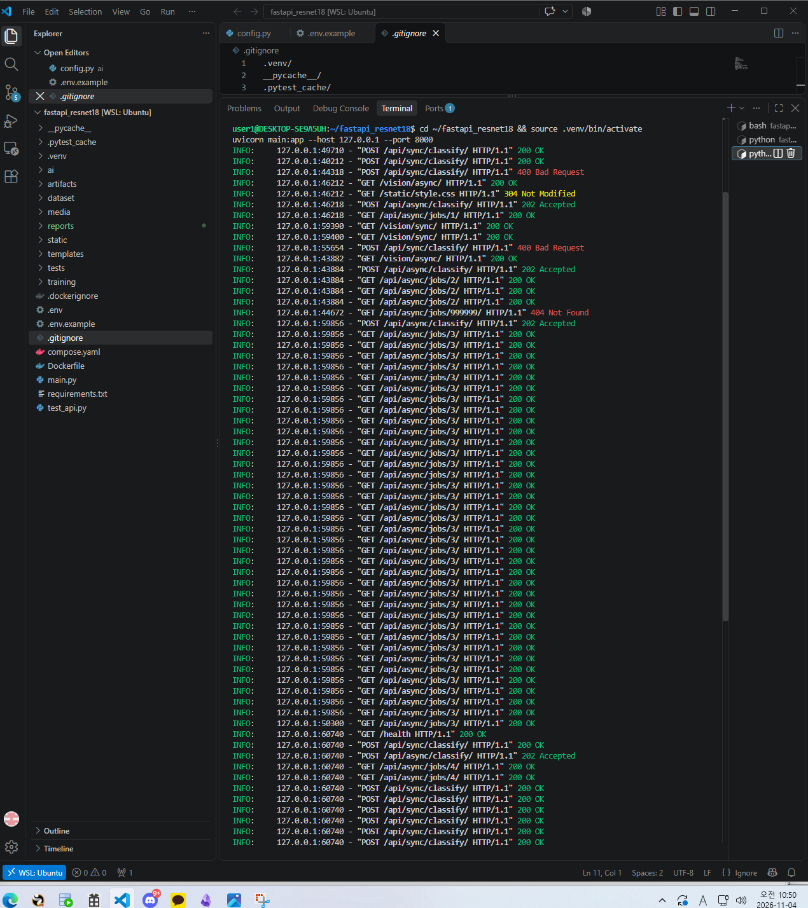
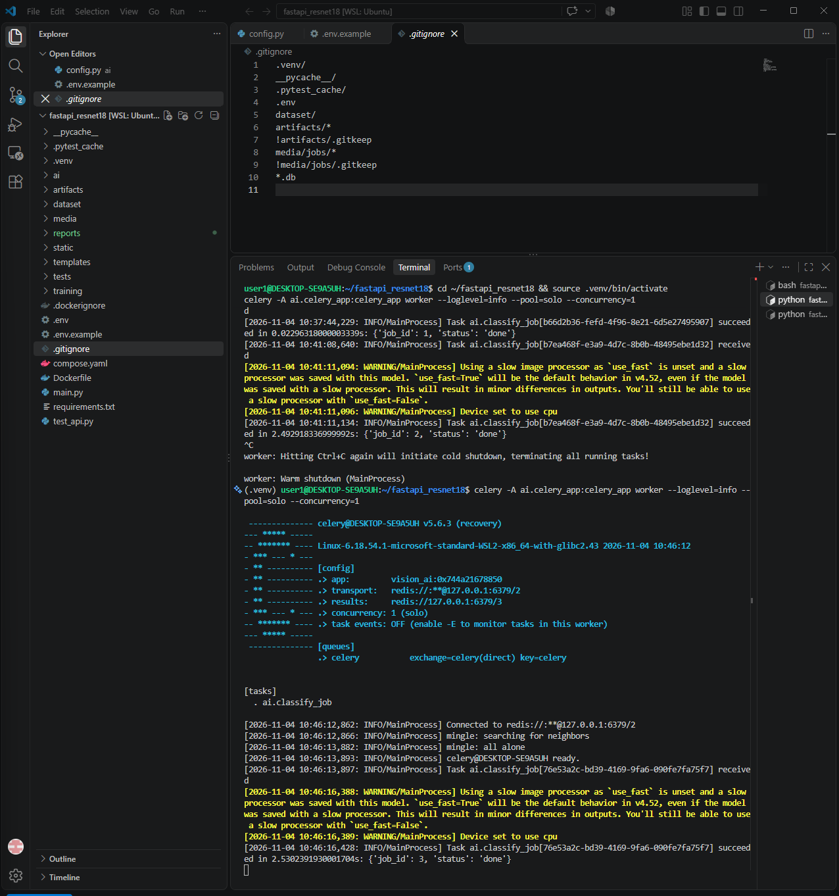
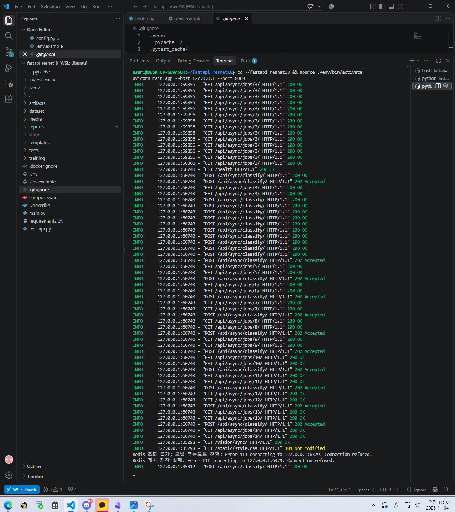

# 산출물 7. 기능 테스트 및 오류 분석 기록서

## 1. 모의 테스트 (단위·모의 — 실환경 아님)

가짜 분류기 · SQLite · 가짜 Broker 로 HTTP 동작과 상태 전이만 검증한다. **실제 모델·Redis·PostgreSQL·Celery 검증이 아니다.** 원문: `data/setup_and_test_log.md` 6장

| 단계 | 파일 | 명령 | 결과 |
|---|---|---|---|
| 01 | `test_api.py` (루트, 01 전용) | `pytest -q test_api.py` | **1 passed**, 1 warning |
| 02 | `tests/test_api.py` | `python -m pytest -q tests/test_api.py` | **4 passed**, 1 warning |

| 02 테스트 함수 | 확인 내용 | 결과 |
|---|---|---|
| `test_end_to_end` | health · 화면 2개 · CSS · 동기 200/400/413 · 비동기 202 → queued → done · 404 | PASS |
| `test_broker_failure` | Broker 연결 실패 시 503 | PASS |
| `test_cache_hit_avoids_repeated_inference` | 같은 바이트 2회 → 두 번째 HIT, 추론 1회 | PASS |
| `test_worker_failure_records_failed` | Worker 예외 시 `failed` + `error_message` | PASS |

경고 1건: `StarletteDeprecationWarning` (httpx 와 TestClient 조합에 대한 라이브러리 안내) — 결과와 무관.

## 2. 실환경 통합 테스트 (실제 ResNet18 · Redis · PostgreSQL · Celery)

| ID | 확인 항목 | 입력·절차 | 기대 | 실제 | 판정 | 증빙 |
|---|---|---|---|---|---|---|
| T-01 | Redis·PostgreSQL 기동 | `docker compose ps`, `redis-cli ping`, `pg_isready` | healthy / PONG / accepting | 둘 다 healthy, PONG, accepting connections | PASS | `docker_ps.png` |
| T-02 | FastAPI 헬스 | GET `/health` | 200 | 200 OK | PASS | `uvicorn_log_status_codes.png` |
| T-03 | 동기 추론 (01) | test 3클래스 각 1장 | 200, 3클래스 라벨 | 3장 모두 정답 | PASS | `ui_sync_*.png` |
| T-04 | 동기 캐시 MISS | angular_leaf_spot_test.30 | 200, `cache_hit=false` | 3,972ms, false | PASS | `sync_miss.png` |
| T-05 | 동기 캐시 HIT | 같은 파일 재요청 | `cache_hit=true`, `inference_ms=null` | 13ms, true, null | PASS | `sync_hit.png` |
| T-06 | 불량 입력 | `test.txt` | 400 | 400, "올바른 이미지 파일이 아닙니다." | PASS | `api_sync_400.png` |
| T-07 | 크기 초과 | 5.8MB 무작위 파일 (curl) | 413 | 413 Request Entity Too Large | PASS | `redis_recover_failed_row_413.png` |
| T-08 | 비동기 접수·완료 | bean_rust_test.30 | 202 → done | 접수 20ms, job 2 done | PASS | `ui_async.png`, `celery_log.png` |
| T-09 | Worker 캐시 공유 | 동기에서 쓴 이미지를 비동기로 | `cache_hit=true` | job 1 true, Worker 0.023초 | PASS | `async_hit.png` |
| T-10 | 없는 작업번호 | GET `/api/async/jobs/999999/` | 404 | 404 Not Found | PASS | `api_404.png`, `uvicorn_log_status_codes.png` |
| T-11 | DB 기록 | `\d image_jobs`, SELECT | 테이블·행 존재 | 12컬럼·인덱스 2개, job 1·2 done | PASS | `db_schema_rows.png` |
| T-12 | Redis 캐시 키 | `redis-cli -n 1 KEYS 'vision:classify:*'` | 키 존재 | 1개 (10:33 키는 TTL 600초로 만료, 10:41 키 잔존) | PASS | `redis_keys.png` |
| T-13 | Worker 미실행 | Worker 종료 후 healthy_test.31 접수 | 202 후 queued 유지 | 접수 21ms, 9초 이상 queued | PASS | `worker_stopped.png` |
| T-14 | Worker 재실행 | T-13 후 Worker 재시작 | 로그·상태로 판정 | ready 4ms 후 job 3 received, 2.53초 후 done (healthy 0.7499) | PASS | `worker_restart_log.png`, `worker_restart_ui.png`, `api_job_done.png` |
| T-15 | Redis 장애 – 동기 | `docker compose stop redis` 후 healthy_test.32 | 캐시 폴백으로 200 | 200 (32ms), 로그 "Redis 조회 불가; 모델 추론으로 전환: Error 111 … Connection refused" + "Redis 캐시 저장 실패" | PASS | `redis_down_sync_200.png`, `redis_down_fallback_log.png` |
| T-16 | Redis 장애 – 비동기 | 같은 상태에서 비동기 접수 | 503 + failed 기록 | 503, job 15 `failed`, error_message 기록 | PASS | `redis_down_async_503.png`, `redis_recover_failed_row_413.png` |
| T-17 | Redis 복구 | `docker compose start redis` | PONG | PONG, 이후 정상 | PASS | `redis_recover_failed_row_413.png` |
| T-18 | 상태코드 일괄 | uvicorn 접근 로그 | 200/202/400/404/304 | 모두 관찰 | PASS | `uvicorn_log_status_codes.png`, `uvicorn_log.png` |

판정 18 / 18 PASS. (T-14 는 "재시작하면 항상 처리된다"가 아니라 **이번 실험에서 처리됐음**을 기록한 것)

## 3. 오류 이력 (실제 발생)

| 오류 ID | 현상 | 원인 확인 | 조치 | 재검증 | 결과 |
|---|---|---|---|---|---|
| **E-01** | `python3.11: command not found` | WSL Ubuntu 가 26.04 LTS 로, 기본 Python 이 3.14 이며 3.11 미설치 | 문서·Dockerfile 이 3.11 기준이고 torch 호환을 위해 3.14 대신 **uv 로 Python 3.11.18 별도 설치** (`uv venv --python 3.11 --seed .venv`) | `python --version` | 3.11.18, 이후 설치·학습 정상 |
| **E-02** | WSL 에서 `docker: command not found` | Docker Desktop WSL integration 은 켜져 있으나 WSL 세션이 설정을 다시 읽지 않음 (`wsl -l -v` 로 기본 배포판 Ubuntu 확인) | `wsl.exe --shutdown` 후 재접속 | `docker --version`, `docker ps` | Docker 29.9.2 / Compose v5.6.1 정상 |
| **E-03** | `ports are not available: exposing port TCP 127.0.0.1:6379` (redis 컨테이너 기동 실패) | `ss -ltnp` → WSL 에 직접 설치된 **redis-server(pid 119)** 가 systemd 서비스로 6379 점유 | `compose.yaml` 포트는 바꾸지 않고(제공 코드 유지) `systemctl stop/disable redis-server` | `docker compose up -d redis postgres`, `redis-cli ping` | PONG, healthy |

원문: `data/setup_and_test_log.md` 2·4·5장, 캡처 `evidence/E01_redis_port_conflict.png`

**오류가 아닌 관찰 (모델 성능 한계)**

| 현상 | 판단 |
|---|---|
| bean_rust_test.30 → angular_leaf_spot (0.4448, 2위 bean_rust 0.4051) | API·DB 는 정상. Head-only 모델(Test 0.7188)의 오분류. Test 평가에서 동일 예측 0.4447 로 재확인 → 산출물 1·8 |
| 측정 중 bean_rust_test.10 → angular, healthy_test.10 → bean_rust | 위와 동일 |

**미발생**
- Worker 내부 예외로 인한 `running → failed`: 실환경 미발생 (모의 테스트로만 확인)
- 422 검증 오류: 미실시

## 4. 테스트 구분
- 1장(모의)과 2장(실환경)을 같은 PASS 로 합치지 않는다.
- 모델 분류 정확도는 모의 테스트로 검증되지 않으며 산출물 1 의 Validation/Test 평가로 따로 확인했다.

## 5. 주요 증빙

