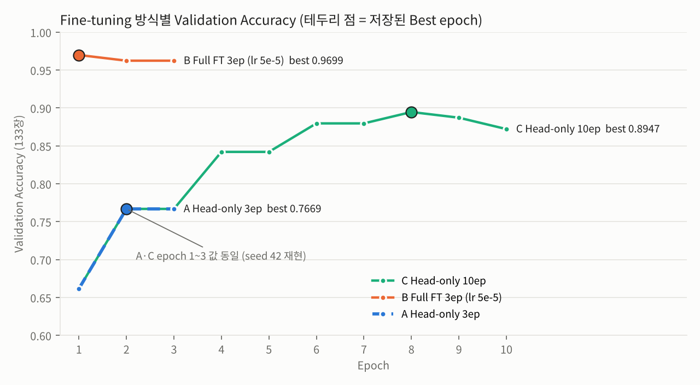
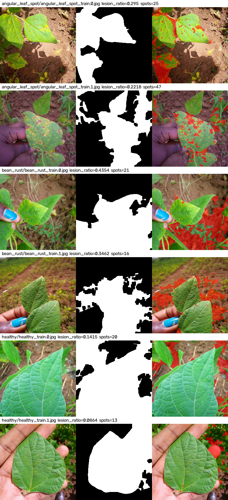
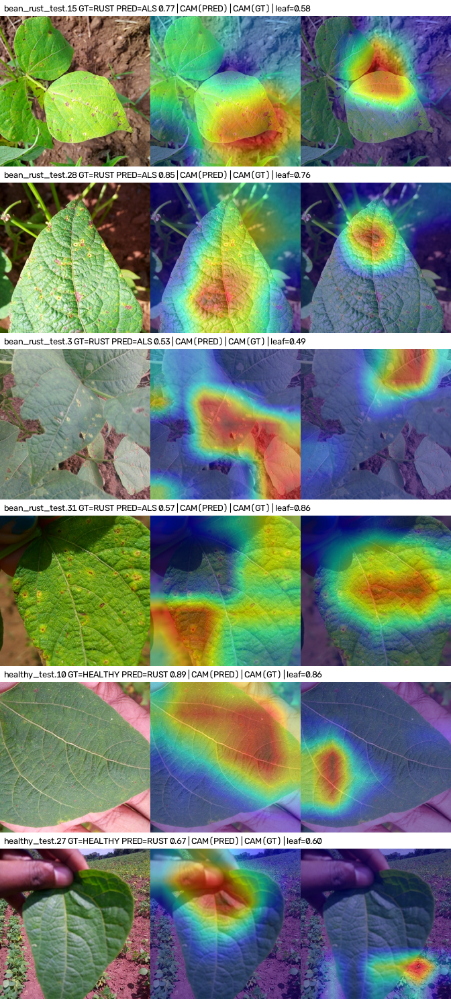
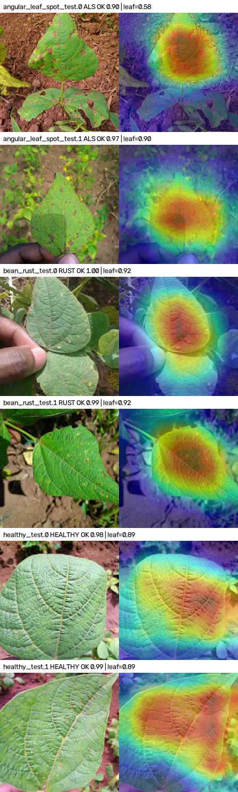
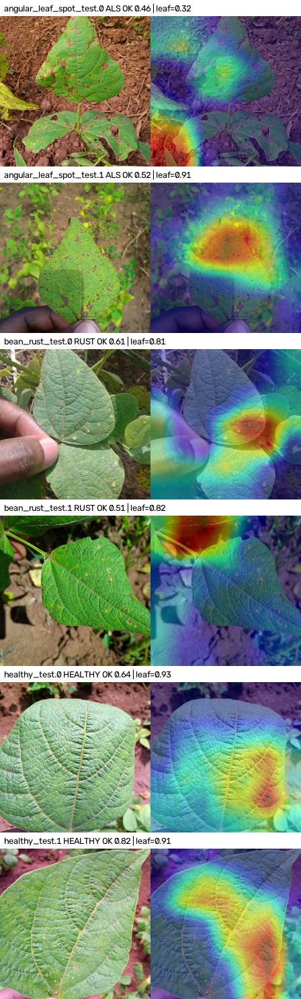

# 산출물 8. 콩잎 질병 분류 Vision AI API 서비스 — 최종 기술보고서

작성자: 김지후 · 작성일: 2026-11-04 · 저장소: `Jihoo2/Test_resnet18`

## 1. 프로젝트 정보

| 항목 | 내용 |
|---|---|
| 과제 | ResNet18 Fine-tuning 기반 Beans 3클래스 분류 및 FastAPI 동기·비동기 서빙 |
| 입력 | JPG / PNG / WEBP, 5MB · 1,200만 픽셀 이하 |
| 출력 | `angular_leaf_spot`(각진잎반점병) / `bean_rust`(녹병) / `healthy`(정상) |
| 모델 | `microsoft/resnet-18` → `artifacts/beans_resnet18` (Head-only Fine-tuning, 서비스 연결) |
| 실행 구조 | FastAPI · Celery Worker (WSL2 `.venv`) + Redis · PostgreSQL (Docker Compose) — 평가가이드 방식 |
| 코드 | 01·02 제공 코드 그대로 사용 (수정 없음). 측정·분석 보조 스크립트만 `reports/tools/` 에 추가 |

## 2. 모델 학습 결과 요약

| 항목 | 결과 |
|---|---|
| 데이터 | Train 1,034 / Validation 133 / Test 128 (3클래스 균형), **Split 간 중복 0건** |
| 필수 학습 | Head-only (Backbone freeze), 3 epoch, batch 8, lr 0.0002, seed 42 |
| **Best Validation Accuracy** | **0.7669** (102/133, Epoch 2 가중치 저장) |
| Test Accuracy (별도 1회 측정) | 0.7188 (92/128), Macro F1 0.7109 |
| 모델 파일 | `artifacts/beans_resnet18/` config.json · model.safetensors(43M) · preprocessor_config.json · training_report.json |

- 근거: [산출물 1](01_FineTuning_결과보고서.md) · `artifacts/beans_resnet18/training_report.json`

## 3. 아키텍처 및 데이터 흐름
- 동기: Browser → FastAPI → Redis Cache(DB/1) → (MISS) ResNet18 → JSON 200
- 비동기: Browser → FastAPI → media 저장 · DB queued → Redis Broker(DB/2) → 202 → Celery Worker → Cache/ResNet18 → DB done → 상태조회
- ResNet18 은 FastAPI·Worker 프로세스에 각각 로드(CPU). Docker 에는 Redis·PostgreSQL 만 있다.
- 근거: [산출물 2](02_시스템_아키텍처.md)

## 4. API · DB 설계
- API: `/health`, `POST /api/sync/classify/`(200/400/413), `POST /api/async/classify/`(202/400/413/503), `GET /api/async/jobs/{id}/`(200/404)
- DB: PostgreSQL `image_jobs` 단일 테이블 12컬럼, 비동기만 기록. 최종 **done 14 / failed 1**
- 근거: [산출물 3](03_API_명세서.md) · [산출물 4](04_DB_구조_작업이력.md)

## 5. 버튼 처리 검증
- 동기: angular_leaf_spot_test.30 → angular_leaf_spot 0.6318, HTTP 200 (MISS 3,972ms → HIT 13ms)
- 비동기: job 2 접수 202 (20ms) → done (3,071ms). Worker 정지 시 queued 유지 → 재시작 후 처리 확인
- 근거: [산출물 5](05_AI버튼_처리흐름.md)

## 6. 성능 비교 (warm-up 제외 중앙값, 각 5회)

| 항목 | 값 |
|---|---:|
| 동기 MISS HTTP (= 결과) | 20.6 ms (추론 15.78) |
| 동기 HIT HTTP | 2.1 ms |
| 비동기 MISS 접수 HTTP | 8.5 ms |
| 비동기 MISS 최종 확인 (폴링 100ms 포함) | 116.7 ms |
| 프로세스 첫 요청 (모델 로딩 포함) | FastAPI 3,934 ms / Worker 2,474 ms |

- 비동기 접수 **−58.74%** (접수·처리 분리 효과, 추론 가속 아님) / 결과 확인은 **+96.1ms** (폴링 간격 지배)
- 동기 캐시 HIT **−89.81%**
- 근거: [산출물 6](06_성능비교_보고서.md) · `data/timings.csv`

## 7. 기능 테스트 · 오류 조치
- 모의 테스트: 01 **1 passed**, 02 **4 passed**
- 실환경 통합 테스트 **18/18 PASS**: 400 · 404 · 413 · 캐시 HIT/MISS · Worker 정지/재시작 · Redis 장애(동기 폴백 200 / 비동기 503 + failed 기록)
- 실제 오류 3건 조치: E-01 Python 3.11 미설치(uv 로 설치), E-02 Docker WSL 연동(`wsl --shutdown`), E-03 Redis 6379 포트 충돌(WSL redis-server 중지)
- 근거: [산출물 7](07_기능테스트_오류분석.md)

---

## 8. 성능 향상 검토 (평가가이드 6장) — 구현·측정과 미구현 제안을 분리

### 8-1. 실행·측정한 실험 (실제 결과)

| 실험 | 구현 | 데이터·조건 | Validation | Test (1회) | 결론 |
|---|---|---|---:|---:|---|
| E0: A Head-only 3ep | 실행 | 고정 Val 133장 | 0.7669 | 0.7188 | 기준선 (서비스 모델) |
| E1: C Head-only 10ep | 실행 | 동일, **epoch 만 변경** | 0.8947 | 0.8828 | **+12.78%p** → A 는 학습 부족 |
| E2: B Full Fine-tuning | 실행 | 동일, 백본 학습 + lr 5e-5 | **0.9699** | **0.9531** | A 대비 **+20.30%p**, C 대비 +7.52%p |
| E3: HSV 병반 규칙 (OpenCV) | 실행 (분석) | Train 으로 임계값, Val 확인 | 0.7143 (정상 vs 질병 2분류) | 미사용 | 단독 판정에 부적합 (아래) |
| E4: Grad-CAM | 실행 (분석) | Test 결과 설명용 | — | — | 오류 원인 분석 도구, 정확도 개선 없음 |

`0.7669 → 0.9699` 는 **20.30%p** 상승이다 (20.30% 가 아님). 모델 선택은 Validation 으로만 했고 Test 는 선택 후 1회 측정했다.

### 8-2. 교과 9 OpenCV 분석 — HSV 병반 특징 (E3)

`reports/tools/hsv_lesion_analysis.py` · 원문 `data/hsv_analysis.md` · 서비스 코드 미변경

처리: RGB→HSV → 잎 마스크(H 20~90, S≥40, V≥40 → Closing 7×7 → 최대 Contour 채움) → 잎 안의 '건강한 녹색'(H 35~90, S≥60)이 아닌 픽셀을 병반 후보 → Opening 3×3 → 면적비·Contour 수

| Validation 중앙값 | lesion_ratio | spot_count | leaf_coverage | 잎 평균 S |
|---|---:|---:|---:|---:|
| angular_leaf_spot (44) | 0.318 | 27.5 | 0.686 | 154 |
| bean_rust (45) | 0.319 | 25 | 0.547 | 120 |
| healthy (44) | 0.157 | 28.5 | 0.810 | 132 |

| 규칙 `lesion_ratio > 0.1431 → 질병` (Train 에서 결정) | 정확도 | FP (정상→질병) | FN (질병→정상) |
|---|---:|---:|---:|
| Train (1,034) | 0.7031 | 206 | 101 |
| **Validation (133)** | **0.7143** | 25 / 44 | 13 / 89 |
| 참고: 항상 "질병" 판정 | 0.6692 (89/133) | 44 | 0 |

**결과**
1. 규칙 단독은 "항상 질병"보다 **4.5%p** 높을 뿐이며, 정상 잎 44장 중 25장을 질병으로 판정했다.
2. 두 질병의 면적비가 같다 (0.318 vs 0.319) → **병명 구분 근거가 되지 못한다.** ResNet 이 가장 많이 혼동한 쌍(rust↔angular)과 일치.
3. 마스크 예시를 보면 원인이 분명하다: 잎이 여러 장이고 풀·그림자·흙이 섞인 밭 사진에서 "가장 큰 녹색 덩어리 = 잎" 가정이 깨져 **배경이 잎·병반으로 계산**된다 (bean_rust_train.0 은 손에 든 잎이 아닌 뒤 배경을 잡음). 손에 든 단일 잎(healthy_train.1)만 깔끔하다.
4. **클래스별 leaf_coverage 차이 (정상 0.81 > ALS 0.69 > RUST 0.55)** 는 병의 특징이 아니라 촬영 구도 차이일 가능성 → CNN 이 구도로 학습하는 지름길 학습(shortcut learning) 위험 신호.

### 8-3. Grad-CAM 오분류 분석 (E4)

`reports/tools/gradcam_analysis.py` · 대상 층 `resnet.encoder.stages[-1]` (512×7×7) · 원문 `data/gradcam_{B_full_e3,A_head_e3}.md`
**히트맵은 설명·오류 분석 도구이며 정확도를 올리지 않는다.** Test 결과를 설명만 하고 모델 선택에 쓰지 않았다.

`cam_on_leaf` = 히트맵 에너지 중 HSV 잎 마스크 안 비율 (1 에 가까울수록 잎을 보고 판단)

| 모델 | 정분류 평균 (n) | 오분류 평균 (n) | 0.5 미만 (배경 주목) |
|---|---:|---:|---|
| B Full FT | **0.842** (122) | 0.693 (6) | 정 2 / 오 1 |
| A Head-only | 0.811 (92) | 0.722 (36) | 정 7 / 오 5 |

**관찰**
1. 두 모델 모두 **맞힌 경우가 잎을 더 많이 본다.** 틀린 경우는 흙·손 등 배경 비중이 크다.
2. **같은 이미지 angular_leaf_spot_test.0:** A 는 왼쪽 아래 **흙**에 주목(leaf 0.32, 정답이지만 확신도 0.46), B 는 **잎의 반점**에 주목(확신도 0.90). → Full FT 로 백본이 적응하며 주목 영역이 배경 → 병반으로 이동한 것이 정확도 상승의 시각적 근거.
3. **B 의 오분류:** healthy_test.27 → rust 는 예측 근거 히트맵이 **엄지손가락**에 있음 (지름길 의심 사례). bean_rust_test.31 은 잎 밖 왼쪽 아래에 주목. bean_rust_test.28 은 예측(angular)·정답(rust) 근거 위치가 달라 두 병의 반점 유사성을 보여줌.
4. **A 의 극단 사례:** healthy_test.40 (0.078), angular_test.20 (0.22), bean_rust_test.6 (0.26) — 거의 배경만 보고 판단.
5. 한계: B 오분류는 6건으로 표본이 작고, 잎 마스크가 8-2 의 HSV 경험 규칙(배경 혼입 확인됨)이라 수치는 근사치. **경향 관찰이며 원인 확정이 아니다.**

| B Full FT 오분류 (원본 · 예측 근거 · 정답 근거) | A vs B 정분류 비교 |
|---|---|
|  |   |

### 8-4. 개선 제안 — 미구현 (측정 결과로 우선순위 재조정)

| 순위 | 제안 | 근거 (본 프로젝트 측정) | 검증 계획 | 상태 |
|---|---|---|---|---|
| 1 | **서비스 모델을 Full FT 로 교체 + 기동 시 모델 warm-up** | Test 0.7188 → 0.9531 / 첫 요청 2.5~4초 | 평가 범위 밖이라 경로 `beans_resnet18` 유지. 별도 브랜치에서 교체 후 동일 측정 반복 | 미구현 |
| 2 | **잎 ROI 분리 후 학습 (배경 억제)** | Grad-CAM 오분류의 배경 주목, 클래스별 구도 차이 | HSV 규칙은 밭 사진에서 실패 → 분할 모델(예: SAM·U-Net)로 잎 마스크, 같은 Val 로 원본 입력과 비교 | 미구현 |
| 3 | **데이터 증강** (RandomResizedCrop·Flip·Rotation, 색 변형 약하게) | 구도 지름길 완화, B 의 ep1 이후 과적합 | Train 에만 적용, 같은 Val 비교. `finetune.py` 원본 유지 원칙상 별도 학습 코드 필요 | 미구현 |
| 4 | **"확인 필요" 플래그** (CNN top1 score < 기준) | 오분류 score 가 낮은 경향 (A 오분류 대부분 0.37~0.62) | Val 로 기준 설정 → 보류율·오답률 함께 기록. 3클래스 예측은 유지 | 미구현 |
| ↓ | HSV 면적비 규칙 판정 | 단독 0.7143, 질병 간 차이 없음 | 단독 판정 비권장, 2번 마스크가 생기면 보조 특징으로 재검토 | 하향 |
| ↓ | CNN + HSV 특징 → RandomForest 융합 | 질병 간 면적비 동일 → 추가 정보 적음 | Train 교차검증으로 학습, Val 비교 | 하향 |

**성능 개선 실측 주장:** E1·E2 (학습 설정 변경) 만 실측. 8-4 의 제안은 모두 미구현이며 개선 수치를 주장하지 않는다.

## 9. 최종 판정 및 한계

| 필수 항목 | 결과 |
|---|---|
| 3클래스 데이터 구조 확인 | ✅ 1,034 / 133 / 128, 누출 0건 |
| Head-only 학습 · 모델 저장 · 동기 API | ✅ Best Val 0.7669, 3클래스 응답 |
| Redis · PostgreSQL · Celery 비동기 접수·상태조회 | ✅ 202 → done, job 1~15 |
| 캐시 HIT/MISS · DB 작업 기록 · 응답시간 비교 | ✅ 5회 반복, CSV 원본 |
| 8개 산출물 + README | ✅ |
| 선택: Full Fine-tuning 비교 | ✅ Val 0.9699 / Test 0.9531 |
| 선택: OpenCV·Grad-CAM | ✅ 분석 실행 (개선 주장 없음) |

**한계**
- 서비스 모델(A)은 학습 부족으로 Test 0.7188 — 평가가이드의 경로 통일 규칙에 따라 유지
- 단일 출처 데이터(우간다 밭, 자연광), 유사 사진 누출 미점검, 촬영 구도 편향 가능성
- 응답시간은 단일 사용자 순차 5회, 동시 부하 미시험. 비동기 최종시간은 100ms 폴링 해상도
- Worker concurrency=1, 모델이 두 프로세스에 중복 로드

**추후 과제:** 8-4 의 1→2→3 순으로 같은 Validation 조건에서 실험하고, 확정된 모델을 Test 에서 1회 확인한다.
