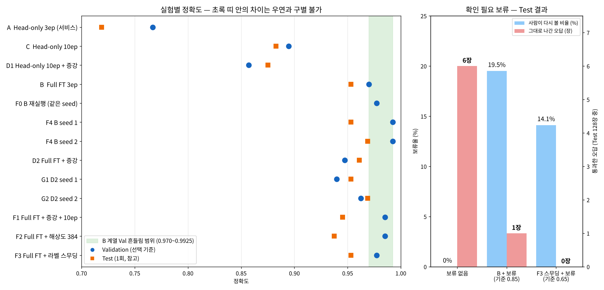
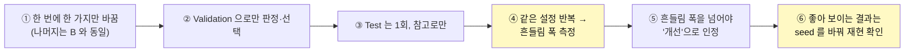

# 부록 09. 추가 성능 향상 실험 보고서 (1~3차)

작성자: 김지후 · 작성일: 2026-11-04 · 관련: [산출물 1](01_FineTuning_결과보고서.md) 6장, [산출물 8](08_최종기술보고서.md) 8장

> 산출물 1~8 의 필수 결과(서비스 모델 A)는 그대로 두고, **"더 좋게 만들 수 있는가"** 를 확인하려고 추가로 한 실험을 모았다.
> 결론부터: 정확도는 **Full Fine-tuning(0.97)** 이 한계였고, 그 위로는 반복 측정한 흔들림 폭을 넘지 못했다. 대신 **라벨 스무딩 + 확인 필요 보류**로 **Test 오답 0건 (보류 14%)** 을 만들었다.



---

## 0. 용어 풀이 — 이 문서에 나오는 영어

| 용어 | 뜻 | 이 실험에서 하는 역할 |
|---|---|---|
| **Validation (Val)** | 학습 중 성능을 확인하는 데이터 133장 | **모델·방법을 고르는 유일한 기준**. 모의고사 |
| **Test** | 끝까지 아껴 둔 데이터 128장 | 고른 뒤 **1회만** 확인하는 참고값. 수능. 이걸로 고르지 않는다 |
| **Full Fine-tuning (Full FT)** | 백본(특징 뽑는 '눈')까지 전부 다시 학습 | 정확도를 가장 크게 올린 방법 (0.77 → 0.97) |
| **Head-only** | 백본은 고정, 마지막 판단 층(헤드)만 학습 | 필수 학습 방식 = 서비스 모델 A |
| **epoch (에폭)** | 학습 데이터 전체를 한 바퀴 보는 것 | 3 → 10 으로 늘려 '덜 배웠는지' 확인 |
| **Augmentation (증강)** | 학습 사진을 무작위로 자르고·뒤집고·돌려서 매번 조금씩 다르게 보여줌 | 배경·구도에 덜 의존하게 만들려는 시도 |
| **Resolution (해상도) 384** | 모델에 넣는 사진 크기를 224×224 → 384×384 로 | 작은 녹병 돌기를 크게 보여주려는 시도 |
| **Label smoothing (라벨 스무딩)** | 정답을 '100% 이것'이 아니라 '90% 이것'으로 가르침 | 모델이 **과하게 확신하며 틀리는 것**을 줄임 |
| **seed (시드)** | 무작위 계산의 시작 번호 | 바꿔서 여러 번 돌리면 **결과가 얼마나 흔들리는지** 알 수 있음 |
| **흔들림 폭 (variance)** | 같은 설정을 반복했을 때 결과가 달라지는 범위 | 이 폭 안의 차이는 **우연**으로 판정 |
| **비결정성 (non-determinism)** | 같은 seed 라도 GPU 계산 순서 차이로 결과가 미세하게 달라지는 현상 | Full FT 가 매번 똑같이 재현되지 않는 이유 |
| **TTA (Test-Time Augmentation)** | 예측할 때 원본·좌우반전·상하반전 사진을 모두 넣고 확률을 평균 | 재학습 없이 정확도를 올리려는 시도. **결과적으로 실패** |
| **hv4 / h2 / none** | TTA 방식: 4장(원본+좌우+상하+좌우상하) / 2장(원본+좌우) / 1장(원본만) | — |
| **확인 필요 보류 (review flag)** | 모델 점수(확신도)가 기준 t 보다 낮으면 자동 판정하지 않고 사람에게 넘김 | 오답이 그대로 나가는 것을 막음 |
| **보류율** | 사람에게 넘긴 비율 | 낮을수록 사람 일이 적음 |
| **수용 정확도** | 보류하지 않고 자동 판정한 것 중 맞은 비율 | 높을수록 자동 판정을 믿을 수 있음 |
| **통과한 오답** | 보류되지 않고 그대로 나간 오답 ÷ 전체 | 0 에 가까울수록 좋음 |
| **융합 (fusion)** | CNN 점수 + HSV 색 특징을 함께 넣어 두 번째 분류기로 다시 판정 | CNN 이 놓친 색 정보를 보태려는 시도 |
| **LR / RF** | Logistic Regression(선형 분류기) / Random Forest(결정 트리 여러 개의 다수결) | 융합에 쓴 두 번째 분류기 |
| **5겹 교차검증 (5-fold CV)** | 데이터를 5조각으로 나눠 4조각으로 학습, 1조각으로 평가를 5번 반복 | 데이터가 적을 때 공정하게 평가 |
| **%p (퍼센트포인트)** | 퍼센트끼리 뺀 차이 | 0.95 → 0.97 은 2%p 상승 |
| **CPU 1장(ms)** | 서비스와 같은 CPU 에서 사진 1장 처리 시간 (밀리초) | 정확도와 맞바꾸는 비용 |

---

## 1. 실험 원칙



| 원칙 | 지킨 방법 |
|---|---|
| 제공 코드 보존 | `training/finetune.py` 는 그대로. 실험용은 복사본 `finetune_aug.py`, `finetune_plus.py` (옵션을 안 주면 원본과 같은 동작) |
| 같은 조건 | 같은 데이터 분할, 같은 Val 133장, AdamW, batch 8, Full FT 는 lr 0.00005 / 3 epoch (B 와 동일) |
| 결과 덮어쓰기 금지 | 모든 모델을 별도 폴더에 저장. 서비스 모델 `artifacts/beans_resnet18`(A) 은 그대로 |
| 사전 고정 | 보류 기준 선택 규칙, 융합 모델 선택 규칙, TTA 선택 규칙을 실행 전에 코드에 고정 |

---

## 2. 기준선 다시 보기

| 실험 | 설정 | Best Val | Test |
|---|---|---:|---:|
| A (서비스 모델) | Head-only 3ep | 0.7669 | 0.7188 |
| C | Head-only 10ep | 0.8947 | 0.8828 |
| **B** | **Full FT 3ep, lr 5e-5** | **0.9699** | **0.9531** |

---

## 3. 1차 — 데이터 증강 · 확인 필요 보류 · CNN+ML 융합

### 3-1. 데이터 증강 (D1, D2)

증강 내용 (Train 에만): 무작위 자르기(60~100%), 좌우·상하 뒤집기, ±20° 회전, 약한 밝기·대비·채도 변화. **색상(Hue)은 병반 색이 단서라 바꾸지 않음.**

| 실험 | 비교 대상 | 바뀐 것 | Best Val | Test | 판정 |
|---|---|---|---:|---:|---|
| D1 | C (0.8947) | 증강 | 0.8571 | 0.8750 | 하락 — 헤드만 학습해서는 다양해진 사진을 소화 못 함 |
| D2 | B (0.9699) | 증강 | 0.9474 | 0.9609 | Val 하락. 학습 곡선이 0.917 → 0.925 → 0.947 로 **아직 오르는 중** → 2차 F1 의 근거 |

### 3-2. 확인 필요 보류 (가이드 6-3 C · CNN + 규칙)

규칙: top1 점수 < t 이면 보류. t 는 **Val 에서 보류율 20% 이하 중 수용 정확도 최대**로 선택.

| 모델 | t | Val 보류율 / 수용 정확도 | Test 보류율 / 수용 정확도 / 통과한 오답 |
|---|---:|---|---|
| A (서비스) | 0.35 | 0.8% / 0.7727 | 0% / 0.7188 / 28.1% |
| B | 0.85 | 15.8% / 1.0000 | 19.5% / **0.9903** / **0.8% (1장)** |

- A 는 효과 없음: 맞힌 사진도 점수가 낮아서, 보류율 20% 안에서는 오답만 골라낼 수 없음
- B 는 효과 큼: 오답 6장 중 5장을 보류로 걸러냄 → "보류 규칙은 **모델이 충분히 좋을 때만** 효과가 있다"

### 3-3. CNN + ML 융합 (가이드 6-3 D)

특징: CNN 3클래스 확률 + HSV 6개(잎 면적, 병반 면적비, 반점 수, 평균 H·S·V). Val 5겹 교차검증으로 LR·RF 중 선택 → Test 1회.

| 모델 | CNN 단독 Val / Test | HSV 단독 Val | 융합 (선택) Val / Test | 판정 |
|---|---|---:|---|---|
| A | 0.7669 / 0.7188 | 0.6541 | RF 0.7895 / **0.7812** | **+6.25%p** — 약한 모델을 색 정보가 보완 |
| B | 0.9699 / 0.9531 | 0.6541 | LR 0.9624 / 0.9375 | −1.56%p — 강한 모델에는 방해 |

한계: Train 은 CNN 이 학습한 사진이라 융합 학습에 쓸 수 없어 Val 안에서 교차검증했다. Val 은 CNN 모델 선택에도 쓰였다.

---

## 4. 2차 — 상승 가능성이 높은 것만, B 와 한 가지씩 비교

| 실험 | B 에서 바꾼 것 | 근거 (1차·기존 결과) | Best Val | Test | CPU 1장 |
|---|---|---|---:|---:|---:|
| **F0** | 없음 (재실행) | 복사본 코드가 원본과 같은지 확인 | **0.9774** | — | — |
| F1 | 증강 + epoch 10 | D2 가 3 epoch 에서 아직 오르는 중 | 0.9850 | 0.9453 | 13.9 ms |
| F2 | 해상도 384 | 작은 녹병 돌기가 224 에서 뭉개짐 | 0.9850 | 0.9375 | **33.2 ms (×2.3)** |
| F3 | 라벨 스무딩 0.1 | B 가 0.8 이상 확신하며 틀린 사례 | 0.9774 | 0.9531 | 14.3 ms |
| F4 | seed 1 | 흔들림 측정 | 0.9925 | 0.9531 | — |
| F4 | seed 2 | 흔들림 측정 | 0.9925 | 0.9688 | — |
| (B) | — | 기준 | 0.9699 | 0.9531 | 14.3 ms |

### 4-1. 가장 중요한 발견 — Full FT 는 같은 seed 로도 결과가 흔들린다

F0 은 B 와 **코드·seed 까지 같은데** 0.9699 가 아니라 0.9774 가 나왔다.

| B 계열 (같은 설정 Full FT) | Val |
|---|---:|
| B (seed 42) | 0.9699 |
| F0 (seed 42 재실행) | 0.9774 |
| F4 seed 1 | 0.9925 |
| F4 seed 2 | 0.9925 |
| **평균 ± 표준편차** | **0.983 ± 0.011** (최저~최고 3장 차이) |

- **원인 — GPU 비결정성:** Head-only 실험(A, C)은 1~3 epoch 결과가 소수점 넷째 자리까지 똑같았다. Head-only 는 백본을 학습하지 않아 합성곱 층의 기울기 계산(역전파)을 하지 않는다. Full FT 는 이 계산을 하는데, GPU 가 병렬로 더하는 순서가 매번 달라 아주 작은 차이가 생기고, 그것이 epoch 마다 쌓인다.
- **의미:** Val 133장에서 **약 3장(2%p) 이내의 차이는 우연과 구별할 수 없다.** 이후 모든 판정의 기준으로 썼다 (그래프의 초록 띠).

### 4-2. 판정

| 실험 | 판정 |
|---|---|
| F1 증강 + 10ep | Val 0.985 는 흔들림 범위 안 → B 보다 낫다고 **말할 수 없음** |
| F2 해상도 384 | 범위 안 + CPU 2.3배 느림 → **채택 안 함** |
| F3 라벨 스무딩 | 정확도 같음. 그러나 **오답의 최고 점수 0.89 → 0.63** 으로 낮아짐 = 목표였던 과신 완화 달성 → 3차에서 보류와 결합 |

### 4-3. TTA (재학습 없이 뒤집기 평균) — 모델별로 Val 최고 방식 선택

| 모델 | Val none → 선택 | 선택 | Test none → 선택 |
|---|---|---|---|
| B | 0.9699 → 0.9850 | hv4 | 0.9531 → 0.9297 (−2.34%p) |
| D2 (증강) | 0.9474 → 0.9925 | hv4 | 0.9609 → **0.9766 (+1.56%p)** |
| F1 (증강) | 0.9850 → 0.9925 | hv4 | 0.9453 → **0.9766 (+3.12%p)** |
| F2, F3 | — | none | 변화 없음 |

2차 시점에는 "증강 학습 + TTA" 가 Test 0.9766 으로 최고였다. **좋아 보이는 결과이므로 원칙 ⑥에 따라 3차에서 재현을 확인했다.**

---

## 5. 3차 — 재현 확인 (결론을 내리기 전 마지막 점검)

### 5-1. 증강 학습 + TTA 는 재현되는가? → **재현되지 않음**

TTA 는 2차에서 Val 로 정한 hv4 로 **고정**.

| 학습 방식 | seed | Val (none) | Test none → hv4 |
|---|---:|---:|---|
| 증강 Full FT (D2) | 42 | 0.9474 | 0.9609 → 0.9766 (+1.56%p) |
| 증강 Full FT (G1) | 1 | 0.9398 | 0.9531 → 0.9297 (−2.34%p) |
| 증강 Full FT (G2) | 2 | 0.9624 | 0.9688 → 0.9531 (−1.56%p) |
| 비증강 Full FT (B) | 42 | 0.9699 | 0.9531 → 0.9297 (−2.34%p) |
| 비증강 Full FT (F4) | 1 | 0.9925 | 0.9531 → 0.9531 (0) |
| 비증강 Full FT (F4) | 2 | 0.9925 | 0.9688 → 0.9453 (−2.34%p) |

| 요약 (평균 ± 표준편차) | 증강 (3회) | 비증강 (4회) |
|---|---:|---:|
| Val | 0.950 ± 0.012 | 0.983 ± 0.011 |
| Test | 0.961 ± 0.008 | 0.958 ± 0.009 (3회) |
| TTA 적용 시 Test 변화 | −0.78%p | −1.56%p |

- **TTA 는 Val 에서는 거의 항상 올랐지만 Test 에서는 평균적으로 떨어졌다.** 2차의 +1.56·+3.12%p 는 우연이었다.
- 원인: Val 133장에서 여러 방식 중 '가장 높은 것'을 고르면, 실력보다 **Val 에 우연히 잘 맞은 쪽**이 뽑히기 쉽다 (선택 편향).
- **철회:** 2차 직후 "증강 모델은 뒤집힌 잎을 학습 때 봤기 때문에 TTA 가 통한다"고 설명했으나, 재현 실험으로 뒷받침되지 않아 철회한다.
- 증강 자체도 3 epoch 에서는 Val 이 일관되게 약 3%p 낮고(흔들림 폭의 약 3배), Test 는 같다 → **이 데이터·설정에서 증강은 정확도를 올리지 않았다.**

### 5-2. 라벨 스무딩 + 확인 필요 보류 → **효과 확인 ✅**

| Test (128장) | 보류 없이 (B) | B + 보류 (t 0.85) | **F3 스무딩 + 보류 (t 0.65)** |
|---|---:|---:|---:|
| 보류율 (사람이 다시 볼 비율) | 0% | 19.5% | **14.1%** |
| 수용 정확도 | 0.9531 | 0.9903 | **1.0000** |
| 그대로 나간 오답 | 6장 | 1장 | **0장** |
| (Val 에서 정한 t, Val 보류율) | — | 0.85, 15.8% | 0.65, **7.5%** |

- **두 단계가 맞물려 작동:** 라벨 스무딩이 틀린 답의 확신도를 낮추고(오답 최고 점수 0.89 → 0.63), 보류 규칙이 낮은 점수만 사람에게 넘긴다 → **더 적게 보류하고도 오답을 전부 걸러냄.**
- t 는 Val 로만 정했고 Test 는 마지막 1회.
- **한계:** Test 오답이 6장뿐이라 표본이 작다. "모든 오답을 막는다"가 아니라 **"이번 Test 에서 보류 14%로 오답 0건"** 이다. 단일 seed 결과다.

---

## 6. 최종 판정

| 시도 | 결과 | 판정 |
|---|---|---|
| Head-only → Full FT | Val 0.77 → 0.97, Test 0.72 → 0.95 | ✅ **가장 큰 정확도 개선** |
| epoch 3 → 10 (Head-only) | Val +12.8%p | ✅ A 가 학습 부족임을 확인 |
| 데이터 증강 | Full FT 에서 Val 일관 하락, Test 동일 | ❌ 정확도 개선 없음 |
| 해상도 384 | 흔들림 범위 안, CPU ×2.3 | ❌ 비용만 증가 |
| 라벨 스무딩 (정확도) | 동일 | − 정확도 변화 없음 (확신도는 낮아짐) |
| TTA | Val 에서만 상승, Test 재현 실패 | ❌ **우연으로 판정, 철회** |
| CNN + HSV 융합 | A +6.25%p, B −1.56%p | △ 약한 모델에서만 유효 |
| 확인 필요 보류 (B) | 보류 19.5% → 통과 오답 1장 | ✅ |
| **라벨 스무딩 + 보류 (F3)** | **보류 14.1% → 통과 오답 0장** | ✅ **최종 권장 조합** |
| 반복 측정 (seed, 재실행) | Full FT Val 흔들림 ±1.1%p | ✅ 판정 기준 확보 |

**한 줄 결론:** 정확도는 ResNet18 Full FT 의 약 0.96~0.97 이 이 데이터에서의 한계였다. 그 위의 개선은 **정확도를 더 올리는 것이 아니라, 틀릴 만한 것을 가려내는 것**으로 달성했다.

---

## 7. 서비스 적용 제안 (미구현)

서비스 모델은 평가가이드의 경로 통일 규칙과 기존 증빙(DB·캐시·측정·시연)을 지키기 위해 **A 를 유지**한다. 실제 운영이라면:

| 순서 | 변경 | 근거 |
|---|---|---|
| 1 | `MODEL_PATH` 를 F3 (Full FT + 라벨 스무딩) 으로 | Test 0.9531 (A 대비 +23.4%p), CPU 속도 동일 (14.3 ms) |
| 2 | 응답에 `review_required` (확인 필요) 필드 추가: score < 0.65 이면 true | Test 보류 14.1%, 통과 오답 0건. 3클래스 예측은 그대로 두고 표시만 추가 |
| 3 | FastAPI·Worker 기동 시 모델 미리 로드 | 첫 요청 2.5~4초 제거 (코드 리뷰 R-01) |
| — | TTA, 해상도 384 는 적용하지 않음 | 재현 실패 / 비용 대비 효과 없음 |

---

## 8. 재현 방법 · 파일

```bash
source .venv/bin/activate
bash reports/tools/run_extra_experiments.sh   # 1차: D1·D2 학습, Test 평가, 확률 저장, 보류(A·B), 융합(A·B)
bash reports/tools/run_boost_round2.sh        # 2차: F0~F4 학습, Test 평가, TTA, 모델 비교표
bash reports/tools/run_boost_round3.sh        # 3차: G1·G2 학습, TTA 고정 재현, 보류(B·F3)
```

| 종류 | 파일 |
|---|---|
| 학습 코드 (원본 복사본) | `training/finetune_aug.py` (증강), `training/finetune_plus.py` (옵션: --aug, --image-size, --label-smoothing, --seed, --base-model) |
| 분석 스크립트 | `reports/tools/predict_split.py`, `review_flag_analysis.py`, `fusion_analysis.py`, `tta_eval.py`, `model_benchmark.py` |
| 학습 로그 | `reports/data/train_log_head_e10_aug.txt`, `train_log_full_aug.txt`, `train_log_F0~F4_*.txt`, `train_log_G1·G2_*.txt` |
| Test 평가 | `reports/data/test_eval_{D1,D2,F1,F2,F3,F4}_*.md` + `test_pred_*.csv` |
| 보류 | `reports/data/review_flag_round1.md` (A·B), `review_flag.md` (B·F3) |
| 융합 | `reports/data/fusion_analysis.md`, `hsv_features_test.csv` |
| TTA | `reports/data/tta_eval.md` (2차), `tta_round3.md` (3차 재현) |
| 모델 비교 | `reports/data/model_compare.md` (정확도 + 파라미터 + 파일 크기 + CPU 시간) |
| 그래프 | `reports/figures/charts/extra_experiments.png` |

모델 가중치(`artifacts/`)는 용량 때문에 저장소에 포함하지 않는다. 위 명령으로 다시 만든다 (Full FT 는 GPU 비결정성 때문에 Val ±1~3장 차이가 날 수 있음).
