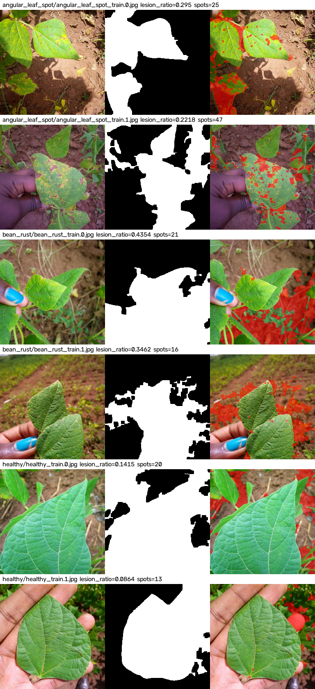

# HSV 병반 특징 분석 (교과 9 OpenCV, 분석 실험)

- 스크립트: `reports/tools/hsv_lesion_analysis.py` / 서비스 코드 미변경 / 성능 개선 주장 없음
- 분석 해상도 256x256, OpenCV HSV(H 0~179)
- 잎: H 20~90·S>=40·V>=40 → Closing 7x7 → 최대 Contour 내부 채움
- 병반 후보: 잎 내부 중 '건강한 녹색'(H 35~90·S>=60)이 아닌 픽셀 → Opening 3x3
- 데이터: Train(기준 개발), Validation(확인). **Test 미사용**

## 1. 클래스별 특징값 (중앙값)

| Split | 클래스 | n | lesion_ratio | spot_count | leaf_coverage | 잎 평균 H | 잎 평균 S |
|---|---|---:|---:|---:|---:|---:|---:|
| train | angular_leaf_spot | 345 | 0.3197 | 29 | 0.694 | 38.05 | 145.72 |
| train | bean_rust | 348 | 0.3023 | 23.0 | 0.5437 | 41.89 | 121.105 |
| train | healthy | 341 | 0.1784 | 30 | 0.8026 | 48.65 | 121.43 |
| val | angular_leaf_spot | 44 | 0.3179 | 27.5 | 0.686 | 37.615 | 154.26 |
| val | bean_rust | 45 | 0.3189 | 25 | 0.5468 | 39.56 | 120.12 |
| val | healthy | 44 | 0.1567 | 28.5 | 0.81 | 49.11 | 132.055 |

## 2. 규칙 기반 참고 베이스라인: healthy vs 질병 (lesion_ratio 임계값 1개)

- 임계값: **lesion_ratio > 0.1431 → 질병** (Train 1034장에서 정확도 최대가 되도록 결정)

| Split | 정확도 | TP(질병→질병) | TN(정상→정상) | FP(정상→질병) | FN(질병→정상) |
|---|---:|---:|---:|---:|---:|
| train | 0.7031 (727/1034) | 592 | 135 | 206 | 101 |
| val | 0.7143 (95/133) | 76 | 19 | 25 | 13 |

## 3. 병명 구분(angular_leaf_spot vs bean_rust)에 대한 관찰

- 위 1번 표에서 두 질병의 lesion_ratio·spot_count 중앙값 차이를 확인한다.
- 면적비는 '병반이 있는가'에는 반응하지만 '어떤 병인가'를 구분하는 근거로는 약할 수 있다 → 수치로 판단

## 4. 시각화

## 5. 한계

- 임계값은 이 데이터 촬영 조건(우간다 밭, 자연광)에 맞춘 값이며 조명·흙 색이 바뀌면 다시 정해야 함
- 노랗게 시든 정상 잎, 그림자, 손가락 등이 병반·잎 마스크에 섞일 수 있음
- HSV 마스크는 병명을 확정하는 농업학적 진단 근거가 아님
